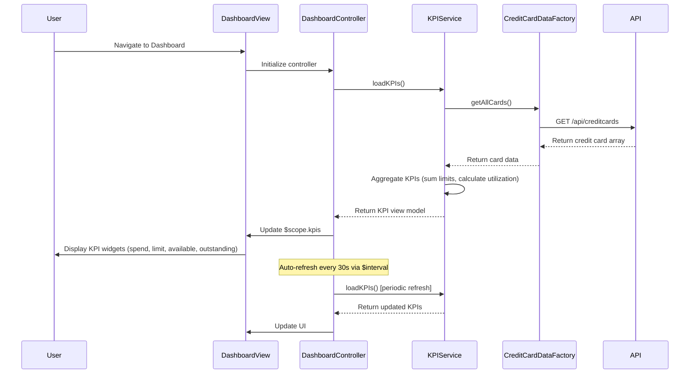

# Low-Level Design: QE-9886 - Dashboard KPIs and Financial Overview

## a. Architecture Mapping

**Component to Artifact Mapping:**
- User Browser → AngularJS SPA entry point (index.html + app.module.js)
- Dashboard UI Component → AngularJS Module (`app.dashboard`) + Controller (`DashboardController`) + View (dashboard.html)
- KPI Aggregation Service → AngularJS Service (`KPIService`) for calculating aggregated metrics
- Credit Card Data Source → AngularJS Factory (`CreditCardDataFactory`) for REST API integration

**Recommended Folder Structure:**
```
app/
├── modules/
│   └── dashboard/
│       ├── dashboard.module.js
│       ├── controllers/
│       │   └── dashboard.controller.js
│       ├── services/
│       │   └── kpi.service.js
│       ├── factories/
│       │   └── credit-card-data.factory.js
│       └── views/
│           └── dashboard.html
├── models/
│   └── credit-card.model.js
└── assets/
    ├── css/
    │   └── dashboard.css
    └── js/
```

## b. Component Specifications

| Component Name | Artifact Type | Responsibility | Key Dependencies |
|----------------|---------------|----------------|------------------|
| DashboardModule | Module | Register dashboard feature module and routing | angular, ngRoute, app.core |
| DashboardController | Controller | Manage dashboard state, refresh KPIs, handle user interactions | $scope, KPIService, $interval |
| KPIService | Service | Aggregate multi-card data, calculate total/available credit, monthly spend, outstanding amount | CreditCardDataFactory, $q |
| CreditCardDataFactory | Factory | Fetch credit card data (balances, limits, transactions) from REST API | $http, API_CONFIG |
| CreditCardModel | Model | Define credit card data structure | None |

## c. Data Model

**Credit Card Model:**
```javascript
{
  cardId: String,
  cardNumber: String, // Masked, e.g., '**** **** **** 1234'
  cardType: String, // 'Visa', 'MasterCard', 'Amex'
  creditLimit: Number,
  availableCredit: Number,
  outstandingAmount: Number,
  currentMonthSpend: Number,
  lastUpdated: Date
}
```

**KPI View Model:**
```javascript
{
  totalCreditLimit: Number,
  totalAvailableCredit: Number,
  totalOutstanding: Number,
  monthlySpend: Number,
  creditUtilization: Number, // Percentage
  cardCount: Number
}
```

## d. Data Flow

User navigates to Dashboard → DashboardController initializes and calls KPIService.loadKPIs() → KPIService invokes CreditCardDataFactory.getAllCards() → Factory executes HTTP GET to /api/creditcards → API returns array of credit card objects → Factory resolves promise with card data → KPIService aggregates totals (sum credit limits, available credit, outstanding amounts, monthly spend) → Service returns KPI view model → Controller updates $scope.kpis → View renders KPI widgets with real-time data → $interval triggers periodic refresh every 30 seconds → UI updates without page reload.

## e. Primary Sequence Diagram



## f. Implementation Notes

- Use AngularJS Dependency Injection to inject KPIService and $interval into DashboardController; ensure $interval is cancelled on $scope.$on('$destroy') to prevent memory leaks.
- Implement KPIService as singleton service with caching mechanism to minimize redundant API calls during rapid navigation.
- Use ES6 arrow functions and template literals in Factory for cleaner API endpoint construction: `$http.get(`${API_CONFIG.baseUrl}/creditcards`)`.
- Apply Bootstrap grid system (col-md-3, col-sm-6, col-xs-12) for responsive KPI card layout across devices.
- Leverage AngularJS `$http` service with promise chaining for sequential data loading and error propagation.

## g. Error Handling

HTTP interceptor-based error handling; CreditCardDataFactory rejects promise on API failure; DashboardController displays error notification and retries after 5 seconds.

## h. Security Notes

Requires token-based auth via existing SSO; API validates user session and returns only user-authorized card data.