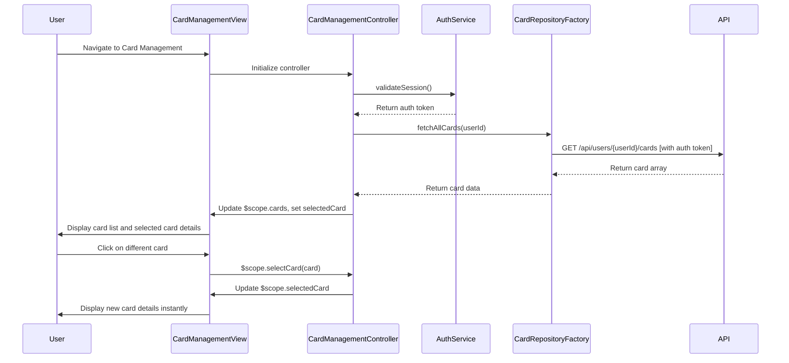

# Low-Level Design: QE-9887 - Multiple Credit Card Management and Tracking

## a. Architecture Mapping

**Component to Artifact Mapping:**
- User Interface → AngularJS Module (`app.cardManagement`) + Controller (`CardManagementController`) + View (card-management.html)
- Card Management Controller → AngularJS Controller managing card selection, switching, and display logic
- Card Data Repository → AngularJS Factory (`CardRepositoryFactory`) for CRUD operations via REST API
- Authentication Service → AngularJS Service (`AuthService`) for session/token management

**Recommended Folder Structure:**
```
app/
├── modules/
│   └── card-management/
│       ├── card-management.module.js
│       ├── controllers/
│       │   └── card-management.controller.js
│       ├── services/
│       │   └── auth.service.js
│       ├── factories/
│       │   └── card-repository.factory.js
│       ├── directives/
│       │   └── card-selector.directive.js
│       └── views/
│           ├── card-management.html
│           └── card-detail.html
├── models/
│   └── card.model.js
└── assets/
    └── css/
        └── card-management.css
```

## b. Component Specifications

| Component Name | Artifact Type | Responsibility | Key Dependencies |
|----------------|---------------|----------------|------------------|
| CardManagementModule | Module | Register card management feature and configure routing | angular, ngRoute, app.core |
| CardManagementController | Controller | Manage card list, handle card selection/switching, display card details | $scope, CardRepositoryFactory, AuthService |
| CardRepositoryFactory | Factory | Perform CRUD operations on card data via REST API | $http, $q, API_CONFIG |
| AuthService | Service | Manage user authentication state, provide auth tokens for API calls | $http, $window (for localStorage) |
| CardSelectorDirective | Directive | Render card selection dropdown/list with two-way binding | None |
| CardModel | Model | Define card data structure with validation | None |

## c. Data Model

**Card Model:**
```javascript
{
  cardId: String,
  userId: String,
  cardNumber: String, // Masked
  cardHolderName: String,
  cardType: String, // 'Visa', 'MasterCard', 'Amex', 'Discover'
  expiryDate: String, // 'MM/YY'
  creditLimit: Number,
  availableBalance: Number,
  outstandingAmount: Number,
  isActive: Boolean,
  addedDate: Date
}
```

**Card List View Model:**
```javascript
{
  cards: Array<Card>,
  selectedCard: Card,
  totalCards: Number
}
```

## d. Data Flow

User accesses Card Management page → CardManagementController initializes and calls AuthService.validateSession() → If authenticated, controller invokes CardRepositoryFactory.fetchAllCards() → Factory executes HTTP GET to /api/users/{userId}/cards with auth token in header → API returns user's card array → Factory resolves promise with card data → Controller populates $scope.cards and sets $scope.selectedCard to first card → User clicks on different card in list → Controller updates $scope.selectedCard → View displays selected card's details (limit, balance, outstanding) → User can switch between cards with minimal latency via client-side state management.

## e. Primary Sequence Diagram



## f. Implementation Notes

- Use AngularJS Dependency Injection to inject CardRepositoryFactory and AuthService into CardManagementController for secure, testable card data access.
- Implement AuthService with token storage in localStorage and automatic token injection via $http interceptor for all API requests.
- Use ES6 class syntax for CardRepositoryFactory with methods: fetchAllCards(), getCardById(cardId), addCard(card), updateCard(card), deleteCard(cardId).
- Implement CardSelectorDirective with isolated scope `{ selectedCard: '=', cards: '=' }` for reusable card selection UI component.
- Leverage AngularJS `ng-repeat` with `track by card.cardId` for efficient card list rendering and `ng-click` for instant card switching without API calls.

## g. Error Handling

HTTP interceptor captures 401/403 errors and redirects to login; CardRepositoryFactory uses try/catch with promise rejection; Controller displays user-friendly error messages via notification service.

## h. Security Notes

Requires token-based auth via existing SSO; API validates user session and enforces user-card ownership; sensitive card data (full card number, CVV) never exposed in client-side code.