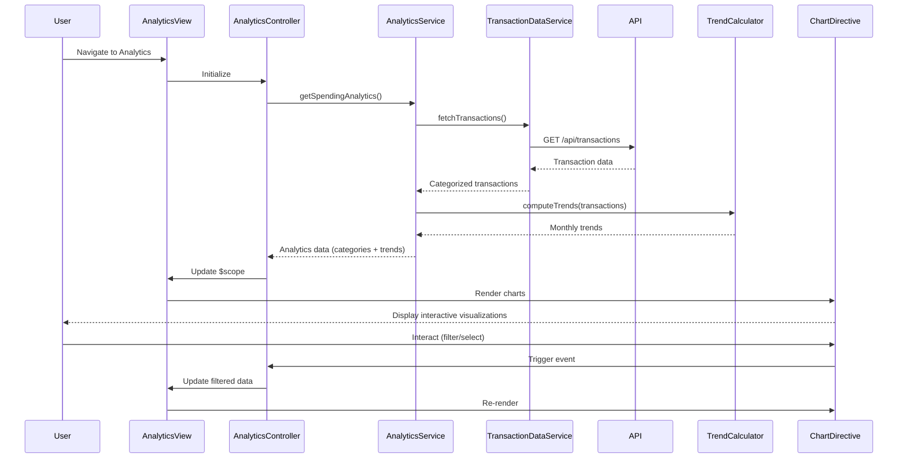

# Low-Level Design: QE-9900 - Spending Analytics and Transaction Insights

## a. Architecture Mapping

**HLD to AngularJS Artifact Mapping:**
- Analytics UI → AngularJS Module (`spendingAnalytics`) + Controller (`AnalyticsController`)
- Visualization Engine → Directive (`spendingChart`) wrapping Chart.js or D3.js
- Analytics Service → Factory (`AnalyticsService`) for business logic and data aggregation
- Transaction Data Service → Service (`TransactionDataService`) for REST API calls
- Data Analytics Engine → Factory (`TrendCalculator`) for client-side trend computation

**Recommended Folder Structure:**
```
app/
├── modules/
│   └── analytics/
│       ├── analytics.module.js
│       ├── controllers/
│       │   └── analytics.controller.js
│       ├── services/
│       │   ├── analytics.service.js
│       │   ├── transaction-data.service.js
│       │   └── trend-calculator.factory.js
│       ├── directives/
│       │   └── spending-chart.directive.js
│       └── views/
│           └── analytics.html
```

## b. Component Specifications

| Component Name | Artifact Type | Responsibility | Key Dependencies |
|----------------|---------------|----------------|------------------|
| spendingAnalytics | Module | Root module for analytics feature, registers all components | angular, ngRoute, chart.js |
| AnalyticsController | Controller | Manages analytics view state, handles user interactions, coordinates data flow | AnalyticsService, $scope |
| AnalyticsService | Factory | Aggregates transaction data, computes category-wise spending, orchestrates trend calculation | TransactionDataService, TrendCalculator |
| TransactionDataService | Service | Fetches categorized transaction history from REST API | $http, $q |
| TrendCalculator | Factory | Computes monthly spend trends, identifies spending patterns | None (pure computation) |
| spendingChart | Directive | Renders interactive charts for category and trend visualization | Chart.js/D3.js library |

## c. Data Model

**Transaction Model:**
```javascript
{
  id: String,
  cardId: String,
  amount: Number,
  category: String, // One of: 'Food & Dining', 'Fuel', 'Shopping', 'Travel', 'Entertainment', 'Utilities', 'Healthcare', 'Education', 'Miscellaneous'
  date: Date,
  description: String,
  merchant: String
}
```

**CategorySpending Model:**
```javascript
{
  category: String,
  totalAmount: Number,
  transactionCount: Number,
  percentage: Number
}
```

**MonthlyTrend Model:**
```javascript
{
  month: String, // 'YYYY-MM'
  totalSpend: Number,
  categoryBreakdown: Array<CategorySpending>
}
```

## d. Data Flow

User navigates to Analytics view → AnalyticsController initializes and calls AnalyticsService.getSpendingAnalytics() → AnalyticsService invokes TransactionDataService.fetchTransactions() which makes REST API call to /api/transactions → Service receives categorized transactions, passes to TrendCalculator.computeTrends() for monthly aggregation → Aggregated data (category spending and monthly trends) returned to Controller → Controller updates $scope with analytics data → spendingChart directive watches scope changes and renders interactive charts using Chart.js → User interactions (category selection, month filter) trigger controller methods that update scope, re-triggering chart updates.

## e. Primary Sequence Diagram



## f. Implementation Notes

- Use AngularJS DI to inject AnalyticsService and TransactionDataService into AnalyticsController; configure module dependencies in analytics.module.js
- Implement TransactionDataService using $http with promise-based API calls; cache transaction data using $cacheFactory for performance with large datasets
- TrendCalculator uses ES6 Array methods (reduce, map, filter) for efficient aggregation; computations run synchronously but results are cached
- spendingChart directive uses isolated scope with two-way binding for chartData and chartConfig; integrates Chart.js for rendering with update/destroy lifecycle management
- Apply Bootstrap grid for responsive layout; use ng-repeat with track by for efficient list rendering of category cards

## g. Error Handling

HTTP interceptor captures API errors from TransactionDataService; errors displayed via Bootstrap alert component with user-friendly messages and retry option.

## h. Security Notes

Requires token-based auth via existing SSO; transaction API endpoints validate user session and return only user-owned transaction data.