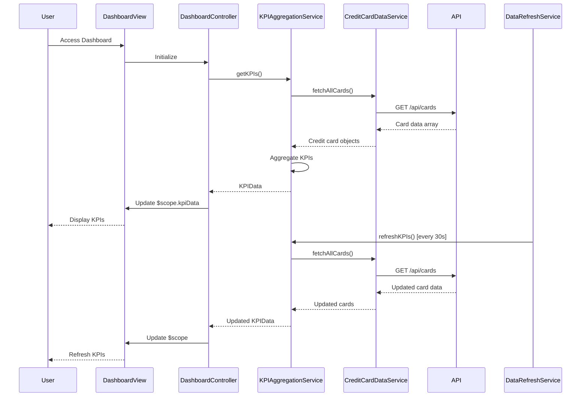

# Low-Level Design: QE-9901 - Credit Card Dashboard and KPI Management

## a. Architecture Mapping

**HLD to AngularJS Artifact Mapping:**
- Dashboard UI → AngularJS Module (`dashboard`) + Controller (`DashboardController`)
- KPI Aggregation Service → Factory (`KPIAggregationService`) for computing aggregated metrics
- Credit Card Data Source → Service (`CreditCardDataService`) for REST API integration
- Real-time Data Refresh Engine → Service (`DataRefreshService`) with $interval for polling

**Recommended Folder Structure:**
```
app/
├── modules/
│   └── dashboard/
│       ├── dashboard.module.js
│       ├── controllers/
│       │   └── dashboard.controller.js
│       ├── services/
│       │   ├── kpi-aggregation.service.js
│       │   ├── credit-card-data.service.js
│       │   └── data-refresh.service.js
│       └── views/
│           └── dashboard.html
```

## b. Component Specifications

| Component Name | Artifact Type | Responsibility | Key Dependencies |
|----------------|---------------|----------------|------------------|
| dashboard | Module | Root module for dashboard feature, configures routes and dependencies | angular, ngRoute |
| DashboardController | Controller | Manages dashboard state, coordinates KPI display, handles refresh triggers | KPIAggregationService, DataRefreshService, $scope |
| KPIAggregationService | Factory | Computes monthly spend, total credit limit, available credit, outstanding amount from card data | CreditCardDataService |
| CreditCardDataService | Service | Fetches credit card balances, limits, and transaction summaries via REST API | $http, $q |
| DataRefreshService | Service | Manages periodic data refresh using $interval, triggers KPI recalculation | $interval, KPIAggregationService |

## c. Data Model

**CreditCard Model:**
```javascript
{
  cardId: String,
  cardNumber: String, // Masked, e.g., '**** 1234'
  cardType: String, // 'Visa', 'MasterCard', etc.
  creditLimit: Number,
  availableCredit: Number,
  outstandingAmount: Number,
  monthlySpend: Number
}
```

**KPIData Model:**
```javascript
{
  totalMonthlySpend: Number,
  totalCreditLimit: Number,
  totalAvailableCredit: Number,
  totalOutstandingAmount: Number,
  lastUpdated: Date
}
```

## d. Data Flow

User lands on Dashboard view → DashboardController initializes and calls KPIAggregationService.getKPIs() → KPIAggregationService invokes CreditCardDataService.fetchAllCards() which makes REST API call to /api/cards → Service receives array of credit card objects → KPIAggregationService aggregates monthly spend, credit limits, available credit, and outstanding amounts across all cards → Aggregated KPIData returned to Controller → Controller updates $scope.kpiData → View binds to scope and displays KPIs in Bootstrap cards → DataRefreshService polls every 30 seconds, triggering KPIAggregationService.refreshKPIs() → Updated KPIs propagate to view via two-way binding.

## e. Primary Sequence Diagram



## f. Implementation Notes

- Use AngularJS DI to inject KPIAggregationService and DataRefreshService into DashboardController; register services as singletons in dashboard.module.js
- CreditCardDataService uses $http.get with promise chaining; implement response transformation to normalize card data structure
- KPIAggregationService uses ES6 reduce for summing card-level metrics; computations are synchronous and lightweight
- DataRefreshService wraps $interval with configurable refresh rate (default 30s); cancels interval on scope $destroy to prevent memory leaks
- Dashboard view uses Bootstrap grid (col-md-3) for responsive KPI card layout; apply CSS3 animations for smooth KPI value updates

## g. Error Handling

HTTP interceptor in CreditCardDataService catches API failures; fallback to cached data if available, otherwise display error toast with retry button.

## h. Security Notes

Requires token-based auth via existing SSO; API endpoints validate user session and return only user's card data with masked card numbers.