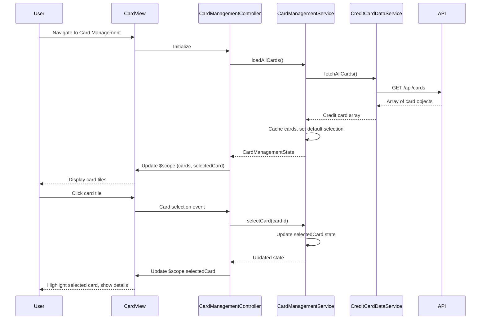

# Low-Level Design: QE-9902 - Multi-Card Management and Visualization

## a. Architecture Mapping

**HLD to AngularJS Artifact Mapping:**
- User Interface → AngularJS Module (`cardManagement`) + Controller (`CardManagementController`) + View template
- Card Management Service → Factory (`CardManagementService`) for card selection and state management
- Credit Card Data Service → Service (`CreditCardDataService`) for REST API calls
- Data Store → Client-side caching using $cacheFactory or service-level state

**Recommended Folder Structure:**
```
app/
├── modules/
│   └── card-management/
│       ├── card-management.module.js
│       ├── controllers/
│       │   └── card-management.controller.js
│       ├── services/
│       │   ├── card-management.service.js
│       │   └── credit-card-data.service.js
│       ├── directives/
│       │   └── card-tile.directive.js
│       └── views/
│           └── card-management.html
```

## b. Component Specifications

| Component Name | Artifact Type | Responsibility | Key Dependencies |
|----------------|---------------|----------------|------------------|
| cardManagement | Module | Root module for multi-card management feature | angular, ngRoute |
| CardManagementController | Controller | Manages card list display, handles card selection, coordinates view state | CardManagementService, $scope |
| CardManagementService | Factory | Maintains selected card state, provides card switching logic, caches card data | CreditCardDataService |
| CreditCardDataService | Service | Fetches multiple credit card details and metadata from REST API | $http, $q, $cacheFactory |
| cardTile | Directive | Renders individual card tile with details, handles click events for card selection | None (isolated scope) |

## c. Data Model

**CreditCard Model:**
```javascript
{
  cardId: String,
  cardNumber: String, // Masked, e.g., '**** 5678'
  cardHolderName: String,
  cardType: String, // 'Visa', 'MasterCard', 'Amex'
  expiryDate: String, // 'MM/YY'
  creditLimit: Number,
  availableCredit: Number,
  outstandingAmount: Number,
  monthlySpend: Number,
  isActive: Boolean
}
```

**CardManagementState Model:**
```javascript
{
  allCards: Array<CreditCard>,
  selectedCard: CreditCard,
  selectedCardId: String
}
```

## d. Data Flow

User navigates to Card Management view → CardManagementController initializes and calls CardManagementService.loadAllCards() → CardManagementService invokes CreditCardDataService.fetchAllCards() which makes REST API call to /api/cards → Service receives array of credit card objects and caches them → CardManagementService stores cards in internal state and sets first card as selected by default → Controller updates $scope.cards and $scope.selectedCard → View renders card tiles using ng-repeat with cardTile directive → User clicks a card tile → cardTile emits selection event → Controller calls CardManagementService.selectCard(cardId) → Service updates selectedCard state → Controller updates $scope.selectedCard → View displays selected card details and highlights selected tile.

## e. Primary Sequence Diagram



## f. Implementation Notes

- Use AngularJS DI to inject CardManagementService into CardManagementController; configure module in card-management.module.js with ngRoute for view routing
- CreditCardDataService uses $http.get with $cacheFactory to cache card data for 5 minutes, reducing redundant API calls on view re-entry
- CardManagementService maintains singleton state for selected card; exposes selectCard(cardId) and getSelectedCard() methods
- cardTile directive uses isolated scope with card object binding and onClick callback; applies CSS classes for selected state and hover effects
- View uses Bootstrap grid (col-md-4) for responsive card tile layout; card details panel uses col-md-8 with smooth CSS3 transitions on card switch

## g. Error Handling

CreditCardDataService uses HTTP interceptor for error handling; displays user-friendly error message via Bootstrap alert if API call fails, with manual retry option.

## h. Security Notes

Requires token-based auth via existing SSO; API returns only user-authorized cards with masked card numbers and no CVV data.