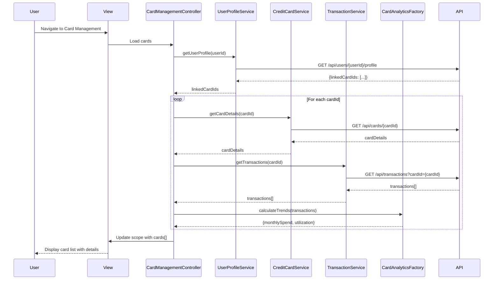

# Low-Level Design: Multiple Credit Card Management
**Epic ID:** QE-9915  
**Epic Title:** PERFTEST20261110205447-Multiple Credit Card Management

---

## a. Architecture Mapping

- **User Interface Card Management** → AngularJS Module (`creditCardModule`) + View Templates (HTML5/Bootstrap)
- **Card Management Controller** → AngularJS Controller (`CardManagementController`)
- **Credit Card Data Service** → AngularJS Service (`CreditCardService`) for REST API integration
- **User Profile Service** → AngularJS Service (`UserProfileService`) for user-card linking
- **Transaction Service** → AngularJS Service (`TransactionService`) for card-specific transaction history
- **Card Analytics Module** → AngularJS Factory (`CardAnalyticsFactory`) for aggregation logic

**Recommended Folder Structure:**
```
/app
  /modules
    /creditCard
      /controllers
        cardManagement.controller.js
      /services
        creditCard.service.js
        userProfile.service.js
        transaction.service.js
      /factories
        cardAnalytics.factory.js
      /views
        cardList.html
        cardDetails.html
      /directives
        cardSummary.directive.js
  /assets
    /css
    /js
```

---

## b. Component Specifications

| Component Name | Artifact Type | Responsibility | Key Dependencies |
|---|---|---|---|
| creditCardModule | Module | Root module for credit card management features | ngRoute, ngResource |
| CardManagementController | Controller | Orchestrates card list display, card selection, and view navigation | CreditCardService, UserProfileService, TransactionService, CardAnalyticsFactory |
| CreditCardService | Service | Fetches card details, balances, and limits from REST API | $http, $q |
| UserProfileService | Service | Retrieves user profile and linked card IDs | $http, $cacheFactory |
| TransactionService | Service | Retrieves card-specific transaction history | $http, $q |
| CardAnalyticsFactory | Factory | Calculates card utilization, monthly spend trends, and aggregations | None (pure JS logic) |
| cardSummary | Directive | Reusable card summary widget displaying card name, limit, balance, utilization | None |

---

## c. Data Model

**CreditCard Object:**
```javascript
{
  cardId: String,
  cardName: String,
  cardNumber: String, // masked (e.g., "**** **** **** 1234")
  cardType: String, // e.g., "Visa", "MasterCard"
  creditLimit: Number,
  outstandingBalance: Number,
  availableCredit: Number,
  utilizationPercent: Number, // calculated: (outstandingBalance / creditLimit) * 100
  lastTransactionDate: Date
}
```

**Transaction Object:**
```javascript
{
  transactionId: String,
  cardId: String,
  amount: Number,
  category: String,
  merchant: String,
  transactionDate: Date,
  description: String
}
```

**UserProfile Object:**
```javascript
{
  userId: String,
  userName: String,
  linkedCardIds: Array<String> // max 10 cards
}
```

---

## d. Data Flow

User navigates to the card management view, triggering CardManagementController to invoke UserProfileService to fetch the user's linked card IDs. The controller then calls CreditCardService for each card ID to retrieve card details (limits, balances) and TransactionService to fetch recent transactions. CardAnalyticsFactory processes the transaction data to calculate monthly spend trends and utilization percentages. The aggregated data is bound to the view via AngularJS two-way data binding, rendering the card list with individual card summaries using the cardSummary directive. User interactions (e.g., selecting a card) update the controller scope, triggering detailed card view navigation.

---

## e. Primary Sequence Diagram



---

## f. Implementation Notes

- Use AngularJS Dependency Injection for all services and factories to ensure testability and modularity.
- Implement $cacheFactory in UserProfileService to cache user profile data for 1-second card retrieval NFR.
- Use $http interceptors for centralized API error handling and authentication token injection.
- Leverage ES6 arrow functions and template literals in service methods for cleaner code.
- Use Bootstrap grid system (col-md-4) for responsive card layout supporting mobile and desktop views.

---

## g. Error Handling

HTTP interceptor-based error handling with user-friendly toast notifications for API failures; try/catch in CardAnalyticsFactory for calculation errors.

---

## h. Security Notes

Requires token-based authentication via existing SSO; card numbers are masked server-side before transmission to client.