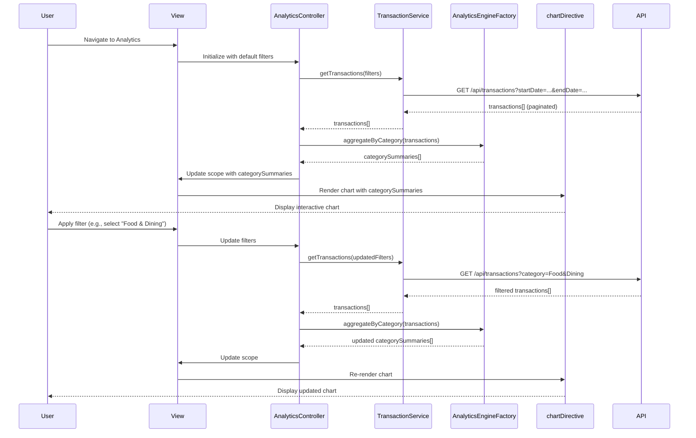

# Low-Level Design: Transaction Analytics and Category Insights
**Epic ID:** QE-9916  
**Epic Title:** PERFTEST20261110205447-Transaction Analytics and Category Insights

---

## a. Architecture Mapping

- **User Interface Analytics** → AngularJS Module (`analyticsModule`) + View Templates (HTML5/Bootstrap)
- **Analytics Controller** → AngularJS Controller (`AnalyticsController`)
- **Transaction Service** → AngularJS Service (`TransactionService`) for transaction data retrieval
- **Category Classification Service** → AngularJS Service (`CategoryService`) for category metadata
- **Analytics Engine** → AngularJS Factory (`AnalyticsEngineFactory`) for aggregation and computation
- **Visualization Renderer** → AngularJS Directive (`chartDirective`) wrapping Chart.js or D3.js

**Recommended Folder Structure:**
```
/app
  /modules
    /analytics
      /controllers
        analytics.controller.js
      /services
        transaction.service.js
        category.service.js
      /factories
        analyticsEngine.factory.js
      /directives
        chart.directive.js
      /views
        analytics.html
        categoryBreakdown.html
  /assets
    /css
    /js
      /libs
        chart.min.js
```

---

## b. Component Specifications

| Component Name | Artifact Type | Responsibility | Key Dependencies |
|---|---|---|---|
| analyticsModule | Module | Root module for analytics and insights features | ngRoute, ngResource |
| AnalyticsController | Controller | Manages analytics view, filters, and data binding for visualizations | TransactionService, CategoryService, AnalyticsEngineFactory |
| TransactionService | Service | Fetches transaction data from REST API with pagination support | $http, $q |
| CategoryService | Service | Provides category metadata (9 predefined categories) | $http (or static config) |
| AnalyticsEngineFactory | Factory | Aggregates transactions by category, calculates totals and percentages | None (pure JS logic) |
| chartDirective | Directive | Renders interactive charts (pie, bar, line) using Chart.js library | Chart.js |

---

## c. Data Model

**Transaction Object:**
```javascript
{
  transactionId: String,
  cardId: String,
  amount: Number,
  category: String, // one of 9 predefined categories
  merchant: String,
  transactionDate: Date,
  description: String
}
```

**CategorySummary Object:**
```javascript
{
  categoryName: String, // e.g., "Food & Dining"
  totalSpend: Number,
  transactionCount: Number,
  percentageOfTotal: Number
}
```

**AnalyticsFilter Object:**
```javascript
{
  startDate: Date,
  endDate: Date,
  selectedCategories: Array<String>,
  selectedCardIds: Array<String>
}
```

---

## d. Data Flow

User accesses the analytics view, triggering AnalyticsController to call TransactionService with default date range (current month). TransactionService fetches paginated transaction data from the REST API. AnalyticsController passes the transactions to AnalyticsEngineFactory, which aggregates data by category, calculates totals and percentages, and returns CategorySummary objects. The controller binds the aggregated data to the view scope. The chartDirective watches the scope data and renders interactive visualizations using Chart.js. User applies filters (date range, category, card), triggering a new API call via TransactionService, followed by re-aggregation and chart re-rendering.

---

## e. Primary Sequence Diagram



---

## f. Implementation Notes

- Use AngularJS $watch in chartDirective to detect scope changes and trigger chart re-rendering for interactive drill-down.
- Implement server-side pagination in TransactionService using $http with query params (page, pageSize) to handle 10,000+ records efficiently.
- Pre-compute category aggregations on the server and cache results for 3-second rendering NFR; client-side aggregation only for filtered subsets.
- Use ES6 Array methods (map, reduce, filter) in AnalyticsEngineFactory for clean aggregation logic.
- Integrate Chart.js via chartDirective with responsive: true option for mobile compatibility.

---

## g. Error Handling

HTTP interceptor-based error handling with user notifications; try/catch in AnalyticsEngineFactory for aggregation errors with fallback to empty state.

---

## h. Security Notes

Standard input validation and secure API calls assumed; category filter inputs sanitized to prevent injection attacks.