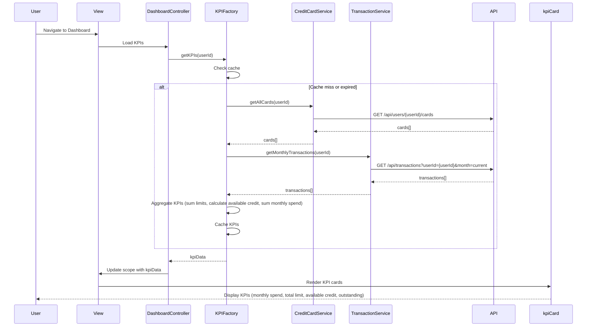

# Low-Level Design: Dashboard and KPI Management
**Epic ID:** QE-9917  
**Epic Title:** PERFTEST20261110205447-Dashboard and KPI Management

---

## a. Architecture Mapping

- **User Interface Dashboard** → AngularJS Module (`dashboardModule`) + View Templates (HTML5/Bootstrap)
- **Dashboard Controller** → AngularJS Controller (`DashboardController`)
- **Credit Card Data Service** → AngularJS Service (`CreditCardService`) for card balances and limits
- **Transaction Service** → AngularJS Service (`TransactionService`) for monthly spend and outstanding amounts
- **KPI Aggregation Engine** → AngularJS Factory (`KPIFactory`) for KPI calculation and caching

**Recommended Folder Structure:**
```
/app
  /modules
    /dashboard
      /controllers
        dashboard.controller.js
      /services
        creditCard.service.js
        transaction.service.js
      /factories
        kpi.factory.js
      /views
        dashboard.html
      /directives
        kpiCard.directive.js
  /assets
    /css
    /js
```

---

## b. Component Specifications

| Component Name | Artifact Type | Responsibility | Key Dependencies |
|---|---|---|---|
| dashboardModule | Module | Root module for dashboard and KPI features | ngRoute, ngResource |
| DashboardController | Controller | Orchestrates KPI data retrieval and view binding | CreditCardService, TransactionService, KPIFactory |
| CreditCardService | Service | Fetches card balances and credit limits from REST API | $http, $q |
| TransactionService | Service | Retrieves monthly spend data and outstanding amounts | $http, $q |
| KPIFactory | Factory | Aggregates and calculates KPIs (monthly spend, total credit limit, available credit, outstanding amount) with caching | $cacheFactory |
| kpiCard | Directive | Reusable KPI display widget showing metric name, value, and icon | None |

---

## c. Data Model

**KPI Object:**
```javascript
{
  monthlySpend: Number,
  totalCreditLimit: Number,
  availableCredit: Number,
  outstandingAmount: Number,
  lastUpdated: Date
}
```

**CreditCard Object:**
```javascript
{
  cardId: String,
  creditLimit: Number,
  outstandingBalance: Number,
  availableCredit: Number
}
```

**Transaction Object:**
```javascript
{
  transactionId: String,
  amount: Number,
  transactionDate: Date
}
```

---

## d. Data Flow

User navigates to the dashboard, triggering DashboardController to invoke KPIFactory. KPIFactory checks $cacheFactory for cached KPI data; if cache miss or expired, it calls CreditCardService to fetch all card details (limits, balances) and TransactionService to retrieve current month's transactions. KPIFactory aggregates the data: sums credit limits across all cards, calculates total outstanding amount, computes available credit (total limit - outstanding), and sums transaction amounts for monthly spend. The aggregated KPI object is cached and returned to DashboardController, which binds it to the view scope. The kpiCard directive renders each KPI metric in a responsive Bootstrap card layout. Real-time updates are handled via $interval polling (every 60 seconds) or WebSocket push notifications.

---

## e. Primary Sequence Diagram



---

## f. Implementation Notes

- Use AngularJS $cacheFactory in KPIFactory to cache aggregated KPI data for 60 seconds to meet 2-second load time NFR.
- Implement $interval in DashboardController to refresh KPI data every 60 seconds for near real-time updates.
- Use Bootstrap grid (col-md-3) for responsive KPI card layout supporting mobile and desktop devices.
- Leverage ES6 Array.reduce() in KPIFactory for efficient aggregation of credit limits and transaction amounts.
- Use AngularJS $q.all() to parallelize CreditCardService and TransactionService API calls for faster data retrieval.

---

## g. Error Handling

HTTP interceptor-based error handling with user-friendly toast notifications for API failures; try/catch in KPIFactory for aggregation errors with fallback to cached data.

---

## h. Security Notes

Requires token-based auth via existing SSO; KPI data is user-scoped and validated server-side before transmission.