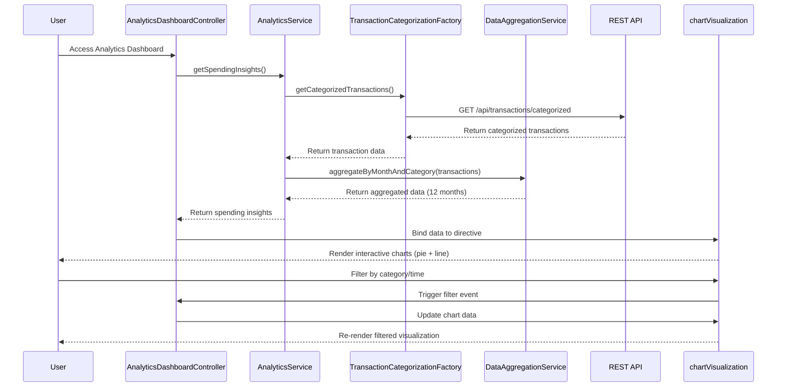

# Low-Level Design: Analytics and Spending Insights
**Epic ID:** QE-9924

## a. Architecture Mapping

- **Analytics Dashboard UI** → AngularJS Module (`app.analytics`) + Controller (`AnalyticsDashboardController`) + HTML5 View with Bootstrap grid
- **Analytics Engine** → AngularJS Service (`AnalyticsService`) for data processing and calculation logic
- **Transaction Categorization Service** → AngularJS Factory (`TransactionCategorizationFactory`) wrapping REST API calls
- **Data Aggregation Service** → AngularJS Service (`DataAggregationService`) for monthly summaries and historical data processing
- **Visualization Rendering Engine** → AngularJS Directive (`chartVisualization`) integrating Chart.js or D3.js for interactive charts

**Recommended Folder Structure:**
```
/app
  /analytics
    analytics.module.js
    analytics-dashboard.controller.js
    analytics.service.js
    transaction-categorization.factory.js
    data-aggregation.service.js
    chart-visualization.directive.js
    analytics-dashboard.html
  /common
    /styles
      analytics.css
```

## b. Component Specifications

| Name | Artifact Type | Responsibility | Key Dependencies |
|------|---------------|----------------|------------------|
| AnalyticsDashboardController | Controller | Manages dashboard state, handles user interactions, coordinates data fetching and visualization updates | AnalyticsService, TransactionCategorizationFactory, DataAggregationService |
| AnalyticsService | Service | Processes transaction data, calculates spending patterns, prepares data for visualization | $http, TransactionCategorizationFactory, DataAggregationService |
| TransactionCategorizationFactory | Factory | Fetches categorized transactions from REST API, maps to nine predefined categories | $http, $q |
| DataAggregationService | Service | Aggregates transaction data by month and category, computes 12-month trends | $filter |
| chartVisualization | Directive | Renders interactive pie and line charts with filtering and drill-down capabilities | Chart.js/D3.js library |
| app.analytics | Module | Main analytics module encapsulating all analytics-related components | ngRoute, chart.js |

## c. Data Model

**SpendingCategory** (ES6 Class/Object):
- `categoryId`: String (unique identifier)
- `categoryName`: String (one of: Food & Dining, Fuel, Shopping, Travel, Entertainment, Utilities, Healthcare, Education, Miscellaneous)
- `totalAmount`: Number (currency)
- `transactionCount`: Number
- `percentageOfTotal`: Number

**MonthlyTrend** (ES6 Object):
- `month`: String (YYYY-MM format)
- `totalSpend`: Number (currency)
- `categoryBreakdown`: Array<SpendingCategory>

**Transaction** (ES6 Object):
- `transactionId`: String
- `amount`: Number
- `date`: Date
- `category`: String
- `description`: String
- `cardId`: String

## d. Data Flow

User navigates to analytics dashboard → AnalyticsDashboardController initializes and calls AnalyticsService.getSpendingInsights() → AnalyticsService invokes TransactionCategorizationFactory.getCategorizedTransactions() via REST API → Factory returns categorized transactions → AnalyticsService passes data to DataAggregationService.aggregateByMonthAndCategory() → Aggregated data (category totals and 12-month trends) is returned to controller → Controller binds data to scope and triggers chartVisualization directive → Directive renders interactive pie chart (category breakdown) and line chart (monthly trends) using Chart.js → User interacts with chart filters → Controller updates data model and directive re-renders within 3 seconds.

## e. Primary Sequence Diagram



## f. Implementation Notes

- Use AngularJS dependency injection for all services, factories, and controllers with explicit array notation for minification safety
- Implement ES6 classes for data models (SpendingCategory, MonthlyTrend) with getter/setter methods
- Use $http service with promise-based API calls; implement caching strategy for 12-month historical data to optimize performance
- Leverage Chart.js responsive configuration for mobile/desktop rendering; bind chart updates to Angular digest cycle using $scope.$apply
- Apply Bootstrap grid system (col-md-6, col-xs-12) for responsive dashboard layout with separate containers for pie and line charts

## g. Error Handling

HTTP interceptor captures API errors; display user-friendly notifications via Bootstrap alerts; fallback to cached data if aggregation fails.

## h. Security Notes

Standard input validation and secure API calls assumed; category filtering inputs sanitized to prevent XSS.