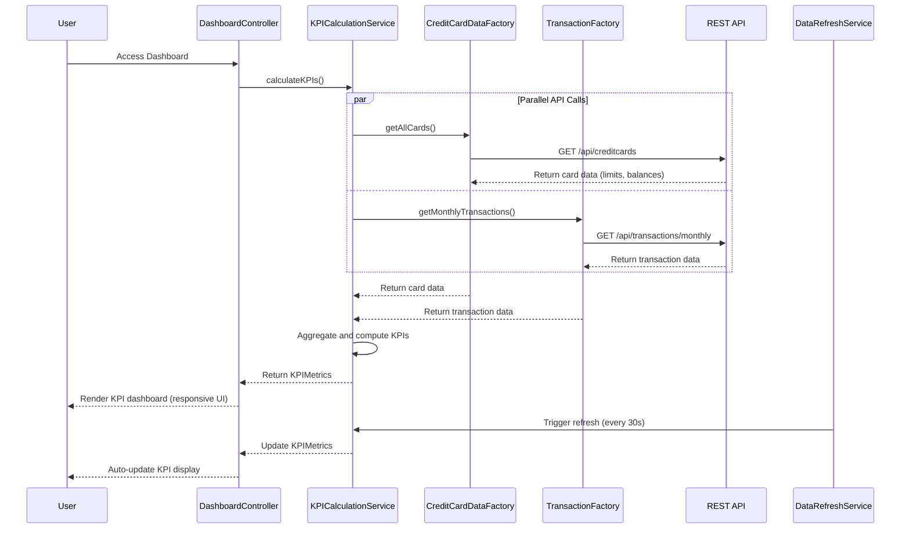

# Low-Level Design: Dashboard and KPI Management
**Epic ID:** QE-9925

## a. Architecture Mapping

- **User Dashboard UI** → AngularJS Module (`app.dashboard`) + Controller (`DashboardController`) + HTML5 View with Bootstrap cards/panels
- **KPI Calculation Engine** → AngularJS Service (`KPICalculationService`) for aggregating and computing KPI metrics
- **Credit Card Data Service** → AngularJS Factory (`CreditCardDataFactory`) wrapping REST API for card balances and limits
- **Transaction Service** → AngularJS Factory (`TransactionFactory`) wrapping REST API for monthly spend and outstanding amounts
- **Real-time Data Refresh Service** → AngularJS Service (`DataRefreshService`) using $interval for periodic KPI updates

**Recommended Folder Structure:**
```
/app
  /dashboard
    dashboard.module.js
    dashboard.controller.js
    kpi-calculation.service.js
    credit-card-data.factory.js
    transaction.factory.js
    data-refresh.service.js
    dashboard.html
  /common
    /styles
      dashboard.css
```

## b. Component Specifications

| Name | Artifact Type | Responsibility | Key Dependencies |
|------|---------------|----------------|------------------|
| DashboardController | Controller | Manages dashboard view state, displays KPIs, handles real-time refresh triggers | KPICalculationService, DataRefreshService |
| KPICalculationService | Service | Aggregates data from multiple sources, calculates total credit limit, available credit, monthly spend, outstanding amounts | CreditCardDataFactory, TransactionFactory |
| CreditCardDataFactory | Factory | Fetches credit card balances and limits from REST API | $http, $q |
| TransactionFactory | Factory | Fetches monthly transactions and outstanding amounts from REST API | $http, $q |
| DataRefreshService | Service | Manages periodic data refresh using $interval, triggers KPI recalculation | $interval, KPICalculationService |
| app.dashboard | Module | Main dashboard module encapsulating all KPI-related components | ngRoute |

## c. Data Model

**KPIMetrics** (ES6 Class/Object):
- `monthlySpend`: Number (currency, current calendar month total)
- `totalCreditLimit`: Number (currency, sum across all cards)
- `availableCredit`: Number (currency, total limit minus outstanding)
- `outstandingAmount`: Number (currency, posted + pending transactions)
- `creditUtilization`: Number (percentage, outstanding/total limit * 100)
- `lastUpdated`: Date (timestamp of last refresh)

**CreditCard** (ES6 Object):
- `cardId`: String
- `cardNumber`: String (masked)
- `creditLimit`: Number
- `currentBalance`: Number
- `availableCredit`: Number

## d. Data Flow

User accesses dashboard → DashboardController initializes and calls KPICalculationService.calculateKPIs() → KPICalculationService invokes CreditCardDataFactory.getAllCards() and TransactionFactory.getMonthlyTransactions() in parallel via REST APIs → Factories return card data (limits, balances) and transaction data (monthly spend, outstanding) → KPICalculationService aggregates data to compute total credit limit, available credit, monthly spend, outstanding amount, and credit utilization percentage → Calculated KPIMetrics object is returned to controller → Controller binds KPIs to scope and renders on responsive dashboard UI using Bootstrap cards → DataRefreshService triggers $interval-based refresh every 30 seconds → KPIs are recalculated and view updates automatically via two-way data binding.

## e. Primary Sequence Diagram



## f. Implementation Notes

- Use AngularJS $q.all() for parallel API calls to CreditCardDataFactory and TransactionFactory to minimize load time under 2 seconds
- Implement ES6 class for KPIMetrics with computed properties (e.g., creditUtilization getter calculates percentage dynamically)
- Use Bootstrap responsive grid (col-lg-3, col-md-6, col-xs-12) for KPI cards; apply CSS3 flexbox for consistent card heights
- DataRefreshService uses $interval with 30-second polling; implement $scope.$on('$destroy') to cancel interval on route change
- Cache API responses in factory using simple in-memory cache with 5-minute TTL to reduce redundant calls during refresh cycles

## g. Error Handling

HTTP interceptor-based error handling with try/catch in service layer; display Bootstrap alert notifications for API failures; fallback to last known KPI values.

## h. Security Notes

Requires token-based auth via existing SSO; card numbers displayed in masked format (last 4 digits only).