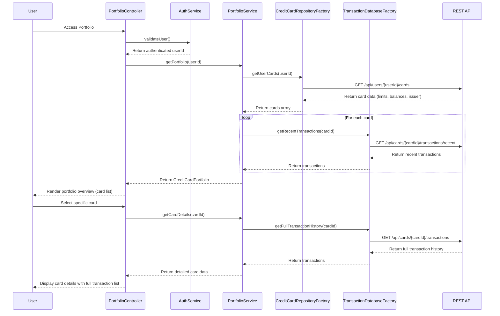

# Low-Level Design: Credit Card Portfolio Management
**Epic ID:** QE-9926

## a. Architecture Mapping

- **User Interface** → AngularJS Module (`app.portfolio`) + Controller (`PortfolioController`) + HTML5 View with Bootstrap list-group/cards
- **Portfolio Management Service** → AngularJS Service (`PortfolioService`) for orchestrating card and transaction data retrieval
- **Credit Card Data Repository** → AngularJS Factory (`CreditCardRepositoryFactory`) wrapping REST API for card information
- **Transaction Database** → AngularJS Factory (`TransactionDatabaseFactory`) wrapping REST API for transaction history
- **User Authentication Service** → AngularJS Service (`AuthService`) for secure card access and user identity verification

**Recommended Folder Structure:**
```
/app
  /portfolio
    portfolio.module.js
    portfolio.controller.js
    portfolio.service.js
    credit-card-repository.factory.js
    transaction-database.factory.js
  /common
    /services
      auth.service.js
    /styles
      portfolio.css
```

## b. Component Specifications

| Name | Artifact Type | Responsibility | Key Dependencies |
|------|---------------|----------------|------------------|
| PortfolioController | Controller | Manages portfolio view, handles card selection, displays card details and transactions | PortfolioService, AuthService |
| PortfolioService | Service | Orchestrates data retrieval from repositories, aggregates card and transaction data, manages card switching logic | CreditCardRepositoryFactory, TransactionDatabaseFactory |
| CreditCardRepositoryFactory | Factory | Fetches credit card information (limits, balances, issuer) from REST API | $http, $q |
| TransactionDatabaseFactory | Factory | Fetches card-specific transaction history from REST API | $http, $q |
| AuthService | Service | Validates user authentication, manages session tokens for secure API calls | $http, $window (localStorage) |
| app.portfolio | Module | Main portfolio module encapsulating all portfolio management components | ngRoute, app.common |

## c. Data Model

**CreditCardPortfolio** (ES6 Class/Object):
- `userId`: String
- `cards`: Array<CreditCard>
- `selectedCard`: CreditCard (currently active card)
- `totalCards`: Number

**CreditCard** (ES6 Object):
- `cardId`: String
- `cardNumber`: String (masked, last 4 digits)
- `cardType`: String (Visa, MasterCard, Amex)
- `issuer`: String
- `creditLimit`: Number
- `currentBalance`: Number
- `availableCredit`: Number
- `transactions`: Array<Transaction>

**Transaction** (ES6 Object):
- `transactionId`: String
- `date`: Date
- `description`: String
- `amount`: Number
- `category`: String
- `status`: String (posted/pending)

## d. Data Flow

User authenticates via AuthService → PortfolioController calls PortfolioService.getPortfolio() → PortfolioService invokes CreditCardRepositoryFactory.getUserCards(userId) via REST API → Factory returns array of CreditCard objects with limits, balances, issuer info → PortfolioService queries TransactionDatabaseFactory.getRecentTransactions(cardId) for each card → Aggregated portfolio data (cards + recent transactions) is returned to controller → Controller renders portfolio overview with card list using Bootstrap list-group → User selects specific card → Controller calls PortfolioService.getCardDetails(cardId) → Service fetches full transaction history via TransactionDatabaseFactory → Detailed card view with complete transaction list is displayed → Card switching completes in under 500ms via cached card metadata.

## e. Primary Sequence Diagram



## f. Implementation Notes

- Use AngularJS $q.all() for parallel transaction fetching across multiple cards during portfolio initialization
- Implement ES6 class for CreditCardPortfolio with methods for card selection and filtering (e.g., selectCard(cardId))
- Cache card metadata in PortfolioService using simple object store to achieve sub-500ms card switching; only fetch transactions on demand
- Use Bootstrap list-group for card list rendering with ng-repeat; apply CSS3 transitions for smooth card selection animations
- Implement pagination for transaction history using ng-repeat with limitTo filter; load 20 transactions initially with "Load More" button

## g. Error Handling

HTTP interceptor captures authentication and API errors; display user-friendly error messages via Bootstrap modals; retry logic for transient failures.

## h. Security Notes

Requires token-based auth via existing SSO; AuthService manages JWT tokens in localStorage; card numbers masked to last 4 digits in all views.