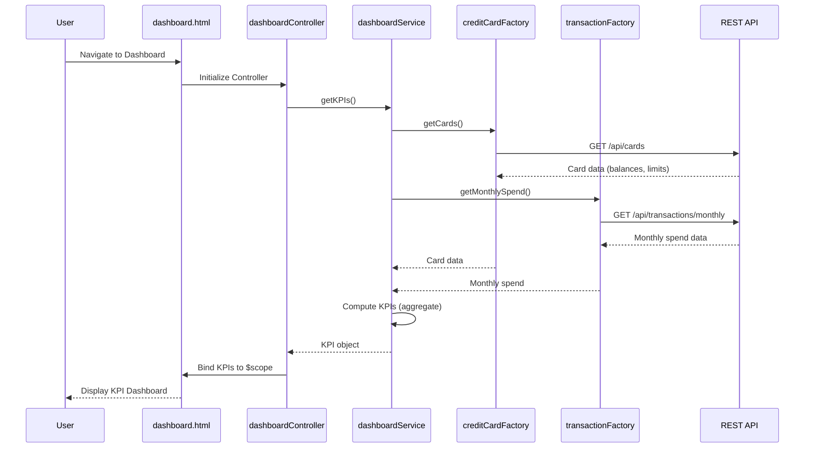

# Low-Level Design: Dashboard and KPI Management
**Epic ID:** QE-9927

## a. Architecture Mapping

- **KPI Dashboard UI** → AngularJS View (HTML5 template with Bootstrap grid)
- **Dashboard Controller** → AngularJS Controller (`dashboardController.js`) managing KPI display logic
- **Dashboard Service** → AngularJS Service (`dashboardService.js`) orchestrating data retrieval and KPI calculations
- **Credit Card Data Service** → AngularJS Factory (`creditCardFactory.js`) for REST API calls to fetch card balances/limits
- **Transaction Data Service** → AngularJS Factory (`transactionFactory.js`) for REST API calls to fetch monthly spend
- **Authentication Interceptor** → AngularJS HTTP Interceptor for token-based authentication

**Recommended Folder Structure:**
```
app/
├── modules/
│   └── dashboard/
│       ├── controllers/
│       │   └── dashboardController.js
│       ├── services/
│       │   └── dashboardService.js
│       ├── views/
│       │   └── dashboard.html
│       └── dashboardModule.js
├── shared/
│   ├── factories/
│   │   ├── creditCardFactory.js
│   │   └── transactionFactory.js
│   └── interceptors/
│       └── authInterceptor.js
└── app.js
```

## b. Component Specifications

| Name | Artifact Type | Responsibility | Key Dependencies |
|------|---------------|----------------|------------------|
| dashboardModule | AngularJS Module | Defines dashboard feature module with routing | angular, ui.router |
| dashboardController | Controller | Manages KPI data binding and UI state for dashboard view | $scope, dashboardService |
| dashboardService | Service | Aggregates data from multiple factories and computes KPIs (total limit, available credit, outstanding, monthly spend) | creditCardFactory, transactionFactory, $q |
| creditCardFactory | Factory | Fetches card balances, limits, and outstanding amounts via REST API | $http, API_CONFIG |
| transactionFactory | Factory | Fetches monthly transaction data via REST API | $http, API_CONFIG |
| authInterceptor | HTTP Interceptor | Attaches authentication token to outgoing API requests | $window, $q |
| dashboard.html | View Template | Displays KPIs in responsive Bootstrap cards with real-time updates | Bootstrap CSS, AngularJS directives |

## c. Data Model

**KPI Model (Client-side JS object):**
```javascript
{
  monthlySpend: Number,        // Total spend for current month
  totalCreditLimit: Number,    // Sum of all card limits
  availableCredit: Number,     // Total limit - total outstanding
  outstandingAmount: Number,   // Sum of all card outstanding balances
  lastUpdated: Date            // Timestamp of last data refresh
}
```

**Card Summary Model (from API):**
```javascript
{
  cardId: String,
  cardNumber: String,          // Masked (e.g., "****1234")
  creditLimit: Number,
  outstandingBalance: Number,
  availableBalance: Number
}
```

**Transaction Summary Model (from API):**
```javascript
{
  month: String,               // Format: "YYYY-MM"
  totalSpend: Number
}
```

## d. Data Flow

User navigates to dashboard → `dashboardController` initializes and calls `dashboardService.getKPIs()` → Service uses `$q.all()` to fetch card data via `creditCardFactory.getCards()` and monthly spend via `transactionFactory.getMonthlySpend()` in parallel → Both factories make REST API calls with authentication tokens (injected by `authInterceptor`) → API responses are received and aggregated by `dashboardService` to compute KPIs (sum limits, calculate available credit, extract monthly spend) → Computed KPI object is returned to controller and bound to `$scope` → View (`dashboard.html`) renders KPIs in responsive Bootstrap cards with two-way data binding, updating in real-time as data refreshes.

## e. Primary Sequence Diagram



## f. Implementation Notes

- Use AngularJS dependency injection to inject services/factories into controllers; follow strict DI annotation (`['$scope', 'dashboardService', function($scope, dashboardService) {...}]`) for minification safety.
- Leverage `$q.all()` in `dashboardService` to parallelize API calls for card data and transaction data, reducing total load time to meet 2-second NFR.
- Use Bootstrap responsive grid (col-xs, col-sm, col-md) in `dashboard.html` to ensure mobile and desktop compatibility.
- Implement `$http` with promise chaining in factories; use `.then()` for success and `.catch()` for error handling.
- Store API base URL in an AngularJS constant (`API_CONFIG`) for environment-specific configuration.

## g. Error Handling

HTTP interceptor captures API errors globally; service-level try/catch with user notification via Bootstrap alert component for failed KPI retrieval.

## h. Security Notes

Requires token-based auth via existing SSO; `authInterceptor` attaches JWT token from `$window.sessionStorage` to all API requests.