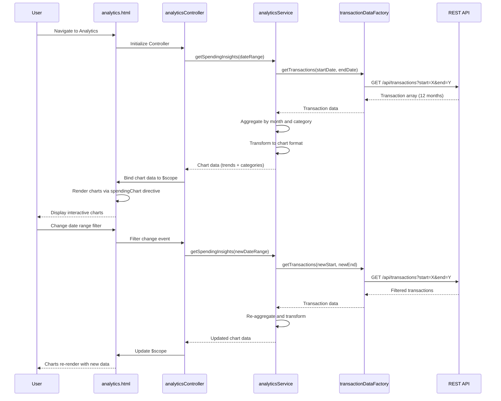

# Low-Level Design: Analytics and Spending Insights
**Epic ID:** QE-9928

## a. Architecture Mapping

- **Analytics Dashboard UI** → AngularJS View (HTML5 template with chart containers)
- **Analytics Controller** → AngularJS Controller (`analyticsController.js`) managing chart data and user interactions
- **Analytics Service** → AngularJS Service (`analyticsService.js`) orchestrating data aggregation and transformation
- **Transaction Data Factory** → AngularJS Factory (`transactionDataFactory.js`) for REST API calls to fetch historical spending
- **Chart Directive** → AngularJS Directive (`spendingChart.js`) wrapping visualization library (e.g., Chart.js)
- **Filter Component** → AngularJS Directive (`dateRangeFilter.js`) for interactive date range selection

**Recommended Folder Structure:**
```
app/
├── modules/
│   └── analytics/
│       ├── controllers/
│       │   └── analyticsController.js
│       ├── services/
│       │   └── analyticsService.js
│       ├── directives/
│       │   ├── spendingChart.js
│       │   └── dateRangeFilter.js
│       ├── views/
│       │   └── analytics.html
│       └── analyticsModule.js
├── shared/
│   └── factories/
│       └── transactionDataFactory.js
└── app.js
```

## b. Component Specifications

| Name | Artifact Type | Responsibility | Key Dependencies |
|------|---------------|----------------|------------------|
| analyticsModule | AngularJS Module | Defines analytics feature module with routing | angular, ui.router, chart.js |
| analyticsController | Controller | Manages analytics data, filters, and chart rendering logic | $scope, analyticsService |
| analyticsService | Service | Aggregates transaction data by month and category, transforms for chart consumption | transactionDataFactory, $filter |
| transactionDataFactory | Factory | Fetches historical transaction data (12 months) via REST API | $http, API_CONFIG |
| spendingChart | Directive | Encapsulates Chart.js rendering for monthly trends and category breakdown | Chart.js library |
| dateRangeFilter | Directive | Provides interactive date range picker for filtering analytics | $scope, analyticsService |
| analytics.html | View Template | Displays trend and category charts with filter controls | Bootstrap CSS, AngularJS directives |

## c. Data Model

**Transaction Model (from API):**
```javascript
{
  transactionId: String,
  cardId: String,
  amount: Number,
  category: String,            // One of 9 predefined categories
  transactionDate: Date,
  description: String
}
```

**Aggregated Monthly Trend Model (client-side):**
```javascript
{
  month: String,               // Format: "YYYY-MM"
  totalSpend: Number
}
```

**Category Breakdown Model (client-side):**
```javascript
{
  category: String,            // "Food & Dining", "Fuel", "Shopping", etc.
  totalSpend: Number,
  percentage: Number           // Percentage of total spend
}
```

**Chart Data Model (for visualization):**
```javascript
{
  labels: Array<String>,       // Month names or category names
  datasets: [{
    data: Array<Number>,       // Spend amounts
    backgroundColor: Array<String>,
    borderColor: String
  }]
}
```

## d. Data Flow

User navigates to analytics dashboard → `analyticsController` initializes and calls `analyticsService.getSpendingInsights(dateRange)` → Service calls `transactionDataFactory.getTransactions(startDate, endDate)` → Factory makes REST API call to fetch historical transactions (12 months) → API returns transaction array → Service aggregates transactions by month (for trend chart) and by category (for breakdown chart) using ES6 `reduce()` and `$filter` → Aggregated data is transformed into chart-compatible format → Controller receives chart data and binds to `$scope` → View renders charts using `spendingChart` directive (wrapping Chart.js) → User interacts with `dateRangeFilter` directive to change date range → Filter emits event, controller re-calls service with new range, charts update dynamically.

## e. Primary Sequence Diagram



## f. Implementation Notes

- Use ES6 `Array.reduce()` in `analyticsService` for efficient aggregation of transactions by month and category.
- Wrap Chart.js in an AngularJS directive (`spendingChart`) with isolated scope; pass chart data and config via directive attributes for reusability.
- Leverage AngularJS `$watch` in `analyticsController` to observe filter changes and trigger service calls reactively.
- Use `$http` caching (`cache: true`) in `transactionDataFactory` for repeated requests within the same session to improve performance.
- Predefine 9 category colors in a constant for consistent chart rendering across trend and breakdown views.

## g. Error Handling

HTTP interceptor-based error capture with try/catch in service; display user-friendly error message in analytics view if data fetch fails.

## h. Security Notes

Standard input validation and secure API calls assumed; token-based auth via existing SSO.