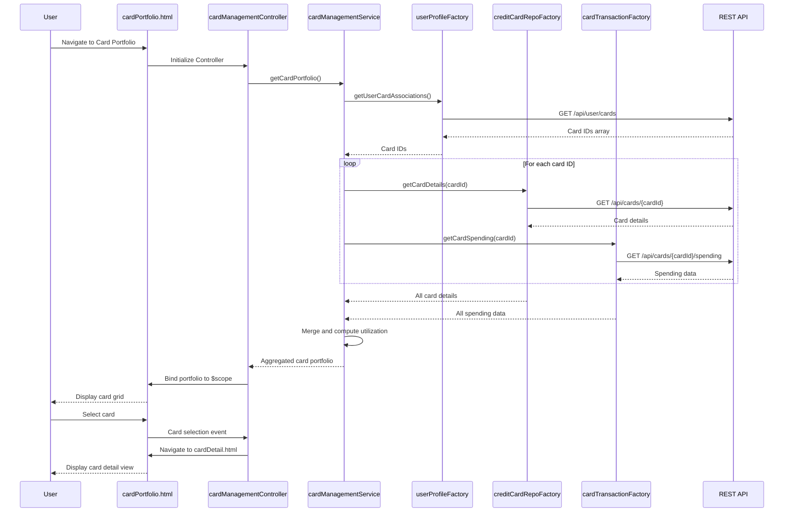

# Low-Level Design: Multiple Credit Card Management
**Epic ID:** QE-9929

## a. Architecture Mapping

- **Card Portfolio UI** → AngularJS View (HTML5 template with Bootstrap card grid)
- **Card Management Controller** → AngularJS Controller (`cardManagementController.js`) managing card list and selection
- **Card Management Service** → AngularJS Service (`cardManagementService.js`) orchestrating card data retrieval and filtering
- **Credit Card Repository Factory** → AngularJS Factory (`creditCardRepoFactory.js`) for REST API calls to fetch card details
- **Transaction Service Factory** → AngularJS Factory (`cardTransactionFactory.js`) for REST API calls to fetch card-wise spending
- **User Profile Factory** → AngularJS Factory (`userProfileFactory.js`) for REST API calls to fetch user-card associations
- **Card Filter Directive** → AngularJS Directive (`cardFilter.js`) for filtering and sorting card list

**Recommended Folder Structure:**
```
app/
├── modules/
│   └── cardManagement/
│       ├── controllers/
│       │   └── cardManagementController.js
│       ├── services/
│       │   └── cardManagementService.js
│       ├── directives/
│       │   └── cardFilter.js
│       ├── views/
│       │   ├── cardPortfolio.html
│       │   └── cardDetail.html
│       └── cardManagementModule.js
├── shared/
│   └── factories/
│       ├── creditCardRepoFactory.js
│       ├── cardTransactionFactory.js
│       └── userProfileFactory.js
└── app.js
```

## b. Component Specifications

| Name | Artifact Type | Responsibility | Key Dependencies |
|------|---------------|----------------|------------------|
| cardManagementModule | AngularJS Module | Defines card management feature module with routing | angular, ui.router |
| cardManagementController | Controller | Manages card portfolio display, selection, and detail view navigation | $scope, cardManagementService, $state |
| cardManagementService | Service | Aggregates card data, spending data, and user associations; provides filtering logic | creditCardRepoFactory, cardTransactionFactory, userProfileFactory, $q |
| creditCardRepoFactory | Factory | Fetches card details (balances, limits) via REST API | $http, API_CONFIG |
| cardTransactionFactory | Factory | Fetches card-wise spending data via REST API | $http, API_CONFIG |
| userProfileFactory | Factory | Fetches user-card associations via REST API | $http, API_CONFIG |
| cardFilter | Directive | Provides UI controls for filtering cards by status, balance, or spend | $scope |
| cardPortfolio.html | View Template | Displays grid of cards with summary info (balance, limit, spend) | Bootstrap CSS, AngularJS directives |
| cardDetail.html | View Template | Displays detailed view of selected card with full spend analysis | Bootstrap CSS, AngularJS directives |

## c. Data Model

**Card Model (from API):**
```javascript
{
  cardId: String,
  cardNumber: String,          // Masked (e.g., "****5678")
  cardType: String,            // "Visa", "Mastercard", etc.
  creditLimit: Number,
  outstandingBalance: Number,
  availableBalance: Number,
  status: String               // "Active", "Blocked", etc.
}
```

**Card Spending Model (from API):**
```javascript
{
  cardId: String,
  monthlySpend: Number,
  totalSpend: Number,          // All-time spend
  lastTransactionDate: Date
}
```

**User-Card Association Model (from API):**
```javascript
{
  userId: String,
  cardIds: Array<String>       // List of card IDs associated with user
}
```

**Aggregated Card Portfolio Model (client-side):**
```javascript
{
  cardId: String,
  cardNumber: String,
  cardType: String,
  creditLimit: Number,
  outstandingBalance: Number,
  availableBalance: Number,
  status: String,
  monthlySpend: Number,
  totalSpend: Number,
  utilizationRate: Number      // (outstandingBalance / creditLimit) * 100
}
```

## d. Data Flow

User navigates to card portfolio → `cardManagementController` initializes and calls `cardManagementService.getCardPortfolio()` → Service first calls `userProfileFactory.getUserCardAssociations()` to fetch user's card IDs → Using card IDs, service makes parallel calls via `$q.all()` to `creditCardRepoFactory.getCardDetails(cardId)` and `cardTransactionFactory.getCardSpending(cardId)` for each card → API returns card details and spending data → Service merges data into aggregated card portfolio model, calculates utilization rate → Aggregated portfolio array is returned to controller and bound to `$scope` → View (`cardPortfolio.html`) renders cards in Bootstrap grid → User applies filter via `cardFilter` directive → Directive updates filter criteria in `$scope` → Controller uses AngularJS `$filter` to filter card list → Filtered list updates view → User clicks card → Controller navigates to `cardDetail.html` state with selected card data.

## e. Primary Sequence Diagram



## f. Implementation Notes

- Use `$q.all()` in `cardManagementService` to parallelize API calls for multiple cards, ensuring 1-second retrieval NFR is met.
- Implement card filtering using AngularJS built-in `$filter` service with custom filter functions for status, balance range, and spend thresholds.
- Use `ui-router` for state management; define states for portfolio view and detail view with card ID as state parameter.
- Store card portfolio data in service-level cache (plain JS object) to avoid redundant API calls during session.
- Use Bootstrap responsive grid (col-md-4, col-sm-6, col-xs-12) for card display to support 10+ cards on various screen sizes.

## g. Error Handling

Interceptor-based error handling with service-level try/catch; display user notification for failed card data retrieval using Bootstrap alert.

## h. Security Notes

Requires token-based auth via existing SSO; all API calls authenticated via HTTP interceptor.