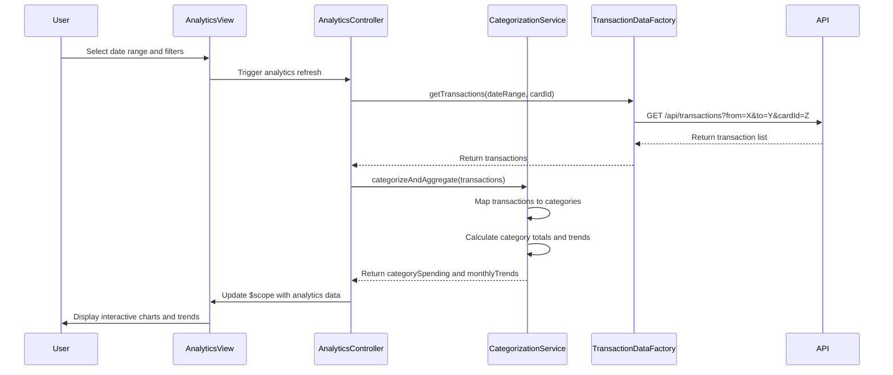

# Low-Level Design: QE-9936 - Spending Analytics and Category Insights

## a. Architecture Mapping

- **User Interface (View)**: HTML5 templates with Bootstrap for responsive category spending charts and trend visualizations
- **Analytics Controller**: AngularJS controller managing user interactions, filtering, and orchestrating analytics data retrieval
- **Categorization Engine**: AngularJS service implementing transaction categorization logic and category mapping
- **Transaction Data Service**: AngularJS factory for REST API calls to retrieve transaction history and categorized data
- **Visualization Renderer**: AngularJS directive wrapping chart library (e.g., Chart.js/D3.js) for interactive spending visualizations

**Recommended Folder Structure:**
```
app/
├── modules/analytics/
│   ├── controllers/analyticsController.js
│   ├── services/categorizationService.js
│   ├── factories/transactionDataFactory.js
│   ├── directives/spendingChartDirective.js
│   └── views/analytics.html
├── models/transaction.js
└── app.module.js
```

## b. Component Specifications

| Component Name | Artifact Type | Responsibility | Key Dependencies |
|----------------|---------------|----------------|------------------|
| analyticsController | Controller | Manages analytics view state, date range selection, category filtering, and coordinates data flow between services and view | categorizationService, transactionDataFactory, $scope |
| categorizationService | Service | Implements transaction categorization logic, maps transactions to predefined categories (Food & Dining, Fuel, Shopping, Travel, Entertainment, Utilities, Healthcare, Education, Miscellaneous), and calculates category-wise totals | transactionDataFactory, $q |
| transactionDataFactory | Factory | Handles REST API calls to retrieve transaction history, filters transactions by date range and card, and caches transaction data | $http, $q |
| spendingChartDirective | Directive | Renders interactive category-wise spending charts and monthly trend visualizations using Chart.js or D3.js | Chart.js/D3.js library |
| monthlyTrendComponent | Directive | Displays monthly spending trends over time with interactive timeline navigation | categorizationService, spendingChartDirective |

## c. Data Model

**Transaction Model:**
```javascript
{
  transactionId: String,
  cardId: String,
  amount: Number,
  category: String, // Food & Dining, Fuel, Shopping, Travel, Entertainment, Utilities, Healthcare, Education, Miscellaneous
  merchant: String,
  transactionDate: Date,
  description: String
}
```

**CategorySpending Model:**
```javascript
{
  category: String,
  totalAmount: Number,
  transactionCount: Number,
  percentage: Number
}
```

**MonthlyTrend Model:**
```javascript
{
  month: String, // YYYY-MM format
  totalSpend: Number,
  categoryBreakdown: Array<CategorySpending>
}
```

## d. Data Flow

User selects date range and category filters in the analytics view → analyticsController captures user input and invokes transactionDataFactory to fetch transaction history via REST API → transactionDataFactory returns transaction data to categorizationService which processes and categorizes transactions into predefined categories → categorizationService calculates category-wise totals and monthly trends, returning aggregated data to analyticsController → analyticsController updates $scope with categorized spending data → spendingChartDirective and monthlyTrendComponent render interactive visualizations reflecting the user's spending patterns across categories and time periods.

## e. Primary Sequence Diagram



## f. Implementation Notes

- Use AngularJS dependency injection to inject categorizationService and transactionDataFactory into analyticsController for loose coupling and testability
- Implement ES6 classes for service and factory definitions with arrow functions for cleaner syntax and lexical scoping
- Leverage $http interceptors for centralized API authentication token injection and response error handling
- Use AngularJS $q promises for asynchronous transaction data retrieval and chaining categorization operations
- Implement directive isolation scope for spendingChartDirective to enable reusable chart components with two-way data binding for interactive filtering

## g. Error Handling

HTTP interceptor-based error handling with try/catch blocks in service methods; user-friendly error notifications displayed via toastr or Bootstrap alerts for API failures and categorization errors.

## h. Security Notes

Standard input validation and secure API calls assumed; transaction data retrieval requires token-based authentication via existing SSO mechanism.