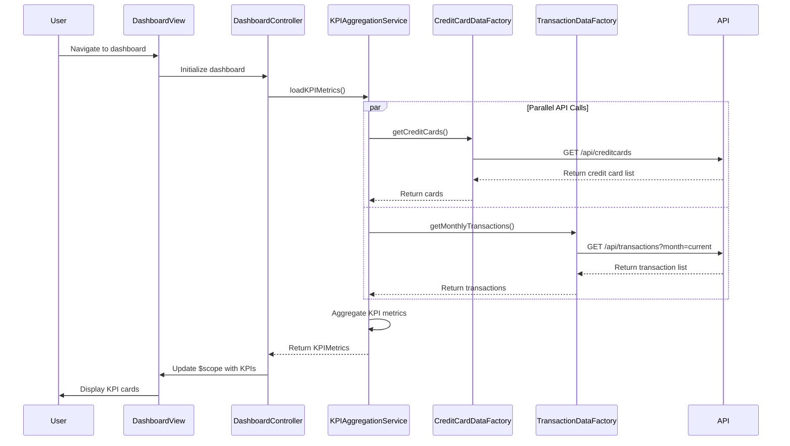

# Low-Level Design: QE-9937 - Credit Card Dashboard and KPI Monitoring

## a. Architecture Mapping

- **User Interface (View)**: HTML5 dashboard template with Bootstrap grid for responsive KPI cards displaying monthly spend, credit limit, available credit, and outstanding amount
- **Dashboard Controller**: AngularJS controller managing dashboard state, KPI data binding, and user interactions
- **KPI Aggregation Service**: AngularJS service aggregating credit card data and calculating KPI metrics across all cards
- **Credit Card Data Repository**: AngularJS factory for REST API calls to retrieve credit card balances, limits, and account details
- **Transaction Data Service**: AngularJS factory for REST API calls to retrieve transaction data for monthly spend calculation

**Recommended Folder Structure:**
```
app/
├── modules/dashboard/
│   ├── controllers/dashboardController.js
│   ├── services/kpiAggregationService.js
│   ├── factories/creditCardDataFactory.js
│   ├── factories/transactionDataFactory.js
│   └── views/dashboard.html
├── models/creditCard.js
└── app.module.js
```

## b. Component Specifications

| Component Name | Artifact Type | Responsibility | Key Dependencies |
|----------------|---------------|----------------|------------------|
| dashboardController | Controller | Manages dashboard view state, initializes KPI data loading, and handles user refresh actions | kpiAggregationService, $scope, $interval |
| kpiAggregationService | Service | Aggregates credit card data from multiple sources, calculates total credit limit, available credit, outstanding amount, and monthly spend across all cards | creditCardDataFactory, transactionDataFactory, $q |
| creditCardDataFactory | Factory | Handles REST API calls to retrieve credit card account details including balances, limits, and outstanding amounts | $http, $q |
| transactionDataFactory | Factory | Handles REST API calls to retrieve transaction data for calculating monthly spend totals | $http, $q |
| kpiCardDirective | Directive | Reusable component for rendering individual KPI cards with icon, label, value, and responsive styling | None |

## c. Data Model

**CreditCard Model:**
```javascript
{
  cardId: String,
  cardNumber: String, // masked
  cardType: String, // Visa, MasterCard, etc.
  creditLimit: Number,
  availableCredit: Number,
  outstandingAmount: Number,
  lastUpdated: Date
}
```

**KPIMetrics Model:**
```javascript
{
  monthlySpend: Number,
  totalCreditLimit: Number,
  totalAvailableCredit: Number,
  totalOutstandingAmount: Number,
  cardCount: Number
}
```

## d. Data Flow

User navigates to dashboard view → dashboardController initializes and invokes kpiAggregationService to load KPI data → kpiAggregationService calls creditCardDataFactory and transactionDataFactory concurrently to fetch credit card details and transaction data via REST APIs → creditCardDataFactory retrieves card balances, limits, and outstanding amounts while transactionDataFactory retrieves current month transactions → kpiAggregationService aggregates data to calculate total credit limit, available credit, outstanding amount, and monthly spend across all cards → kpiAggregationService returns KPIMetrics object to dashboardController → dashboardController updates $scope with KPI data → dashboard view renders KPI cards with responsive Bootstrap layout displaying all metrics.

## e. Primary Sequence Diagram



## f. Implementation Notes

- Use AngularJS dependency injection to inject kpiAggregationService, creditCardDataFactory, and transactionDataFactory into dashboardController
- Implement ES6 arrow functions and promises ($q.all) for parallel API calls to optimize dashboard load time
- Use $interval service for optional auto-refresh of KPI data at configurable intervals (e.g., every 5 minutes)
- Leverage Bootstrap responsive grid (col-xs, col-sm, col-md, col-lg) for KPI card layout across desktop, tablet, and mobile devices
- Implement loading spinner directive to indicate data fetching state during KPI aggregation

## g. Error Handling

HTTP interceptor-based error handling with fallback to cached KPI data if available; user notification via Bootstrap alert for API failures with retry option.

## h. Security Notes

Requires token-based authentication via existing SSO; credit card numbers displayed in masked format; API calls secured with HTTPS and authorization headers.