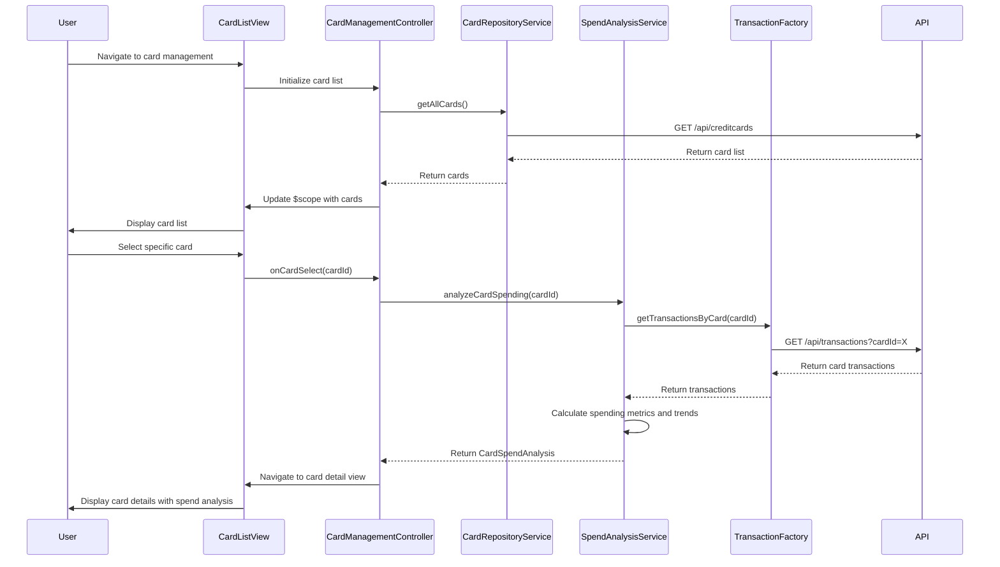

# Low-Level Design: QE-9938 - Multiple Credit Card Management and Visualization

## a. Architecture Mapping

- **User Interface (View)**: HTML5 templates with Bootstrap for responsive card list, card detail views, and card-wise spend analysis charts
- **Card Management Controller**: AngularJS controller managing card selection, filtering, and navigation between card list and detail views
- **Card Repository Service**: AngularJS service for CRUD operations on credit card data and card-specific balance tracking
- **Transaction Service**: AngularJS factory for REST API calls to retrieve card-specific transaction history
- **Spend Analysis Engine**: AngularJS service calculating card-wise spending patterns, trends, and utilization metrics

**Recommended Folder Structure:**
```
app/
├── modules/cards/
│   ├── controllers/cardManagementController.js
│   ├── services/cardRepositoryService.js
│   ├── services/spendAnalysisService.js
│   ├── factories/transactionFactory.js
│   ├── directives/cardListDirective.js
│   ├── directives/cardDetailDirective.js
│   └── views/
│       ├── cardList.html
│       └── cardDetail.html
├── models/creditCard.js
└── app.module.js
```

## b. Component Specifications

| Component Name | Artifact Type | Responsibility | Key Dependencies |
|----------------|---------------|----------------|------------------|
| cardManagementController | Controller | Manages card list and detail views, handles card selection, filtering, and coordinates card-wise spend analysis | cardRepositoryService, spendAnalysisService, $scope, $routeParams |
| cardRepositoryService | Service | Provides CRUD operations for credit card data, retrieves card details, and maintains card list state | transactionFactory, $http, $q |
| spendAnalysisService | Service | Calculates card-wise spending totals, trends, utilization percentage, and comparative analysis across cards | transactionFactory, $q |
| transactionFactory | Factory | Handles REST API calls to retrieve card-specific transaction history and filters transactions by card ID | $http, $q |
| cardListDirective | Directive | Renders list of credit cards with summary information (card type, balance, limit) and supports card selection | cardRepositoryService |
| cardDetailDirective | Directive | Displays detailed card information including card-specific spend analysis, balance, limit, and transaction history | spendAnalysisService |

## c. Data Model

**CreditCard Model:**
```javascript
{
  cardId: String,
  cardNumber: String, // masked
  cardType: String, // Visa, MasterCard, Amex, etc.
  cardHolderName: String,
  expiryDate: String, // MM/YY
  creditLimit: Number,
  availableCredit: Number,
  outstandingAmount: Number,
  isActive: Boolean
}
```

**CardSpendAnalysis Model:**
```javascript
{
  cardId: String,
  monthlySpend: Number,
  averageTransactionAmount: Number,
  transactionCount: Number,
  utilizationPercentage: Number, // (outstandingAmount / creditLimit) * 100
  topCategories: Array<String>,
  spendTrend: Array<{month: String, amount: Number}>
}
```

## d. Data Flow

User navigates to card management view → cardManagementController initializes and invokes cardRepositoryService to fetch all credit cards via REST API → cardRepositoryService returns card list to controller → controller updates $scope and cardListDirective renders all cards with summary information → user selects a specific card → cardManagementController captures card selection and invokes spendAnalysisService with selected cardId → spendAnalysisService calls transactionFactory to retrieve card-specific transaction history via REST API → transactionFactory returns transactions for the selected card → spendAnalysisService calculates card-wise spending totals, utilization percentage, and trends → spendAnalysisService returns CardSpendAnalysis object to controller → controller updates $scope and cardDetailDirective renders detailed card information with spend analysis visualizations.

## e. Primary Sequence Diagram



## f. Implementation Notes

- Use AngularJS dependency injection to inject cardRepositoryService, spendAnalysisService, and transactionFactory into cardManagementController
- Implement ES6 classes for service definitions with arrow functions for cleaner asynchronous operations and promise chaining
- Use AngularJS $routeProvider or ui-router for navigation between card list view and card detail view with cardId as route parameter
- Leverage Bootstrap card components and responsive grid for displaying multiple cards with consistent styling across devices
- Implement filtering and sorting functionality in cardListDirective using AngularJS filters for card type, balance range, and utilization percentage

## g. Error Handling

HTTP interceptor-based error handling with try/catch in service methods; user-friendly error messages displayed via Bootstrap alerts for API failures with option to retry card data loading.

## h. Security Notes

Requires token-based authentication via existing SSO; credit card numbers displayed in masked format (last 4 digits only); sensitive card details transmitted over HTTPS with authorization headers.