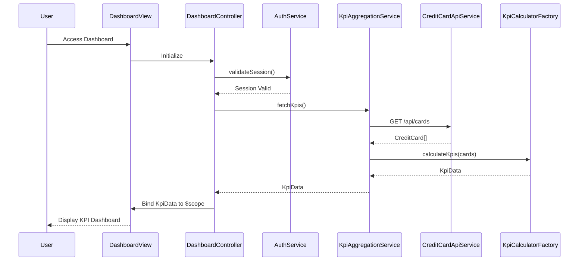

# Low-Level Design: Credit Card Dashboard and KPIs
**Epic ID:** QE-9939  
**Stack:** AngularJS 1.x, JavaScript ES6, HTML5, CSS3, Bootstrap, REST APIs, MVC

---

## a. Architecture Mapping

- **Dashboard Module** → AngularJS Module (`app.dashboard`)
- **Dashboard Controller** → AngularJS Controller (`DashboardController`)
- **Data Aggregation Service** → AngularJS Service (`KpiAggregationService`)
- **KPI Calculation Engine** → AngularJS Factory (`KpiCalculatorFactory`)
- **Authentication** → AngularJS Service (`AuthService`)
- **API Communication** → AngularJS Service (`CreditCardApiService`)

**Folder Structure:**
```
/app
  /modules
    /dashboard
      dashboard.module.js
      dashboard.controller.js
      dashboard.html
  /services
    kpi-aggregation.service.js
    credit-card-api.service.js
    auth.service.js
  /factories
    kpi-calculator.factory.js
  /styles
    dashboard.css
```

---

## b. Component Specifications

| Name | Artifact Type | Responsibility | Key Dependencies |
|------|---------------|----------------|------------------|
| DashboardController | Controller | Orchestrates dashboard view, fetches and displays KPIs | KpiAggregationService, AuthService, $scope |
| KpiAggregationService | Service | Aggregates multi-card data and coordinates KPI calculation | CreditCardApiService, KpiCalculatorFactory, $q |
| KpiCalculatorFactory | Factory | Computes monthly spend, total limit, available credit, outstanding amounts | None (pure calculation logic) |
| CreditCardApiService | Service | Handles REST API calls to credit card data source | $http, $q |
| AuthService | Service | Manages user authentication and session tokens | $http, $window |
| dashboardView | HTML Template | Renders responsive KPI cards using Bootstrap grid | DashboardController |

---

## c. Data Model

**KpiData (JS Object):**
```javascript
{
  monthlySpend: Number,        // Current month total spend
  totalCreditLimit: Number,    // Sum of all card limits
  availableCredit: Number,     // Total limit - outstanding
  outstandingAmount: Number,   // Sum of all card balances
  lastUpdated: Date            // Timestamp of data fetch
}
```

**CreditCard (JS Object):**
```javascript
{
  cardId: String,
  cardType: String,
  creditLimit: Number,
  currentBalance: Number,
  availableBalance: Number
}
```

---

## d. Data Flow

User accesses dashboard → DashboardController initializes and calls AuthService to validate session → Upon authentication, controller invokes KpiAggregationService.fetchKpis() → Service calls CreditCardApiService to GET /api/cards endpoint → API returns array of CreditCard objects → KpiCalculatorFactory processes array to compute aggregated KPIs (monthly spend, total limit, available credit, outstanding) → KpiAggregationService returns KpiData object to controller → Controller binds data to $scope → View renders responsive KPI cards via Bootstrap grid → Real-time updates triggered via $interval polling or WebSocket push.

---

## e. Primary Sequence Diagram



---

## f. Implementation Notes

- Use AngularJS DI to inject services into controller; follow strict-di annotation pattern for minification safety
- Implement $http interceptor for automatic auth token attachment and response error handling
- Use $q.all() for parallel API calls if multiple endpoints needed; cache KPI data with $cacheFactory for sub-2s load
- Apply Bootstrap responsive grid (col-xs/sm/md/lg) for mobile/tablet/desktop layouts
- Use $interval or $timeout for periodic KPI refresh; consider WebSocket via angular-websocket for real-time push

---

## g. Error Handling

HTTP interceptor captures API errors; display user-friendly notifications via Bootstrap alerts; retry logic with exponential backoff for transient failures.

---

## h. Security Notes

Requires token-based auth via existing SSO; tokens stored in sessionStorage and attached to API requests via $http interceptor.

---