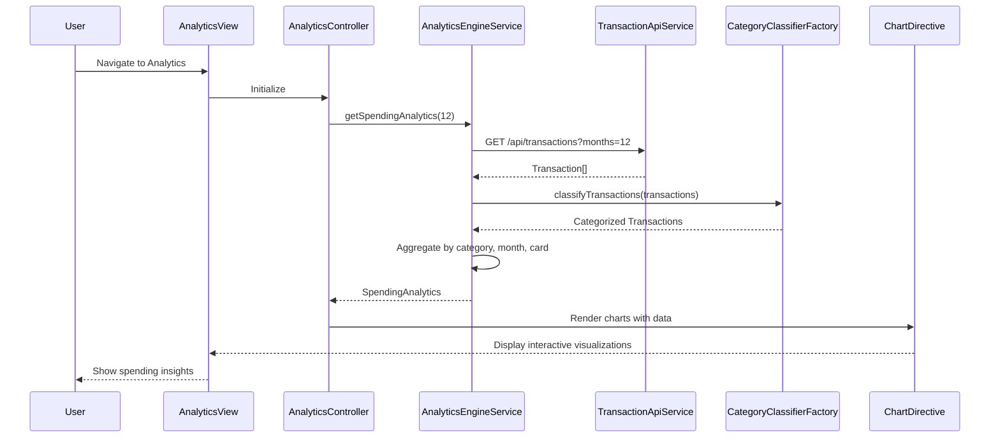

# Low-Level Design: Spending Analytics and Insights
**Epic ID:** QE-9940  
**Stack:** AngularJS 1.x, JavaScript ES6, HTML5, CSS3, Bootstrap, REST APIs, MVC

---

## a. Architecture Mapping

- **Analytics Module** → AngularJS Module (`app.analytics`)
- **Analytics Controller** → AngularJS Controller (`AnalyticsController`)
- **Data Analytics Engine** → AngularJS Service (`AnalyticsEngineService`)
- **Transaction Data Service** → AngularJS Service (`TransactionApiService`)
- **Category Classification** → AngularJS Factory (`CategoryClassifierFactory`)
- **Visualization** → AngularJS Directive (`spendingChart`)

**Folder Structure:**
```
/app
  /modules
    /analytics
      analytics.module.js
      analytics.controller.js
      analytics.html
  /services
    analytics-engine.service.js
    transaction-api.service.js
  /factories
    category-classifier.factory.js
  /directives
    spending-chart.directive.js
  /styles
    analytics.css
```

---

## b. Component Specifications

| Name | Artifact Type | Responsibility | Key Dependencies |
|------|---------------|----------------|------------------|
| AnalyticsController | Controller | Manages analytics view, fetches transaction data, triggers visualizations | AnalyticsEngineService, $scope, $filter |
| AnalyticsEngineService | Service | Aggregates transactions, computes monthly trends and category totals | TransactionApiService, CategoryClassifierFactory, $q |
| TransactionApiService | Service | Fetches historical transaction data via REST API | $http, $q |
| CategoryClassifierFactory | Factory | Classifies transactions into 9 predefined categories | None (mapping logic) |
| spendingChart | Directive | Renders interactive charts using Chart.js or D3.js | AnalyticsController, Chart.js/D3 library |
| analyticsView | HTML Template | Displays category breakdown, monthly trends, and card-wise analysis | AnalyticsController |

---

## c. Data Model

**Transaction (JS Object):**
```javascript
{
  transactionId: String,
  cardId: String,
  amount: Number,           // 2 decimal precision
  date: Date,
  merchantName: String,
  category: String          // One of 9 categories
}
```

**SpendingAnalytics (JS Object):**
```javascript
{
  categoryBreakdown: {      // Object with 9 category keys
    'Food & Dining': Number,
    'Fuel': Number,
    'Shopping': Number,
    'Travel': Number,
    'Entertainment': Number,
    'Utilities': Number,
    'Healthcare': Number,
    'Education': Number,
    'Miscellaneous': Number
  },
  monthlyTrends: Array,     // [{month: String, total: Number}]
  cardWiseSpend: Array      // [{cardId: String, total: Number}]
}
```

---

## d. Data Flow

User navigates to analytics view → AnalyticsController initializes and calls AnalyticsEngineService.getSpendingAnalytics(timeRange) → Service invokes TransactionApiService to GET /api/transactions?months=12 → API returns Transaction[] for last 12 months → CategoryClassifierFactory categorizes each transaction into one of 9 categories → AnalyticsEngineService aggregates by category, computes monthly totals (2-decimal precision), and groups by card → Service returns SpendingAnalytics object to controller → Controller binds data to $scope and triggers spendingChart directive → Directive renders interactive charts (Chart.js/D3) within 1 second → User interacts with responsive visualizations (filter by time, category, card).

---

## e. Primary Sequence Diagram



---

## f. Implementation Notes

- Use AngularJS DI for service injection; leverage $filter for date/currency formatting with 2-decimal precision
- Integrate Chart.js via angular-chart.js directive or D3.js for custom visualizations; ensure chart rendering completes within 1s via lazy loading
- Implement CategoryClassifierFactory as singleton with static category mapping; use ES6 Map for O(1) lookups
- Cache transaction data with $cacheFactory (12-month TTL) to optimize repeated queries
- Use $q.all() for parallel API calls if fetching from multiple endpoints; apply pagination/lazy loading for large datasets

---

## g. Error Handling

$http interceptor handles API failures; display error messages via Bootstrap modals; implement client-side retry with exponential backoff.

---

## h. Security Notes

Standard input validation and secure API calls assumed; token-based auth via existing SSO for transaction data access.

---