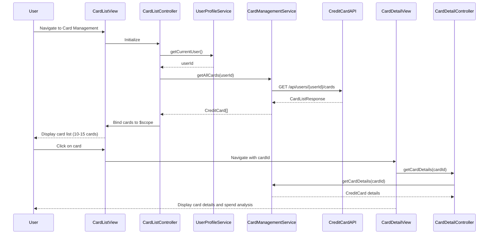

# Low-Level Design: Multiple Credit Card Management
**Epic ID:** QE-9941  
**Stack:** AngularJS 1.x, JavaScript ES6, HTML5, CSS3, Bootstrap, REST APIs, MVC

---

## a. Architecture Mapping

- **Card Management Module** → AngularJS Module (`app.cardManagement`)
- **Card Display Controller** → AngularJS Controller (`CardListController`)
- **Card Detail Controller** → AngularJS Controller (`CardDetailController`)
- **Card Management Service** → AngularJS Service (`CardManagementService`)
- **User Profile Service** → AngularJS Service (`UserProfileService`)
- **Card List View** → AngularJS Directive (`cardListItem`)

**Folder Structure:**
```
/app
  /modules
    /card-management
      card-management.module.js
      card-list.controller.js
      card-detail.controller.js
      card-list.html
      card-detail.html
  /services
    card-management.service.js
    user-profile.service.js
  /directives
    card-list-item.directive.js
  /styles
    card-management.css
```

---

## b. Component Specifications

| Name | Artifact Type | Responsibility | Key Dependencies |
|------|---------------|----------------|------------------|
| CardListController | Controller | Displays list of all user credit cards (10-15 cards), handles card selection | CardManagementService, UserProfileService, $scope |
| CardDetailController | Controller | Shows detailed view of selected card including limits, balance, spend analysis | CardManagementService, $routeParams, $scope |
| CardManagementService | Service | Fetches, caches, and manages card data from Credit Card Database | $http, $q, $cacheFactory |
| UserProfileService | Service | Provides authenticated user context and profile data | $http, AuthService |
| cardListItem | Directive | Renders individual card summary with type, limit, balance | CardListController |
| cardListView | HTML Template | Displays grid/list of cards using Bootstrap responsive layout | CardListController |
| cardDetailView | HTML Template | Shows comprehensive card details and spend analysis | CardDetailController |

---

## c. Data Model

**CreditCard (JS Object):**
```javascript
{
  cardId: String,
  userId: String,
  cardType: String,          // e.g., Visa, Mastercard, Amex
  cardNumber: String,        // Masked (last 4 digits)
  creditLimit: Number,
  currentBalance: Number,
  availableBalance: Number,
  outstandingAmount: Number,
  monthlySpend: Number,
  issueDate: Date,
  expiryDate: Date
}
```

**CardListResponse (API Response):**
```javascript
{
  cards: CreditCard[],       // Array of 10-15 cards
  totalCards: Number
}
```

---

## d. Data Flow

User logs in and navigates to card management → CardListController initializes and calls UserProfileService.getCurrentUser() to get userId → Controller invokes CardManagementService.getAllCards(userId) → Service calls GET /api/users/{userId}/cards → API queries Credit Card Database and returns CardListResponse → Service caches response and returns CreditCard[] to controller → Controller binds cards to $scope → View renders card list using cardListItem directive with Bootstrap grid → User clicks card → CardDetailController loads with cardId from $routeParams → Controller calls CardManagementService.getCardDetails(cardId) → Service returns cached or fetches detailed CreditCard object → Detail view displays comprehensive card information and card-wise spend analysis.

---

## e. Primary Sequence Diagram



---

## f. Implementation Notes

- Use AngularJS DI with strict-di for minification; inject services into controllers using array notation
- Implement $cacheFactory in CardManagementService to cache card list (TTL: 5 min) for optimized performance with 10-15 cards
- Use ng-repeat with track by cardId for efficient card list rendering; apply Bootstrap grid (col-md-4) for responsive card layout
- Leverage $routeProvider for navigation between list and detail views; pass cardId via route params
- Apply lazy loading with ng-if for card details to improve initial load performance; use $http interceptor for auth token injection

---

## g. Error Handling

$http interceptor captures API errors; display user notifications via Bootstrap alerts; implement retry logic for failed card data fetches.

---

## h. Security Notes

Requires token-based auth via existing SSO; sensitive card data (full card number) never transmitted; only masked card numbers displayed in UI.

---