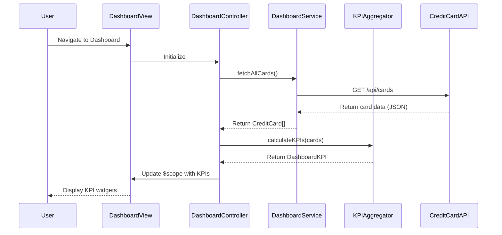

# Low-Level Design: QE-9984 - Credit Card Dashboard and KPI Management

## a. Architecture Mapping

**HLD to AngularJS Artifact Mapping:**
- **Web Application UI** → AngularJS Module: `creditCardDashboard.module.js`
- **Dashboard Service** → AngularJS Service: `dashboardService.js` (handles API calls and data aggregation)
- **Data Aggregation Engine** → AngularJS Factory: `kpiAggregatorFactory.js` (client-side KPI calculations)
- **Dashboard UI Components** → AngularJS Controller: `dashboardController.js` + Directive: `kpiWidget.directive.js`
- **User Authentication** → AngularJS Service: `authService.js` (session validation and token management)

**Recommended Folder Structure:**
```
app/
├── modules/
│   └── dashboard/
│       ├── controllers/
│       │   └── dashboardController.js
│       ├── services/
│       │   ├── dashboardService.js
│       │   └── authService.js
│       ├── factories/
│       │   └── kpiAggregatorFactory.js
│       ├── directives/
│       │   └── kpiWidget.directive.js
│       ├── views/
│       │   └── dashboard.html
│       └── dashboard.module.js
├── shared/
│   ├── models/
│   └── interceptors/
└── assets/
    ├── css/
    └── js/
```

## b. Component Specifications

| Component Name | Artifact Type | Responsibility | Key Dependencies |
|----------------|---------------|----------------|------------------|
| `creditCardDashboard.module` | Module | Root module for dashboard feature, declares all dashboard components | `ngRoute`, `ngResource`, `ui.bootstrap` |
| `dashboardController` | Controller | Manages dashboard view state, fetches KPI data, handles user interactions | `dashboardService`, `kpiAggregatorFactory`, `$scope` |
| `dashboardService` | Service | Makes REST API calls to Credit Card Data Service and User Authentication Service | `$http`, `$q`, `authService` |
| `kpiAggregatorFactory` | Factory | Aggregates and calculates KPIs (monthly spend, available credit, outstanding amount) from raw card data | None (pure calculation logic) |
| `kpiWidget` | Directive | Reusable UI component to display individual KPI metrics with responsive styling | `$timeout` (for animations) |
| `authService` | Service | Validates user session, manages authentication tokens, handles token refresh | `$http`, `$window` (localStorage) |

## c. Data Model

**CreditCard Model:**
```javascript
{
  cardId: String,
  cardNumber: String,  // masked, e.g., "****1234"
  cardType: String,    // "Visa", "MasterCard", "Amex"
  creditLimit: Number,
  currentBalance: Number,
  availableCredit: Number,
  outstandingAmount: Number,
  lastUpdated: Date
}
```

**DashboardKPI Model:**
```javascript
{
  monthlySpend: Number,
  totalCreditLimit: Number,
  totalAvailableCredit: Number,
  totalOutstandingAmount: Number,
  cardCount: Number,
  lastRefreshed: Date
}
```

## d. Data Flow

User opens the dashboard → `dashboard.html` loads and `dashboardController` initializes → Controller calls `dashboardService.fetchAllCards()` which makes a REST API call to Credit Card Data Service → Service returns array of CreditCard objects → Controller passes data to `kpiAggregatorFactory.calculateKPIs()` which computes aggregated metrics → Calculated `DashboardKPI` object is bound to `$scope` → View updates via two-way data binding, rendering `kpiWidget` directives for each KPI → User can trigger manual refresh, repeating the flow with real-time data fetch.

## e. Primary Sequence Diagram



## f. Implementation Notes

- **MVC Pattern:** Strict separation: Controllers manage view logic, Services handle API communication, Factories perform business logic (KPI calculations).
- **Dependency Injection:** Use AngularJS DI to inject services and factories into controllers; annotate with array syntax for minification safety: `['$scope', 'dashboardService', function($scope, dashboardService) {...}]`.
- **REST API Integration:** Use `$http` service with Promises (`$q`) for asynchronous API calls; configure base URL in app config; handle HTTP status codes (200, 401, 500) appropriately.
- **Responsive Design:** Use Bootstrap grid system (col-xs, col-sm, col-md, col-lg) in `dashboard.html`; KPI widgets adapt layout based on viewport size using CSS media queries.
- **Real-time Refresh:** Implement auto-refresh using `$interval` service (e.g., every 30 seconds) with user option to disable; show loading spinner during data fetch using `ng-show` directive.

## g. Error Handling

HTTP interceptor (`$httpProvider.interceptors`) captures API errors; display user-friendly error messages via Bootstrap alert directive; log errors to console for debugging.

## h. Security Notes

Requires token-based authentication via existing SSO; tokens stored in localStorage and attached to API requests via Authorization header in HTTP interceptor.