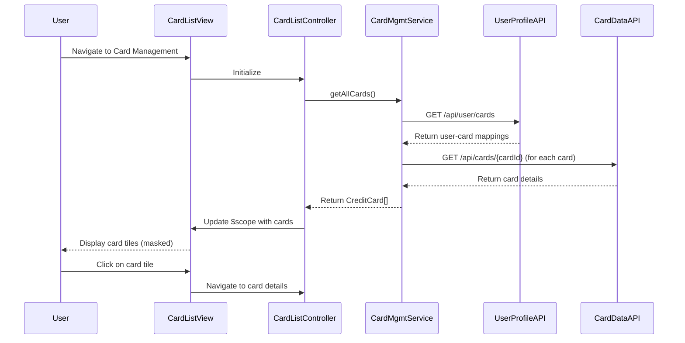

# Low-Level Design: QE-9985 - Credit Card Management and Monitoring

## a. Architecture Mapping

**HLD to AngularJS Artifact Mapping:**
- **User Interface** → AngularJS Module: `cardManagement.module.js`
- **Card Management Service** → AngularJS Service: `cardManagementService.js` (orchestrates card operations and API calls)
- **Credit Card Data Service** → REST API integration via `$http` in `cardDataService.js`
- **User Profile Service** → REST API integration via `$http` in `userProfileService.js`
- **Spend Analysis Module** → AngularJS Controller: `spendAnalysisController.js` + Factory: `spendCalculatorFactory.js`
- **Card Listing UI** → AngularJS Controller: `cardListController.js` + Directive: `cardTile.directive.js`
- **Card Details UI** → AngularJS Controller: `cardDetailsController.js` + View: `cardDetails.html`

**Recommended Folder Structure:**
```
app/
├── modules/
│   └── cardManagement/
│       ├── controllers/
│       │   ├── cardListController.js
│       │   ├── cardDetailsController.js
│       │   └── spendAnalysisController.js
│       ├── services/
│       │   ├── cardManagementService.js
│       │   ├── cardDataService.js
│       │   └── userProfileService.js
│       ├── factories/
│       │   └── spendCalculatorFactory.js
│       ├── directives/
│       │   └── cardTile.directive.js
│       ├── views/
│       │   ├── cardList.html
│       │   └── cardDetails.html
│       └── cardManagement.module.js
└── shared/
    ├── filters/
    │   └── cardMask.filter.js
    └── models/
```

## b. Component Specifications

| Component Name | Artifact Type | Responsibility | Key Dependencies |
|----------------|---------------|----------------|------------------|
| `cardManagement.module` | Module | Root module for card management feature, declares all card-related components | `ngRoute`, `ngResource`, `ui.bootstrap` |
| `cardListController` | Controller | Manages card listing view, handles card selection and filtering | `cardManagementService`, `$scope`, `$filter` |
| `cardDetailsController` | Controller | Displays individual card details, manages card-specific view state | `cardManagementService`, `$routeParams`, `$scope` |
| `spendAnalysisController` | Controller | Manages card-wise spend analysis view and chart rendering | `spendCalculatorFactory`, `cardManagementService`, `$scope` |
| `cardManagementService` | Service | Orchestrates card operations, coordinates between cardDataService and userProfileService | `cardDataService`, `userProfileService`, `$q` |
| `cardDataService` | Service | Makes REST API calls to Credit Card Data Service for card info and balances | `$http`, `$q` |
| `userProfileService` | Service | Makes REST API calls to User Profile Service for user-card relationships | `$http`, `$q` |
| `spendCalculatorFactory` | Factory | Calculates card-wise spending metrics and aggregates transaction data | None (pure calculation logic) |
| `cardTile` | Directive | Reusable card display component showing masked card number, limit, balance | `cardMask` filter |
| `cardMask` | Filter | Masks card numbers to show only last 4 digits (e.g., "****1234") | None |

## c. Data Model

**CreditCard Model:**
```javascript
{
  cardId: String,
  userId: String,
  cardNumber: String,      // full number (encrypted in storage)
  maskedCardNumber: String, // "****1234"
  cardHolderName: String,
  cardType: String,        // "Visa", "MasterCard", "Amex", "Discover"
  creditLimit: Number,
  currentBalance: Number,
  availableCredit: Number,
  outstandingAmount: Number,
  expiryDate: String,      // "MM/YY"
  issuerBank: String,
  status: String,          // "Active", "Blocked", "Expired"
  lastUpdated: Date
}
```

**CardSpendAnalysis Model:**
```javascript
{
  cardId: String,
  currentMonthSpend: Number,
  previousMonthSpend: Number,
  yearToDateSpend: Number,
  topCategory: String,
  categoryBreakdown: Array  // [{category: String, amount: Number}]
}
```

## d. Data Flow

User navigates to card management page → `cardList.html` loads and `cardListController` initializes → Controller calls `cardManagementService.getAllCards()` which internally calls `userProfileService.getUserCards()` to get user-card mappings, then `cardDataService.fetchCardDetails()` for each card → Service returns array of CreditCard objects → Controller applies `cardMask` filter and binds data to `$scope` → View renders `cardTile` directive for each card → User clicks on a card tile → `$routeParams` passes cardId to `cardDetailsController` → Controller fetches detailed card info and calls `spendCalculatorFactory.analyzeSpend(cardId)` → Spend analysis data is displayed in `cardDetails.html` with charts.

## e. Primary Sequence Diagram



## f. Implementation Notes

- **Service Orchestration:** `cardManagementService` acts as facade, coordinating multiple API calls to `userProfileService` and `cardDataService`; uses `$q.all()` to parallelize card detail fetches.
- **Card Number Masking:** Implement `cardMask` filter to transform full card numbers to masked format; apply filter in view templates: `{{ card.cardNumber | cardMask }}`; never expose full card numbers in client-side logs.
- **Caching Strategy:** Use `$cacheFactory` to cache card list data for 5 minutes to reduce API calls; invalidate cache on user-triggered refresh or after card updates.
- **Routing:** Configure `$routeProvider` with routes: `/cards` (list view) and `/cards/:cardId` (details view); use `resolve` property to pre-fetch card data before view loads.
- **Responsive Card Grid:** Use Bootstrap grid with `col-md-4 col-sm-6 col-xs-12` for card tiles; implement CSS flexbox for consistent card tile heights; add hover effects for better UX.

## g. Error Handling

Use try/catch blocks in service methods; HTTP interceptor captures API failures and displays user-friendly error notifications via toastr or Bootstrap alerts.

## h. Security Notes

Card numbers encrypted at rest; masked display using client-side filter; all API calls secured with JWT tokens in Authorization header; validate user ownership of cards server-side.