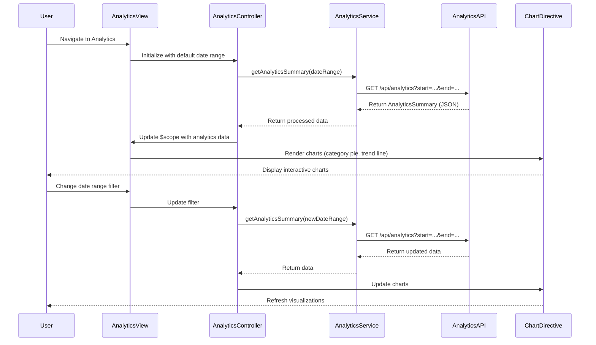

# Low-Level Design: QE-9986 - Spending Analytics and Transaction Insights

## a. Architecture Mapping

**HLD to AngularJS Artifact Mapping:**
- **User Interface** → AngularJS Module: `spendingAnalytics.module.js`
- **Analytics Service** → AngularJS Service: `analyticsService.js` (handles API calls for analytics data)
- **Transaction Data Service** → REST API integration via `$http` in `transactionDataService.js`
- **Analytics Engine** → REST API integration + client-side Factory: `analyticsProcessorFactory.js` (client-side aggregations)
- **Chart Rendering Library** → AngularJS Directive: `spendingChart.directive.js` (wraps Chart.js or D3.js)
- **Category Classification Module** → Server-side API (consumed via `analyticsService`)
- **Transaction List UI** → AngularJS Controller: `transactionListController.js` + Directive: `transactionTable.directive.js`
- **Analytics Dashboard UI** → AngularJS Controller: `analyticsController.js` + View: `analytics.html`

**Recommended Folder Structure:**
```
app/
├── modules/
│   └── analytics/
│       ├── controllers/
│       │   ├── analyticsController.js
│       │   └── transactionListController.js
│       ├── services/
│       │   ├── analyticsService.js
│       │   └── transactionDataService.js
│       ├── factories/
│       │   └── analyticsProcessorFactory.js
│       ├── directives/
│       │   ├── spendingChart.directive.js
│       │   └── transactionTable.directive.js
│       ├── views/
│       │   ├── analytics.html
│       │   └── transactions.html
│       └── spendingAnalytics.module.js
└── assets/
    └── libs/
        └── chart.js
```

## b. Component Specifications

| Component Name | Artifact Type | Responsibility | Key Dependencies |
|----------------|---------------|----------------|------------------|
| `spendingAnalytics.module` | Module | Root module for analytics feature, declares all analytics components | `ngRoute`, `ngResource`, `chart.js` (via directive) |
| `analyticsController` | Controller | Manages analytics dashboard view, fetches category-wise and trend data, handles date range filters | `analyticsService`, `analyticsProcessorFactory`, `$scope`, `$filter` |
| `transactionListController` | Controller | Manages transaction list view, handles filtering and sorting | `transactionDataService`, `$scope`, `$filter` |
| `analyticsService` | Service | Makes REST API calls to Analytics Engine for pre-processed analytics data | `$http`, `$q` |
| `transactionDataService` | Service | Makes REST API calls to Transaction Data Service for raw transaction history | `$http`, `$q` |
| `analyticsProcessorFactory` | Factory | Performs client-side aggregations and calculations for trend analysis and category breakdowns | None (pure calculation logic) |
| `spendingChart` | Directive | Wraps Chart.js library to render interactive pie/bar/line charts for spending visualization | `Chart.js` library, `$timeout` |
| `transactionTable` | Directive | Reusable table component with sorting, filtering, and pagination for transaction list | `$filter`, `ngTable` (optional) |

## c. Data Model

**Transaction Model:**
```javascript
{
  transactionId: String,
  cardId: String,
  merchantName: String,
  category: String,  // "Food & Dining", "Fuel", "Shopping", "Travel", "Entertainment", "Utilities", "Healthcare", "Education", "Miscellaneous"
  amount: Number,
  currency: String,  // "USD", "EUR", etc.
  transactionDate: Date,
  description: String,
  status: String     // "Posted", "Pending"
}
```

**CategorySpending Model:**
```javascript
{
  category: String,
  totalAmount: Number,
  transactionCount: Number,
  percentage: Number  // % of total spending
}
```

**MonthlyTrend Model:**
```javascript
{
  month: String,      // "2024-01", "2024-02", etc.
  totalSpend: Number,
  categoryBreakdown: Array  // [CategorySpending]
}
```

**AnalyticsSummary Model:**
```javascript
{
  dateRange: { startDate: Date, endDate: Date },
  totalSpend: Number,
  categorySpending: Array,  // [CategorySpending]
  monthlyTrends: Array,     // [MonthlyTrend]
  topMerchants: Array       // [{merchantName: String, totalSpend: Number}]
}
```

## d. Data Flow

User navigates to analytics page → `analytics.html` loads and `analyticsController` initializes with default date range (last 12 months) → Controller calls `analyticsService.getAnalyticsSummary(dateRange)` which makes REST API call to Analytics Engine → API returns pre-categorized `AnalyticsSummary` object → Controller passes data to `analyticsProcessorFactory` for any additional client-side calculations (e.g., percentage calculations) → Processed data is bound to `$scope` → View renders multiple `spendingChart` directives (pie chart for category breakdown, line chart for monthly trends) using Chart.js → User can filter by date range or category, triggering new API call → Charts update reactively via two-way binding → User clicks "View Transactions" link → `transactionListController` fetches raw transactions via `transactionDataService` and displays in `transactionTable` directive with sorting/filtering.

## e. Primary Sequence Diagram



## f. Implementation Notes

- **Chart.js Integration:** Create `spendingChart` directive that accepts data model and chart type (pie, bar, line) as attributes; use directive's `link` function to initialize Chart.js instance; destroy and recreate chart on data updates using `$scope.$watch`.
- **Date Range Filtering:** Implement date picker using Bootstrap Datepicker or AngularJS UI Bootstrap; bind date range to controller scope; trigger API call on date change with debouncing (`$timeout`) to avoid excessive requests.
- **Category Constants:** Define spending categories as constant array in module config: `['Food & Dining', 'Fuel', 'Shopping', 'Travel', 'Entertainment', 'Utilities', 'Healthcare', 'Education', 'Miscellaneous']`; use for validation and dropdown filters.
- **Performance Optimization:** Implement pagination for transaction list (50 transactions per page); use virtual scrolling for large datasets; cache analytics data for current month to reduce API calls.
- **Interactive Charts:** Enable click events on chart segments to drill down into category-specific transactions; use Chart.js `onClick` callback to navigate to filtered transaction list view.

## g. Error Handling

HTTP interceptor captures API errors; display user-friendly messages for empty data states ("No transactions found") and API failures; use try/catch in chart rendering to prevent UI crashes.

## h. Security Notes

Standard input validation and secure API calls assumed; date range inputs validated to prevent injection attacks; transaction data filtered server-side by authenticated user ID.