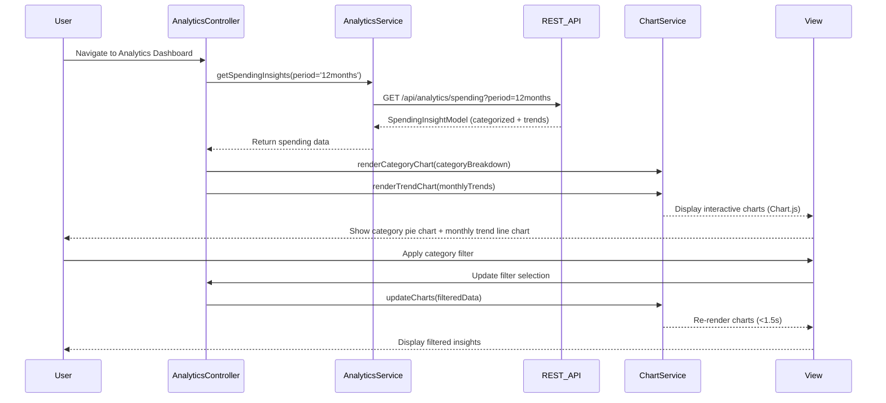

# Low-Level Design: Analytics and Spending Insights
**Epic ID:** QE-9999  
**Tech Stack:** AngularJS 1.x, JavaScript ES6, HTML5, CSS3, Bootstrap, REST APIs, MVC Architecture

---

## a. Architecture Mapping

- **Analytics Module** (`app.analytics`) → AngularJS Module for analytics and visualization features
- **AnalyticsController** → Controller managing analytics data fetching and chart rendering
- **AnalyticsService** → Service for fetching categorized transaction data and trends via REST APIs
- **ChartService** → Factory for rendering interactive charts using Chart.js or D3.js
- **categoryFilter Directive** → Directive for category selection and filtering UI

**Folder Structure:**
```
/app
  /analytics
    analytics.module.js
    analytics.controller.js
    analytics.html
  /services
    analytics.service.js
    chart.service.js
  /directives
    category-filter.directive.js
  /models
    spending-insight.model.js
```

---

## b. Component Specifications

| Component Name | Artifact Type | Responsibility | Key Dependencies |
|----------------|---------------|----------------|------------------|
| AnalyticsModule | Module | Registers analytics components and routing | ngRoute, app.services, chart.js |
| AnalyticsController | Controller | Fetches spending data, manages filters, and updates charts | AnalyticsService, ChartService, $scope |
| AnalyticsService | Service | Fetches categorized transactions and monthly trends from REST APIs | $http, $q |
| ChartService | Factory | Renders and updates interactive charts (bar, pie, line) using Chart.js | chart.js library |
| categoryFilter | Directive | Provides category selection checkboxes with two-way binding | None |
| SpendingInsightModel | Model | Defines spending data structure (categories, monthly trends, totals) | None |

---

## c. Data Model

**SpendingInsightModel (JavaScript ES6 Class):**
```javascript
class SpendingInsightModel {
  constructor() {
    this.categoryBreakdown = [];   // Array<CategorySpend>
    this.monthlyTrends = [];       // Array<MonthlySpend>
    this.totalSpend = 0;           // Number
    this.period = '';              // String (e.g., "Last 12 months")
  }
}
```

**CategorySpend:**
```javascript
{
  category: String,  // One of: Food & Dining, Fuel, Shopping, Travel, Entertainment, Utilities, Healthcare, Education, Miscellaneous
  amount: Number,
  percentage: Number,
  transactionCount: Number
}
```

**MonthlySpend:**
```javascript
{
  month: String,     // Format: "YYYY-MM"
  totalAmount: Number,
  categoryBreakdown: Array<CategorySpend>
}
```

---

## d. Data Flow

User navigates to analytics dashboard → AnalyticsController calls AnalyticsService.getSpendingInsights() → Service invokes GET `/api/analytics/spending?period=12months` → API returns SpendingInsightModel with categorized data and 12-month trends → Controller binds data to $scope → ChartService renders category pie chart and monthly trend line chart using Chart.js → User selects category filters via categoryFilter directive → Controller filters data client-side and updates ChartService → Charts re-render within 1.5 seconds → User clicks chart segment for drill-down → Controller fetches detailed transactions for selected category/month via AnalyticsService.getCategoryDetails() → View displays filtered transaction list.

---

## e. Primary Sequence Diagram



---

## f. Implementation Notes

- Integrate Chart.js library via CDN or npm; register as AngularJS dependency for chart rendering
- Use AngularJS two-way binding (`ng-model`) for category filter checkboxes with immediate chart updates
- Pre-aggregate monthly data server-side; client-side filtering for interactive drill-down to meet 1.5s render time
- ChartService exposes methods: `renderCategoryChart()`, `renderTrendChart()`, `updateCharts()` with Chart.js API
- REST API returns 12 months of pre-categorized data; client caches response for filter operations

---

## g. Error Handling

HTTP interceptor captures API errors; displays inline error messages below charts; provides retry button for failed data fetches.

---

## h. Security Notes

Standard input validation and secure API calls assumed; analytics API requires authenticated user token for data access.