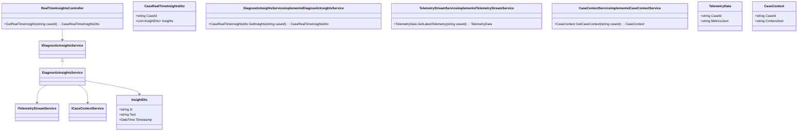
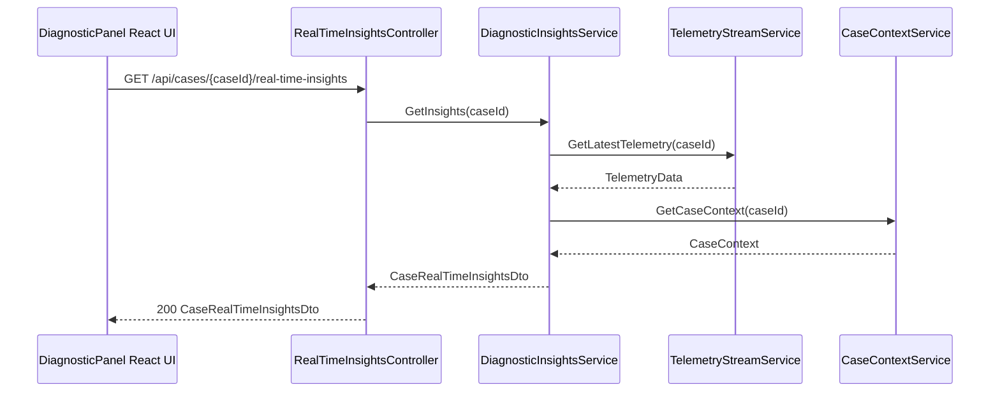
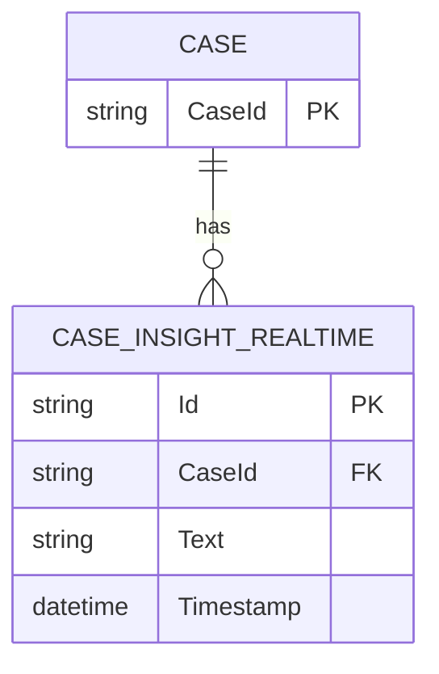

# Repository: APB_Demo
# Branch: Release1
# Folder: LLD

1. Objective
Provide real-time diagnostic insights for support agents viewing member cases in the diagnostic panel.
Update insights when the system receives new telemetry or case context changes.
Ensure refreshed AI-generated insights remain relevant to the members issue.

2. Backend C# API Details
2.1. API Model
2.1.1. Common Components/Services
- IDiagnosticInsightsService: Generates and refreshes AI-based diagnostic insights for a case.
- ITelemetryStreamService: Subscribes to telemetry updates related to member issues.
- ICaseContextService: Provides case context required to compute insights.

2.1.2. API Details
| Operation | REST Method | Type | URL | Request JSON | Response JSON |
|----------|-------------|------|-----|--------------|---------------|
| GetRealTimeInsights | GET | Query | /api/cases/{caseId}/real-time-insights | { "caseId": "string" } | { "caseId": "string", "insights": [ { "id": "string", "text": "string", "timestamp": "2024-10-11T10:00:00Z" } ] } |

2.1.3. Exceptions
- CaseNotFoundException: Thrown when caseId is invalid.
- TelemetryUnavailableException: Thrown when telemetry stream cannot be accessed.

2.2. Functional Design
2.2.1. Class Diagram

2.2.2. UML Sequence Diagram

2.2.3. Components
| Component Name | Description | Existing/New |
|----------------|-------------|--------------|
| RealTimeInsightsController | ASP.NET Core API controller exposing real-time diagnostic insights. | New |
| DiagnosticInsightsService | Service combining telemetry and case context to produce insights. | New |
| TelemetryStreamService | Service retrieving latest telemetry for cases. | New |
| CaseContextService | Service retrieving case context data. | New |

2.3. Service Layer Business Logic
Service architecture & dependency injection:
- RealTimeInsightsController depends on IDiagnosticInsightsService injected via constructor.
- DiagnosticInsightsService depends on ITelemetryStreamService and ICaseContextService via constructor.
- Services registered in ASP.NET Core DI container with scoped lifetime.

Workflow:
- RealTimeInsightsController validates caseId and calls DiagnosticInsightsService.GetInsights.
- TelemetryStreamService.GetLatestTelemetry obtains latest metrics for the case.
- CaseContextService.GetCaseContext retrieves current case context.
- DiagnosticInsightsService uses telemetry and context to call the underlying AI engine and construct InsightDto list with timestamps.

Caching strategy:
- No long-lived caching; only short-lived in-memory caching of latest telemetry per case may be used within a request.

Validation rules
| Field Name | Validation | Error Message | Class Used |
|------------|-----------|---------------|------------|
| caseId | Must not be null or empty. | "CaseId is required." | RealTimeInsightsController |

2.4. Service Integrations
| System | Integrated For | Integration Type |
|--------|----------------|------------------|
| Telemetry Platform | Provide real-time metrics for member issues. | Internal service call via ITelemetryStreamService |
| Case Management System | Provide case context. | Internal service call via ICaseContextService |
| AI Insights Engine | Generate diagnostic insights from telemetry and context. | Internal integration inside DiagnosticInsightsService |

3. Front End React Details
3.1. UI Component Architecture
- Components:
  - RealTimeInsightsSection: container within DiagnosticPanelDrawer showing real-time insights.
  - InsightFeed: renders list of InsightItem components with timestamps.
  - InsightItem: displays individual insight text and timestamp.
- Data flow:
  - RealTimeInsightsSection uses useRealTimeInsights hook to fetch CaseRealTimeInsightsDto by caseId.
  - Insights array is passed to InsightFeed as props.
- State management:
  - useRealTimeInsights maintains loading, error, and insights state; may use polling or WebSocket subscription for refresh.
- Routing:
  - Section integrated into existing diagnostic panel view.

3.2. UI Specifications
- Wireframes/pages:
  - InsightFeed shows insights ordered by timestamp descending.
  - Each insight shows relative time (e.g., "2 minutes ago") derived from timestamp.
- Responsive breakpoints:
  - On desktop, insights occupy full width within section.
  - On mobile, insights are stacked vertically with larger tap targets.
- Form structures with validation:
  - No forms introduced; read-only insights.
- User interaction patterns:
  - Auto-refresh behaviour (e.g., every 15 seconds) or via "Refresh" button.

3.3. API Integration
- HTTP client configuration:
  - useRealTimeInsights uses shared axios instance and may use setInterval for polling.
- Call patterns and error handling:
  - GET /cases/{caseId}/real-time-insights called initially and on refresh.
  - On TelemetryUnavailableException, UI displays: "Real-time telemetry is unavailable.".
  - On CaseNotFoundException, UI displays: "Case not found.".
- Loading states:
  - InsightFeed shows spinner or skeleton items during fetch.
- Data transformation:
  - Timestamp is converted to localized Date objects and relative time for display.

4. Database Details
4.1. ER Model

4.2. Database Validations
- CASE_INSIGHT_REALTIME.Timestamp must be a valid UTC datetime.
- CASE_INSIGHT_REALTIME.CaseId must reference an existing CASE.CaseId.

5. Non-Functional Requirements
5.1. Performance
- Real-time insights retrieval must complete within 500ms under normal load.

5.2. Security (Authentication & Authorization)
- API requires authenticated access with case-level permissions.

5.3. Logging (Application, Audit, Monitoring)
- Log response sizes and telemetry access failures.

6. Dependencies
- ASP.NET Core 8 backend.
- React 18 frontend.
- Axios for HTTP requests.

7. Assumptions
- Telemetry platform provides near real-time metrics accessible via ITelemetryStreamService.
- AI Insights Engine can generate insights quickly enough to support near real-time updates.
