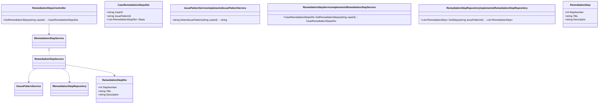
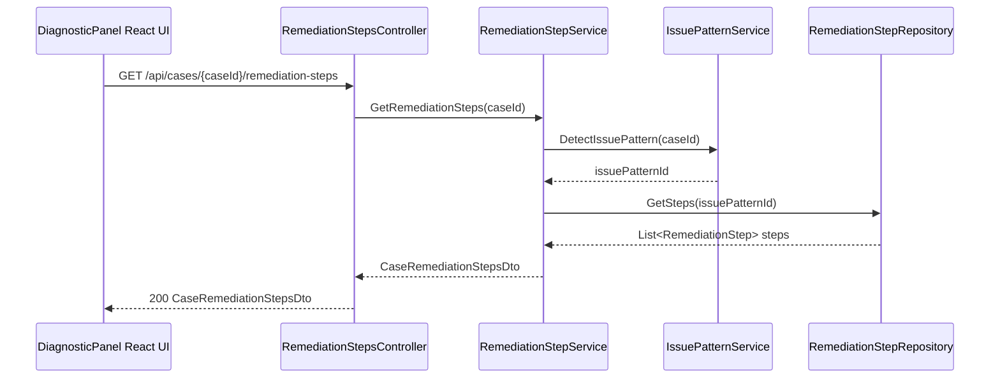
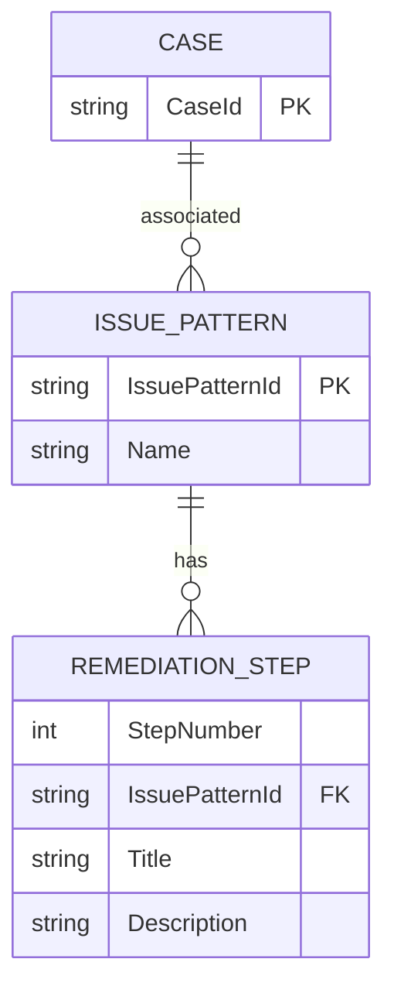

# Repository: APB_Demo
# Branch: Release1
# Folder: LLD

1. Objective
Provide AI-guided step-by-step remediation instructions for support agents.
Display ordered remediation steps tailored to the specific issue in the diagnostic panel.
Enable efficient and consistent resolution of member issues based on recognized patterns.

2. Backend C# API Details
2.1. API Model
2.1.1. Common Components/Services
- IIssuePatternService: Detects issue patterns from case data in the diagnostic panel.
- IRemediationStepService: Retrieves ordered remediation steps for recognized issue patterns.
- IRemediationStepRepository: Persists remediation step definitions and sequences.

2.1.2. API Details
| Operation | REST Method | Type | URL | Request JSON | Response JSON |
|----------|-------------|------|-----|--------------|---------------|
| GetRemediationSteps | GET | Query | /api/cases/{caseId}/remediation-steps | { "caseId": "string" } | { "caseId": "string", "issuePatternId": "string", "steps": [ { "stepNumber": 1, "title": "string", "description": "string" } ] } |

2.1.3. Exceptions
- CaseNotFoundException: Thrown when caseId does not exist.
- IssuePatternNotRecognizedException: Thrown when no issue pattern is detected for the case.

2.2. Functional Design
2.2.1. Class Diagram

2.2.2. UML Sequence Diagram

2.2.3. Components
| Component Name | Description | Existing/New |
|----------------|-------------|--------------|
| RemediationStepsController | ASP.NET Core API controller exposing remediation steps for a case. | New |
| IssuePatternService | Service detecting issue patterns for the case. | New |
| RemediationStepService | Service assembling ordered remediation steps for recognized patterns. | New |
| RemediationStepRepository | Service retrieving remediation step definitions. | New |

2.3. Service Layer Business Logic
Service architecture & dependency injection:
- RemediationStepsController depends on IRemediationStepService injected via constructor.
- RemediationStepService depends on IIssuePatternService and IRemediationStepRepository via constructor.
- Services registered in ASP.NET Core DI container with scoped lifetime.

Workflow:
- RemediationStepsController validates caseId and calls RemediationStepService.GetRemediationSteps.
- IssuePatternService.DetectIssuePattern determines issuePatternId for the case based on AI analysis.
- RemediationStepRepository.GetSteps retrieves ordered remediation steps for the pattern.
- RemediationStepService constructs CaseRemediationStepsDto from the retrieved steps, ensuring sequential StepNumber values.

Caching strategy:
- RemediationStep definitions for each issuePatternId may be cached in memory to reduce repeated lookups.

Validation rules
| Field Name | Validation | Error Message | Class Used |
|------------|-----------|---------------|------------|
| caseId | Must not be null or empty. | "CaseId is required." | RemediationStepsController |
| StepNumber | Must be greater than 0 and unique per issuePatternId. | "StepNumber must be positive and unique." | RemediationStepService |

2.4. Service Integrations
| System | Integrated For | Integration Type |
|--------|----------------|------------------|
| AI Issue Pattern Engine | Detect issue patterns for a case. | Internal service call via IIssuePatternService |
| Remediation Knowledge Base | Store remediation step definitions. | Internal service call via IRemediationStepRepository |

3. Front End React Details
3.1. UI Component Architecture
- Components:
  - RemediationStepsSection: container within DiagnosticPanelDrawer showing remediation steps.
  - RemediationStepList: renders ordered list of RemediationStepItem components.
  - RemediationStepItem: displays title, description, and step number.
- Data flow:
  - RemediationStepsSection uses useRemediationSteps hook to fetch CaseRemediationStepsDto by caseId.
  - RemediationStepList receives steps and issuePatternId as props.
  - RemediationStepItem renders each step with stepNumber.
- State management:
  - useRemediationSteps manages loading, error, and steps data in React state.
- Routing:
  - Section is part of diagnostic panel view, no additional routes.

3.2. UI Specifications
- Wireframes/pages:
  - Steps are displayed as a numbered list, each with title and description.
  - Issue pattern label shown above the list (e.g., "Pattern: Connectivity issue").
- Responsive breakpoints:
  - On desktop, steps are rendered in full width with clear separation.
  - On mobile, step titles are bold and descriptions wrap underneath for readability.
- Form structures with validation:
  - No new forms introduced; steps are read-only.
- User interaction patterns:
  - Agents can mark steps as completed locally (visual indicator) without affecting backend.

3.3. API Integration
- HTTP client configuration:
  - useRemediationSteps uses shared axios instance with baseURL "/api".
- Call patterns and error handling:
  - GET /cases/{caseId}/remediation-steps is invoked when diagnostic panel loads or caseId changes.
  - On CaseNotFoundException, UI displays: "No remediation steps available for this case.".
  - On IssuePatternNotRecognizedException, UI displays: "No recognized issue pattern for this case.".
- Loading states:
  - RemediationStepList shows skeleton list items while loading.
- Data transformation:
  - API response is mapped directly to RemediationStepViewModel objects for rendering.

4. Database Details
4.1. ER Model

4.2. Database Validations
- REMEDIATION_STEP.StepNumber must be unique within each IssuePatternId.
- REMEDIATION_STEP.Title must be non-empty.
- ISSUE_PATTERN.IssuePatternId must be non-empty.

5. Non-Functional Requirements
5.1. Performance
- Retrieval of remediation steps must complete within 700ms for typical issue patterns.

5.2. Security (Authentication & Authorization)
- API access restricted to authenticated agents with case access rights.

5.3. Logging (Application, Audit, Monitoring)
- Log detected issuePatternId and number of steps returned for each API call.

6. Dependencies
- ASP.NET Core 8 backend.
- React 18 frontend.
- Axios HTTP client.

7. Assumptions
- An AI Issue Pattern Engine exists and can provide a deterministic issuePatternId per case.
- Remediation steps are static per issue pattern and maintained in a central knowledge base.
