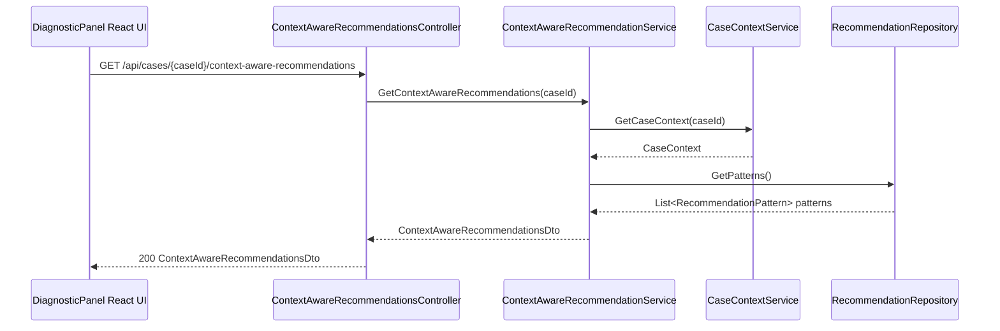
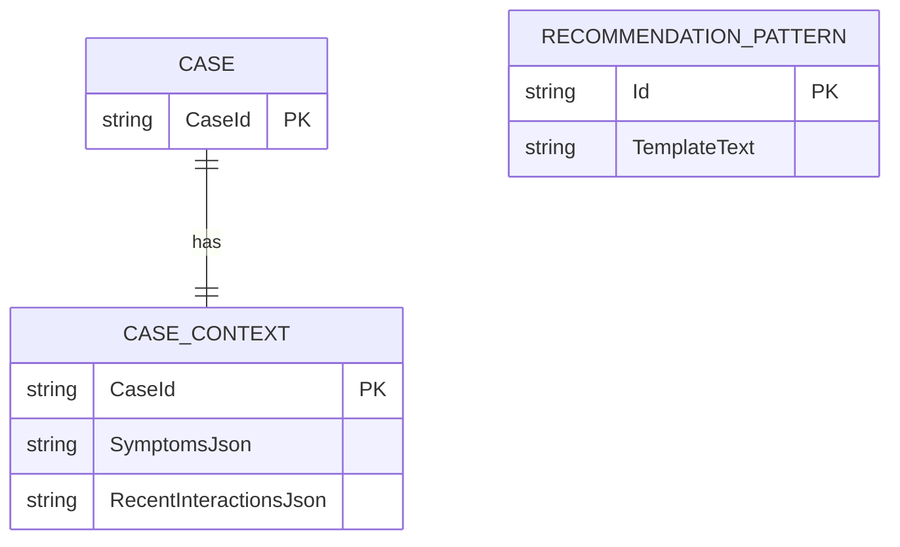

# Repository: APB_Demo
# Branch: Release1
# Folder: LLD

1. Objective
Provide context-aware recommendations so guidance is relevant to the members current situation.
Ensure AI-based insights reference the members documented symptoms and recent interactions for a given case.
Avoid generic guidance by incorporating case-specific context into recommendation generation and display.

2. Backend C# API Details
2.1. API Model
2.1.1. Common Components/Services
- ICaseContextService: Retrieves case details including symptoms and recent interactions.
- IContextAwareRecommendationService: Generates recommendations that explicitly reference current case context.
- IRecommendationRepository: Fetches base recommendation templates or patterns from the AI engine.

2.1.2. API Details
| Operation | REST Method | Type | URL | Request JSON | Response JSON |
|----------|-------------|------|-----|--------------|---------------|
| GetContextAwareRecommendations | GET | Query | /api/cases/{caseId}/context-aware-recommendations | { "caseId": "string" } | { "caseId": "string", "symptoms": ["string"], "recentInteractions": ["string"], "recommendations": [ { "id": "string", "text": "string", "referencedSymptoms": ["string"], "referencedInteractions": ["string"] } ] } |

2.1.3. Exceptions
- CaseNotFoundException: Thrown when the caseId does not exist.
- CaseContextUnavailableException: Thrown when symptoms or interactions cannot be retrieved.

2.2. Functional Design
2.2.1. Class Diagram

```mermaid
classDiagram
    class ContextAwareRecommendationsController {
        +GetContextAwareRecommendations(string caseId) : ContextAwareRecommendationsDto
    }

    class ContextAwareRecommendationsDto {
        +string CaseId
        +List~string~ Symptoms
        +List~string~ RecentInteractions
        +List~RecommendationDto~ Recommendations
    }

    class RecommendationDto {
        +string Id
        +string Text
        +List~string~ ReferencedSymptoms
        +List~string~ ReferencedInteractions
    }

    class CaseContextService implements ICaseContextService {
        +CaseContext GetCaseContext(string caseId) : CaseContext
    }

    class ContextAwareRecommendationService implements IContextAwareRecommendationService {
        +ContextAwareRecommendationsDto GetContextAwareRecommendations(string caseId) : ContextAwareRecommendationsDto
    }

    class RecommendationRepository implements IRecommendationRepository {
        +List~RecommendationPattern~ GetPatterns() : List~RecommendationPattern~
    }

    class RecommendationPattern {
        +string Id
        +string TemplateText
    }

    class CaseContext {
        +string CaseId
        +List~string~ Symptoms
        +List~string~ RecentInteractions
    }

    ContextAwareRecommendationsController --> IContextAwareRecommendationService
    IContextAwareRecommendationService <|.. ContextAwareRecommendationService
    ContextAwareRecommendationService --> ICaseContextService
    ContextAwareRecommendationService --> IRecommendationRepository
    CaseContextService --> CaseContext
    ContextAwareRecommendationService --> RecommendationDto
```

2.2.2. UML Sequence Diagram

2.2.3. Components
| Component Name | Description | Existing/New |
|----------------|-------------|--------------|
| ContextAwareRecommendationsController | ASP.NET Core API controller exposing context-aware recommendations. | New |
| CaseContextService | Service retrieving case symptoms and recent interactions. | New |
| ContextAwareRecommendationService | Service generating recommendations referencing current context. | New |
| RecommendationRepository | Service fetching base recommendation patterns from AI engine. | New |

2.3. Service Layer Business Logic
Service architecture & dependency injection:
- ContextAwareRecommendationsController depends on IContextAwareRecommendationService injected via constructor.
- ContextAwareRecommendationService depends on ICaseContextService and IRecommendationRepository via constructor.
- Services registered in ASP.NET Core DI container with scoped lifetime.

Workflow:
- ContextAwareRecommendationsController validates caseId and delegates to ContextAwareRecommendationService.GetContextAwareRecommendations.
- CaseContextService.GetCaseContext retrieves symptoms and recent interactions for the case.
- RecommendationRepository.GetPatterns retrieves generic recommendation patterns.
- ContextAwareRecommendationService combines CaseContext and patterns to create RecommendationDto items that incorporate referencedSymptoms and referencedInteractions for each recommendation.

Caching strategy:
- Recommendation patterns may be cached in memory for reuse across cases, while case-specific context is always fresh per request.

Validation rules
| Field Name | Validation | Error Message | Class Used |
|------------|-----------|---------------|------------|
| caseId | Must not be null or empty. | "CaseId is required." | ContextAwareRecommendationsController |
| Symptoms | Must contain at least one symptom string to generate context-aware recommendations. | "Symptoms are required for context-aware recommendations." | ContextAwareRecommendationService |

2.4. Service Integrations
| System | Integrated For | Integration Type |
|--------|----------------|------------------|
| Case Management System | Retrieve case symptoms and recent interactions. | Internal service call via ICaseContextService |
| AI Recommendation Engine | Provide base recommendation patterns. | Internal service call via IRecommendationRepository |

3. Front End React Details
3.1. UI Component Architecture
- Components:
  - ContextAwareRecommendationsSection: container within DiagnosticPanelDrawer displaying recommendations.
  - RecommendationList: renders list of RecommendationItem components.
  - RecommendationItem: displays recommendation text along with referenced symptoms and interactions.
- Data flow:
  - ContextAwareRecommendationsSection uses useContextAwareRecommendations hook to fetch ContextAwareRecommendationsDto by caseId.
  - Recommendations and context arrays are passed to RecommendationList and RecommendationItem as props.
- State management:
  - useContextAwareRecommendations manages loading, error, and data state internally.
- Routing:
  - Section is integrated into existing diagnostic panel view; no new routes.

3.2. UI Specifications
- Wireframes/pages:
  - Each RecommendationItem shows main recommendation text.
  - Below the text, badges or labels list referenced symptoms and recent interactions (e.g., "Symptom: high latency", "Interaction: call on 2024-10-01").
- Responsive breakpoints:
  - On desktop, symptoms and interactions are shown as inline chips.
  - On mobile, chips wrap onto multiple lines for readability.
- Form structures with validation:
  - No forms added; recommendations are read-only.
- User interaction patterns:
  - Agents can expand/collapse recommendation details if many symptoms/interactions are referenced.

3.3. API Integration
- HTTP client configuration:
  - useContextAwareRecommendations uses shared axios instance with baseURL "/api".
- Call patterns and error handling:
  - GET /cases/{caseId}/context-aware-recommendations is called when diagnostic panel opens or caseId changes.
  - On CaseNotFoundException, UI displays: "No recommendations available for this case.".
  - On CaseContextUnavailableException, UI displays: "Case context is temporarily unavailable.".
- Loading states:
  - RecommendationList shows skeleton cards during data loading.
- Data transformation:
  - API response is mapped to RecommendationViewModel including text, referencedSymptoms, and referencedInteractions for display.

4. Database Details
4.1. ER Model

4.2. Database Validations
- CASE_CONTEXT.CaseId must reference an existing CASE.CaseId.
- CASE_CONTEXT.SymptomsJson and CASE_CONTEXT.RecentInteractionsJson must contain valid JSON arrays of strings.
- RECOMMENDATION_PATTERN.TemplateText must be non-empty.

5. Non-Functional Requirements
5.1. Performance
- Generating context-aware recommendations must complete within 1 second for typical cases.

5.2. Security (Authentication & Authorization)
- Access to case context and recommendations must be limited to authenticated agents with case-level permissions.

5.3. Logging (Application, Audit, Monitoring)
- Log number of referenced symptoms and interactions per recommendation to monitor context usage.

6. Dependencies
- ASP.NET Core 8 for backend.
- React 18 for UI.
- Axios for HTTP calls.

7. Assumptions
- Case management system stores symptoms and interactions in a structured form accessible via ICaseContextService.
- The AI Recommendation Engine can consume case context and patterns to produce recommendations that reference provided symptoms and interactions.
