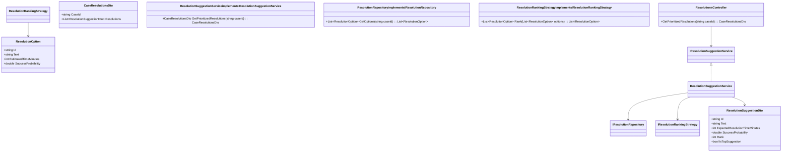
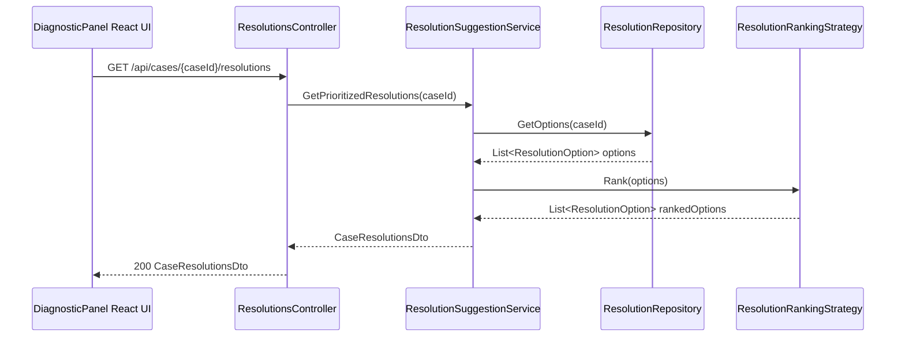
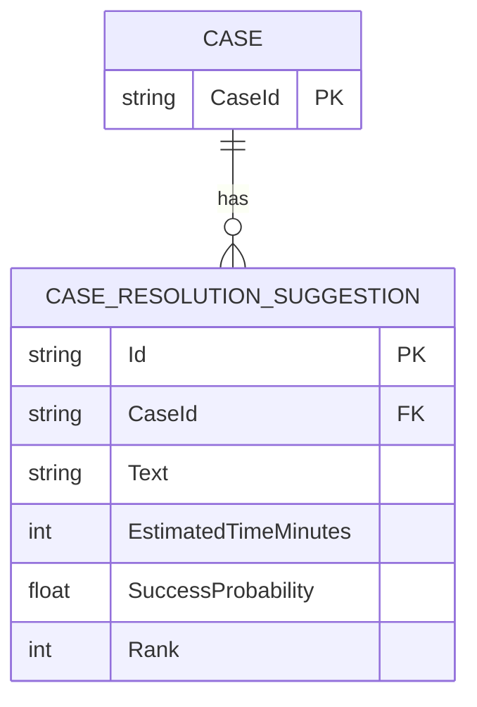

# Repository: APB_Demo
# Branch: Release1
# Folder: LLD

1. Objective
Provide support agents with resolution suggestions prioritized by efficiency to minimize handling time while maintaining quality.
Order AI-generated remediation options by expected time to resolve and likelihood of success in the diagnostic panel.
Highlight the top recommendation clearly so agents can quickly identify the best option.

2. Backend C# API Details
2.1. API Model
2.1.1. Common Components/Services
- IResolutionSuggestionService: Calculates prioritized resolution suggestions based on efficiency metrics.
- IResolutionRepository: Retrieves raw remediation options from the AI engine for a case.
- IResolutionRankingStrategy: Encapsulates ranking logic using expected resolution time and success likelihood.

2.1.2. API Details
| Operation | REST Method | Type | URL | Request JSON | Response JSON |
|----------|-------------|------|-----|--------------|---------------|
| GetPrioritizedResolutions | GET | Query | /api/cases/{caseId}/resolutions | { "caseId": "string" } | { "caseId": "string", "resolutions": [ { "id": "string", "text": "string", "expectedResolutionTimeMinutes": 10, "successProbability": 0.9, "rank": 1, "isTopSuggestion": true } ] } |

2.1.3. Exceptions
- CaseNotFoundException: Thrown when caseId has no remediation suggestions.
- ResolutionDataUnavailableException: Thrown when AI-generated remediation data cannot be retrieved.

2.2. Functional Design
2.2.1. Class Diagram

2.2.2. UML Sequence Diagram

2.2.3. Components
| Component Name | Description | Existing/New |
|----------------|-------------|--------------|
| ResolutionsController | ASP.NET Core API controller exposing prioritized resolution suggestions. | New |
| ResolutionSuggestionService | Service orchestrating retrieval and ranking of resolution options. | New |
| ResolutionRepository | Service fetching raw AI-generated remediation options. | New |
| ResolutionRankingStrategy | Service encapsulating ranking logic based on efficiency metrics. | New |

2.3. Service Layer Business Logic
Service architecture & dependency injection:
- ResolutionsController depends on IResolutionSuggestionService injected via constructor.
- ResolutionSuggestionService depends on IResolutionRepository and IResolutionRankingStrategy injected via constructor.
- Services registered in ASP.NET Core DI container with scoped lifetime.

Workflow:
- ResolutionsController validates caseId and calls ResolutionSuggestionService.GetPrioritizedResolutions.
- ResolutionRepository.GetOptions retrieves ResolutionOption list for the case.
- ResolutionRankingStrategy.Rank orders options based on a composite score derived from EstimatedTimeMinutes (ascending) and SuccessProbability (descending).
- ResolutionSuggestionService maps ranked ResolutionOption entities to ResolutionSuggestionDto objects, assigns Rank based on order, and sets IsTopSuggestion = true for Rank 1.

Caching strategy:
- Resolutions for a given case are not cached to allow AI updates; responses rely on fresh data per request.

Validation rules
| Field Name | Validation | Error Message | Class Used |
|------------|-----------|---------------|------------|
| caseId | Must not be null or empty. | "CaseId is required." | ResolutionsController |
| EstimatedTimeMinutes | Must be greater than 0. | "Estimated resolution time must be positive." | ResolutionRankingStrategy |
| SuccessProbability | Must be between 0.0 and 1.0. | "Success probability must be between 0 and 1." | ResolutionRankingStrategy |

2.4. Service Integrations
| System | Integrated For | Integration Type |
|--------|----------------|------------------|
| AI Remediation Engine | Retrieve AI-generated remediation options per case. | Internal service call via IResolutionRepository |

3. Front End React Details
3.1. UI Component Architecture
- Components:
  - ResolutionSuggestionsSection: container within DiagnosticPanelDrawer showing resolution suggestions.
  - ResolutionSuggestionList: displays list of ResolutionSuggestionItem components.
  - ResolutionSuggestionItem: renders individual suggestion with efficiency details and highlight for top suggestion.
- Data flow:
  - ResolutionSuggestionsSection uses useResolutionSuggestions hook to fetch CaseResolutionsDto.
  - CaseResolutionsDto.Resolutions is passed to ResolutionSuggestionList as props.
  - ResolutionSuggestionItem receives ResolutionSuggestionDto including IsTopSuggestion and highlights accordingly.
- State management:
  - useResolutionSuggestions manages loading, error, and data state via useState.
- Routing:
  - Section is rendered within existing diagnostic panel view, no additional routes.

3.2. UI Specifications
- Wireframes/pages:
  - ResolutionSuggestionItem shows suggestion text, expectedResolutionTimeMinutes (e.g., "~10 min"), and successProbability (e.g., "90% success").
  - Top suggestion has a distinct visual treatment (e.g., border and "Top suggestion" label).
- Responsive breakpoints:
  - On desktop, suggestions are shown in a vertical list with full details.
  - On mobile, some secondary text (e.g., successProbability) can be wrapped below the main line for readability.
- Form structures with validation:
  - No forms introduced; suggestions are read-only.
- User interaction patterns:
  - Clicking a suggestion may expand a detail area (optional) showing additional explanation text if available.

3.3. API Integration
- HTTP client configuration:
  - useResolutionSuggestions uses shared axios instance with baseURL "/api".
- Call patterns and error handling:
  - GET /cases/{caseId}/resolutions is called when diagnostic panel loads or caseId changes.
  - On CaseNotFoundException, UI displays: "No resolution suggestions available for this case.".
  - On ResolutionDataUnavailableException, UI displays: "Resolution suggestions are temporarily unavailable.".
- Loading states:
  - ResolutionSuggestionList shows skeleton rows while fetching data.
- Data transformation:
  - API response is mapped to ResolutionSuggestionViewModel objects without additional transformation aside from formatting values for display.

4. Database Details
4.1. ER Model

4.2. Database Validations
- CASE_RESOLUTION_SUGGESTION.EstimatedTimeMinutes must be greater than 0.
- CASE_RESOLUTION_SUGGESTION.SuccessProbability must be between 0.0 and 1.0.
- CASE_RESOLUTION_SUGGESTION.CaseId must reference an existing CASE.CaseId.

5. Non-Functional Requirements
5.1. Performance
- API response time for resolution suggestions should be under 700ms for up to 20 options.

5.2. Security (Authentication & Authorization)
- API must require an authenticated user with access to the case.

5.3. Logging (Application, Audit, Monitoring)
- Log number of suggestions and identity of top suggestion per response for monitoring efficiency outcomes.

6. Dependencies
- ASP.NET Core 8 for backend API.
- React 18 for UI components.
- Axios for HTTP calls.

7. Assumptions
- The AI Remediation Engine provides estimated time and success probability for each remediation option.
- Ranking strategy uses a simple weighted combination of time and success probability and can be adjusted later without API changes.
