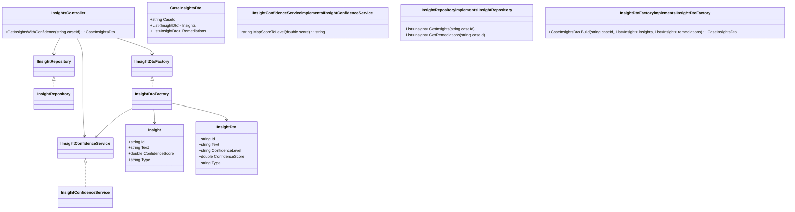
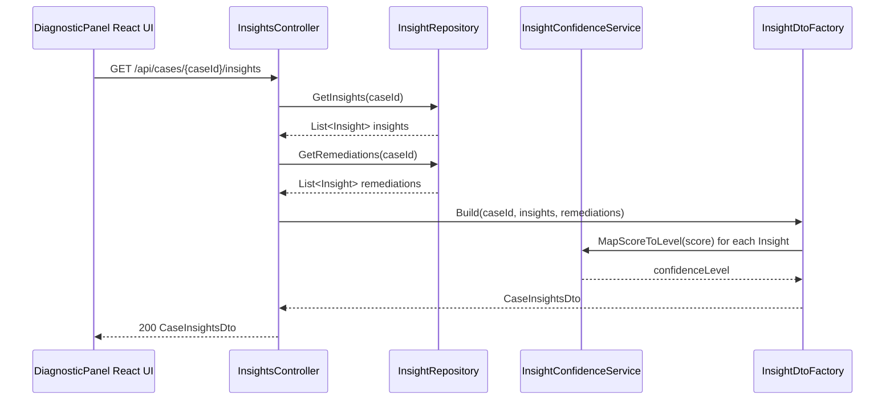
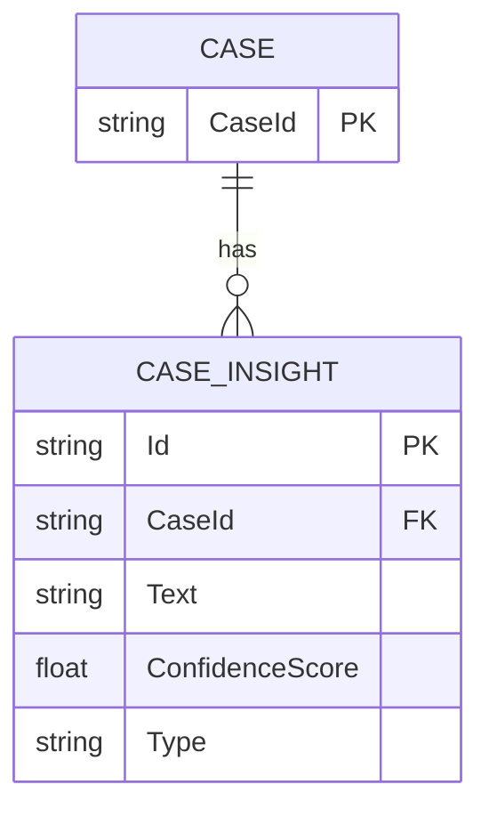

# Repository: APB_Demo
# Branch: Release1
# Folder: LLD

1. Objective
Provide support agents with confidence indicators on AI-generated insights so they can judge reliability for each suggestion.
Display confidence levels (high, medium, low) for diagnostic insights and remediation steps within the diagnostic panel.
Ensure the confidence indicators are derived from the models internal scoring in a consistent and interpretable manner.

2. Backend C# API Details
2.1. API Model
2.1.1. Common Components/Services
- IInsightConfidenceService: Maps model confidence scores to human-readable confidence levels.
- IInsightRepository: Retrieves AI-generated diagnostic insights and remediation steps for a case.
- IInsightDtoFactory: Builds DTOs including confidence indicators from domain objects.

2.1.2. API Details
| Operation | REST Method | Type | URL | Request JSON | Response JSON |
|----------|-------------|------|-----|--------------|---------------|
| GetInsightsWithConfidence | GET | Query | /api/cases/{caseId}/insights | { "caseId": "string" } | { "caseId": "string", "insights": [ { "id": "string", "text": "string", "confidenceLevel": "high", "confidenceScore": 0.92, "type": "diagnostic" } ], "remediations": [ { "id": "string", "text": "string", "confidenceLevel": "medium", "confidenceScore": 0.76, "type": "remediation" } ] } |

2.1.3. Exceptions
- CaseNotFoundException: Thrown when the caseId has no associated insights.
- InsightDataUnavailableException: Thrown when AI model outputs are unavailable.

2.2. Functional Design
2.2.1. Class Diagram

2.2.2. UML Sequence Diagram

2.2.3. Components
| Component Name | Description | Existing/New |
|----------------|-------------|--------------|
| InsightsController | ASP.NET Core API controller exposing insights with confidence indicators. | New |
| InsightRepository | Service fetching AI-generated insights and remediation steps for a case. | New |
| InsightConfidenceService | Service mapping numeric model scores to confidence levels. | New |
| InsightDtoFactory | Service constructing CaseInsightsDto with confidence metadata. | New |

2.3. Service Layer Business Logic
Service architecture & dependency injection:
- InsightsController depends on IInsightRepository, IInsightConfidenceService, and IInsightDtoFactory injected via constructor.
- InsightDtoFactory depends on IInsightConfidenceService to enrich DTOs.
- Register services in ASP.NET Core DI container with scoped lifetime.

Workflow:
- InsightsController validates caseId and retrieves lists of insights and remediations using InsightRepository.
- InsightDtoFactory.Build creates InsightDto objects from Insight domain entities.
- For each Insight, InsightConfidenceService.MapScoreToLevel converts ConfidenceScore to ConfidenceLevel ("high", "medium", "low").
- CaseInsightsDto is returned to the UI containing both diagnostic and remediation entries with confidence indicators.

Caching strategy:
- Insights are not cached to ensure near real-time reflection of AI outputs; caching may be added later if required.

Validation rules
| Field Name | Validation | Error Message | Class Used |
|------------|-----------|---------------|------------|
| caseId | Must not be null or empty. | "CaseId is required." | InsightsController |
| ConfidenceScore | Must be between 0.0 and 1.0. | "ConfidenceScore must be between 0 and 1." | InsightConfidenceService |

2.4. Service Integrations
| System | Integrated For | Integration Type |
|--------|----------------|------------------|
| AI Insight Engine | Retrieve raw diagnostic insights and remediation data. | Internal service call via IInsightRepository |

3. Front End React Details
3.1. UI Component Architecture
- Components:
  - DiagnosticPanelDrawer: container showing insights and remediation steps.
  - InsightList: lists diagnostic insights with confidence indicators.
  - RemediationList: lists remediation steps with confidence indicators.
  - InsightConfidenceBadge: visual badge component showing confidenceLevel and optionally ConfidenceScore.
- Data flow:
  - DiagnosticPanelDrawer uses useCaseInsights hook to fetch CaseInsightsDto by caseId.
  - CaseInsightsDto is passed to InsightList and RemediationList as props.
  - InsightList and RemediationList render InsightConfidenceBadge for each entry.
- State management:
  - useCaseInsights maintains loading, error, and data state internally via useState.
- Routing:
  - No new routes; components are used within existing diagnostic panel route/view.

3.2. UI Specifications
- Wireframes/pages:
  - Each insight row displays the insight text and a confidence badge on the right (e.g., "High", "Medium", "Low").
  - Remediation steps are displayed similarly with confidence badges.
- Responsive breakpoints:
  - Confidence badges remain right-aligned on desktop and tablet; on mobile, they appear below the text for readability.
- Form structures with validation:
  - No forms introduced; read-only display of insights and confidence indicators.
- User interaction patterns:
  - Hovering over InsightConfidenceBadge shows a tooltip with the numeric ConfidenceScore.

3.3. API Integration
- HTTP client configuration:
  - useCaseInsights uses shared axios instance with baseURL "/api".
- Call patterns and error handling:
  - GET /cases/{caseId}/insights is invoked when the diagnostic panel is opened or caseId changes.
  - On CaseNotFoundException, the UI displays a message: "No insights available for this case.".
  - On InsightDataUnavailableException, the UI displays a message: "Insight data is temporarily unavailable.".
- Loading states:
  - InsightList and RemediationList show skeleton rows while data is loading.
- Data transformation:
  - API response is mapped 1:1 into local InsightViewModel objects, preserving ConfidenceLevel and ConfidenceScore for UI rendering.

4. Database Details
4.1. ER Model

4.2. Database Validations
- CASE_INSIGHT.ConfidenceScore must be between 0.0 and 1.0.
- CASE_INSIGHT.Type must be either "diagnostic" or "remediation".
- CASE_INSIGHT.CaseId must reference an existing CASE.CaseId.

5. Non-Functional Requirements
5.1. Performance
- Retrieving insights with confidence must respond within 700ms for up to 50 insights per case.

5.2. Security (Authentication & Authorization)
- API requires authenticated agents with access to the associated case.

5.3. Logging (Application, Audit, Monitoring)
- Log confidence mapping rule usage with counts of high, medium, and low levels per response for monitoring.

6. Dependencies
- ASP.NET Core 8 for backend API.
- React 18 for DiagnosticPanelDrawer and related components.
- Axios for API calls.

7. Assumptions
- The AI Insight Engine already produces numeric confidence scores for each insight and remediation step.
- Confidence levels are simply derived from numeric scores with static thresholds (e.g., high >= 0.8, medium >= 0.5, low < 0.5).
