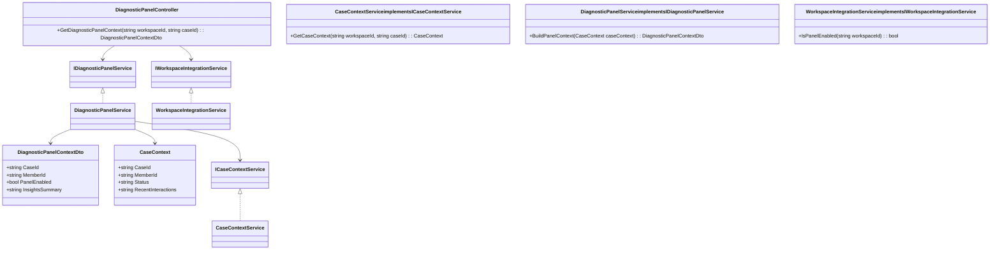
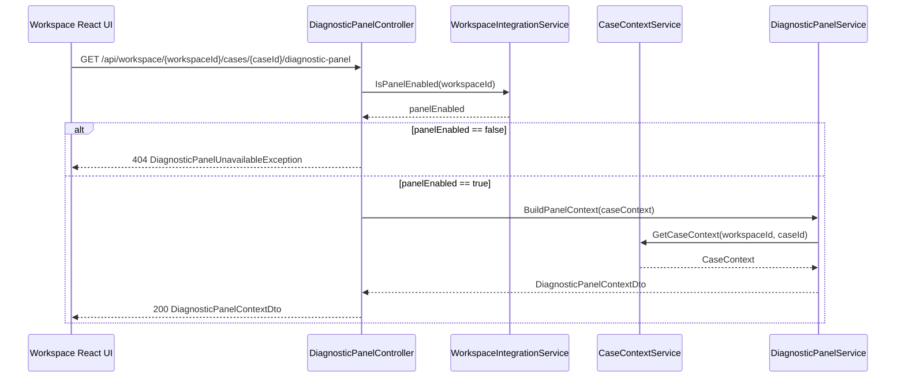
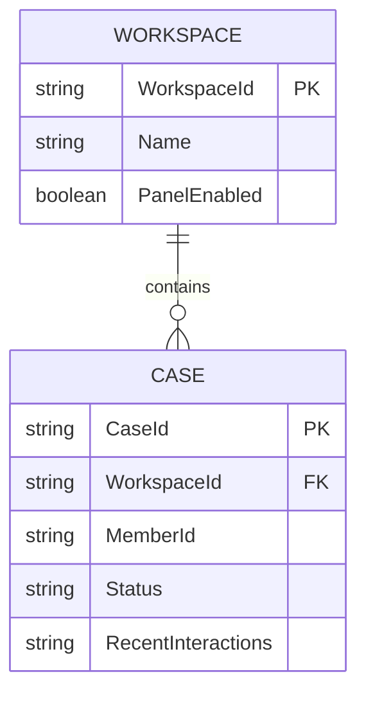

# Repository: APB_Demo
# Branch: Release1
# Folder: LLD

1. Objective
As a support agent, integrate the AI-assisted diagnostic panel into the existing case handling workspace so insights are available without switching tools.
Enable opening the diagnostic panel directly from an active member case within the primary workspace.
Maintain a seamless user experience and consistent navigation between the workspace and the diagnostic panel.

2. Backend C# API Details
2.1. API Model
2.1.1. Common Components/Services
- ICaseContextService: Provides case context (member ID, case ID, status, recent interactions) for the current workspace session.
- IDiagnosticPanelService: Orchestrates retrieval of diagnostic insights and remediation suggestions for a given member case.
- IWorkspaceIntegrationService: Manages mapping between the standard case handling workspace UI and backend APIs for the diagnostic panel.

2.1.2. API Details
| Operation | REST Method | Type | URL | Request JSON | Response JSON |
|----------|-------------|------|-----|--------------|---------------|
| GetDiagnosticPanelContext | GET | Query | /api/workspace/{workspaceId}/cases/{caseId}/diagnostic-panel | { "workspaceId": "string", "caseId": "string" } | { "caseId": "string", "memberId": "string", "panelEnabled": true, "insightsSummary": "string" } |

2.1.3. Exceptions
- CaseNotFoundException: Thrown when the specified caseId does not exist in the workspace.
- WorkspaceNotFoundException: Thrown when the workspaceId is invalid or not active.
- DiagnosticPanelUnavailableException: Thrown when the diagnostic panel feature is disabled or temporarily unavailable.

2.2. Functional Design
2.2.1. Class Diagram

2.2.2. UML Sequence Diagram

2.2.3. Components
| Component Name | Description | Existing/New |
|----------------|-------------|--------------|
| DiagnosticPanelController | ASP.NET Core API controller exposing diagnostic panel context to the workspace UI. | New |
| CaseContextService | Service retrieving case and member context for the workspace. | New |
| DiagnosticPanelService | Service assembling diagnostic panel context for given case. | New |
| WorkspaceIntegrationService | Service controlling feature availability per workspace and integration configuration. | New |

2.3. Service Layer Business Logic
Service architecture & dependency injection:
- DiagnosticPanelController depends on IDiagnosticPanelService and IWorkspaceIntegrationService injected via constructor.
- DiagnosticPanelService depends on ICaseContextService injected via constructor.
- All services registered in ASP.NET Core DI container with scoped lifetime.

Workflow:
- When the UI requests diagnostic panel context, DiagnosticPanelController validates workspaceId and caseId.
- WorkspaceIntegrationService.IsPanelEnabled determines if the panel is available for the workspace.
- CaseContextService.GetCaseContext retrieves case details and member context.
- DiagnosticPanelService.BuildPanelContext uses CaseContext to populate DiagnosticPanelContextDto including InsightsSummary placeholder.

Caching strategy:
- CaseContextService caches case context per caseId in memory for the duration of the request to avoid repeated data lookups.

Validation rules
| Field Name | Validation | Error Message | Class Used |
|------------|-----------|---------------|------------|
| workspaceId | Must not be null or empty. | "WorkspaceId is required." | DiagnosticPanelController |
| caseId | Must not be null or empty. | "CaseId is required." | DiagnosticPanelController |

2.4. Service Integrations
| System | Integrated For | Integration Type |
|--------|----------------|------------------|
| Case Management System | Retrieve case and member context for the workspace. | Internal service call via ICaseContextService |
| Feature Configuration Store | Determine if diagnostic panel feature is enabled per workspace. | Internal service call via IWorkspaceIntegrationService |

3. Front End React Details
3.1. UI Component Architecture
- Components:
  - WorkspaceLayout: existing shell for the standard case handling workspace.
  - CaseViewPanel: displays the active member case details.
  - DiagnosticPanelToggleButton: button within CaseViewPanel to open the diagnostic panel.
  - DiagnosticPanelDrawer: side drawer component displaying diagnostic panel content.
- Data flow:
  - WorkspaceLayout passes selected caseId and workspaceId as props to CaseViewPanel.
  - CaseViewPanel invokes useDiagnosticPanel hook to fetch DiagnosticPanelContextDto when DiagnosticPanelToggleButton is clicked.
  - DiagnosticPanelDrawer receives DiagnosticPanelContextDto as props and renders the panel state.
- State management:
  - Local React state within CaseViewPanel manages isDiagnosticPanelOpen and panelContext.
- Routing:
  - Diagnostic panel is rendered as an in-page drawer in the existing case route path (e.g., /workspace/:workspaceId/cases/:caseId) without adding new routes.

3.2. UI Specifications
- Wireframes/pages:
  - CaseViewPanel includes a new "Diagnostic Panel" button aligned with existing action buttons.
  - DiagnosticPanelDrawer slides in from the right side within the same workspace page.
- Responsive breakpoints:
  - On desktop (≥1024px), DiagnosticPanelDrawer occupies 30% of viewport width.
  - On tablet (768–1023px), DiagnosticPanelDrawer occupies 50% of viewport width.
  - On mobile (<768px), DiagnosticPanelDrawer overlays full width.
- Form structures with validation:
  - No new forms; interactions are limited to opening/closing the diagnostic panel.
- User interaction patterns:
  - Clicking DiagnosticPanelToggleButton fetches panel context and opens the drawer.
  - Closing the drawer returns the agent to the full case view without navigation change.

3.3. API Integration
- HTTP client configuration:
  - Use a shared axios instance configured with baseURL "/api" and workspace authentication headers.
- Call patterns and error handling:
  - useDiagnosticPanel hook calls GET /workspace/{workspaceId}/cases/{caseId}/diagnostic-panel.
  - On 404 DiagnosticPanelUnavailableException, UI shows a non-blocking banner: "Diagnostic panel is not available for this workspace.".
  - On CaseNotFoundException or WorkspaceNotFoundException, UI shows an inline error message and keeps drawer closed.
- Loading states:
  - DiagnosticPanelDrawer shows a loading spinner while the request is in progress.
- Data transformation:
  - Response data is mapped directly to panelContext state (caseId, memberId, panelEnabled, insightsSummary).

4. Database Details
4.1. ER Model

4.2. Database Validations
- Workspace.PanelEnabled must be boolean and default to false when not set.
- CASE.WorkspaceId must reference an existing WORKSPACE.WorkspaceId.
- CASE.CaseId and CASE.MemberId must be non-empty strings.

5. Non-Functional Requirements
5.1. Performance
- Diagnostic panel context retrieval must complete within 500ms under normal load for a single case request.
- API must support concurrent requests from up to 500 agents without degradation beyond acceptable latency.

5.2. Security (Authentication & Authorization)
- All API calls must require authenticated workspace sessions using existing bearer token authentication.
- Access to diagnostic panel context must be authorized based on agent roles within the workspace (read access to member cases).

5.3. Logging (Application, Audit, Monitoring)
- Log every invocation of GetDiagnosticPanelContext with workspaceId and caseId at info level.
- Log exceptions CaseNotFoundException, WorkspaceNotFoundException, and DiagnosticPanelUnavailableException at warning level.
- Emit metrics for diagnostic panel usage (open count per workspace) for monitoring.

6. Dependencies
- ASP.NET Core 8 for backend API implementation.
- React 18 for workspace UI components.
- Axios for HTTP requests in the frontend.

7. Assumptions
- Diagnostic insights themselves are generated by an existing AI engine and only a summary is displayed in this story.
- The standard case handling workspace already exists and exposes caseId and workspaceId to the UI.
- Role-based authorization is already implemented and reused for diagnostic panel access.
