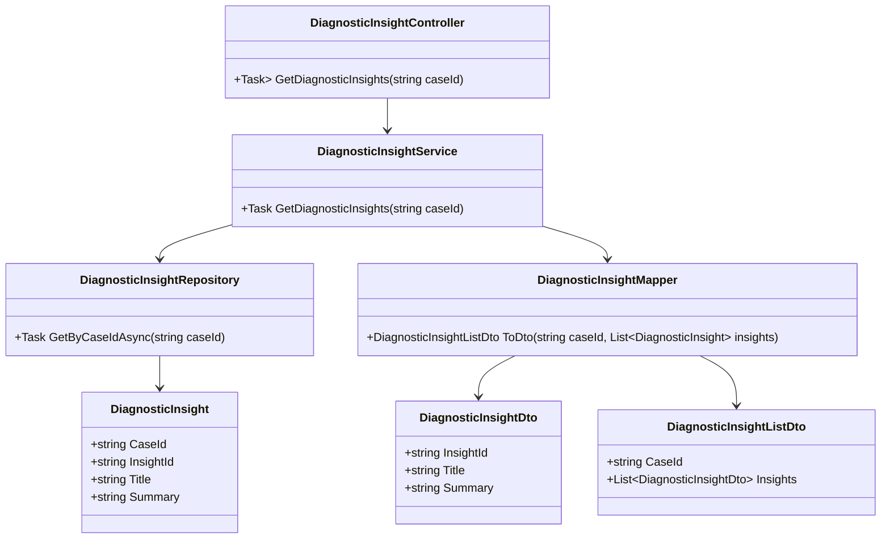
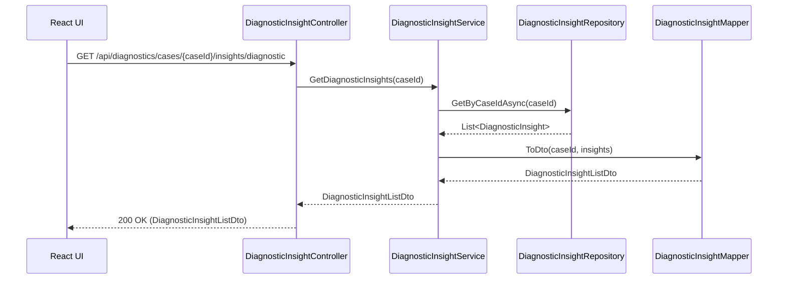
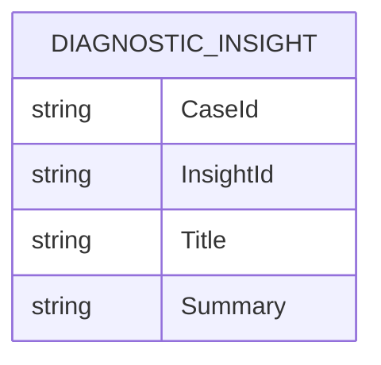

# Repository: APB_Demo
# Branch: APBTEST2610
# Folder: LLD

1. Objective
The objective is to allow support agents to view real-time AI-generated diagnostic insights for active member cases. The system must provide a list of insights summarizing potential causes of an issue in real time within the diagnostic panel. This enables agents to quickly understand the members issue and context.

2. Backend C# API Details
2.1. API Model
2.1.1. Common Components/Services
- DiagnosticInsightService (application service): Manages retrieval of AI-generated insights for a given member case.
- DiagnosticInsightRepository (data access abstraction): Retrieves insights from the data store.
- DiagnosticInsightMapper (mapping helper): Maps domain entities to DTOs.

2.1.2. API Details
| Operation | REST Method | Type | URL | Request JSON | Response JSON |
| --- | --- | --- | --- | --- | --- |
| GetDiagnosticInsights | GET | New | /api/diagnostics/cases/{caseId}/insights/diagnostic | {} | {"caseId": "string", "insights": [{"insightId": "string", "title": "string", "summary": "string"}]} |

2.1.3. Exceptions
- CaseNotFoundException: Thrown when the specified caseId does not exist.

2.2. Functional Design
2.2.1. Class Diagram

2.2.2. UML Sequence Diagram

2.2.3. Components
| Component Name | Description | Existing/New |
| --- | --- | --- |
| DiagnosticInsightController | API controller for diagnostic insight retrieval. | New |
| DiagnosticInsightService | Service layer for retrieving and assembling insights. | New |
| DiagnosticInsightRepository | Repository for fetching AI-generated diagnostic insights. | New |
| DiagnosticInsight | Domain entity representing an AI diagnostic insight. | New |
| DiagnosticInsightMapper | Mapper between domain insights and DTOs. | New |
| DiagnosticInsightListDto | DTO for a list of diagnostic insights. | New |
| DiagnosticInsightDto | DTO for a single diagnostic insight. | New |

2.3. Service Layer Business Logic
- Service architecture & dependency injection: DiagnosticInsightService is scoped and injected into DiagnosticInsightController. DiagnosticInsightRepository and DiagnosticInsightMapper are injected into DiagnosticInsightService.
- Workflow: The service validates the caseId, retrieves insights for the case, maps them to DiagnosticInsightListDto, and returns them. If no insights exist, it returns an empty list.
- Caching strategy: A short-lived cache per caseId may be used to serve repeated requests while the diagnostic panel is open.
- Validation rules: Ensures caseId is non-empty.

Validation rules
| Field Name | Validation | Error Message | Class Used |
| --- | --- | --- | --- |
| caseId | Required, non-empty string | "CaseId is required." | DiagnosticInsightService |

2.4. Service Integrations
| System | Integrated For | Integration Type |
| --- | --- | --- |
| Internal AI Diagnostics Store | Retrieval of AI-generated diagnostic insights per case. | Synchronous DB access via repository |

3. Front End React Details
3.1. UI Component Architecture
- Component hierarchy and data flow: A React component named DiagnosticInsightsPanel displays the list of diagnostic insights. It receives caseId as a prop from the parent diagnostic panel and fetches diagnostic insights on mount and at configured intervals or via real-time updates (integrated with other stories).
- State management: DiagnosticInsightsPanel uses React hooks for managing insights list, loading, and error states.
- Props interfaces: DiagnosticInsightsPanelProps includes caseId: string.
- Routing: The component is used within the existing route for viewing an active member case.

3.2. UI Specifications
- Wireframes/pages: The panel shows a list of insight cards, each displaying a title and short summary. The list is scrollable and grouped under a header "AI Diagnostic Insights".
- Responsive breakpoints: On small screens, cards are full width with stacked content; on larger screens, there is additional spacing and typography scaling.
- Form structures with validation: No forms are present as this is a read-only display.
- User interaction patterns: Selecting an insight card triggers navigation or expansion to more details (handled by other stories).

3.3. API Integration
- HTTP client configuration: DiagnosticInsightsPanel uses useApiClient to perform GET requests to /api/diagnostics/cases/{caseId}/insights/diagnostic.
- Call patterns and error handling: Network and server errors are surfaced as inline error messages with a retry option.
- Loading states: A spinner or skeleton loader is displayed while insights are loading.
- Data transformation: The DTO is mapped to an internal view model that preserves ordering and attaches any display-specific metadata.

4. Database Details
4.1. ER Model

4.2. Database Validations
- CaseId and InsightId combination is unique.
- Title and Summary are non-nullable.

5. Non-Functional Requirements
5.1. Performance
- Retrieval of insights should respond within 300 ms under normal load.

5.2. Security (Authentication & Authorization)
- Only authenticated support agents with appropriate permissions may view diagnostic insights.

5.3. Logging (Application, Audit, Monitoring)
- Errors retrieving insights are logged with correlation identifiers.

6. Dependencies
- ASP.NET Core Web API and DI.
- ORM (e.g., EF Core) for DiagnosticInsightRepository.
- React and shared HTTP client utilities.

7. Assumptions
- AI-generated insights are computed by upstream processes and stored before being retrieved by this service.
- The diagnostic panel UI already exists and will host DiagnosticInsightsPanel.
- Real-time behavior beyond basic retrieval is coordinated with separate stories.
