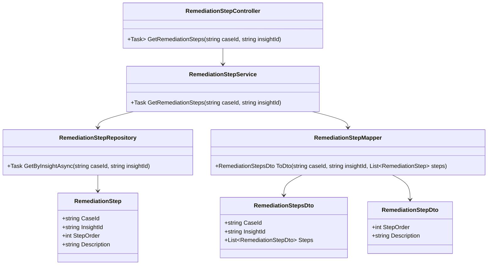
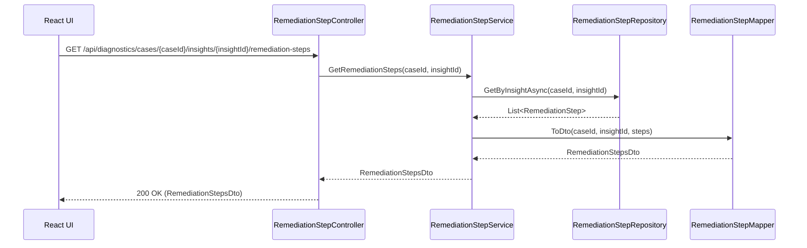
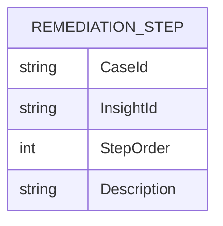

# Repository: APB_Demo
# Branch: APBTEST2610
# Folder: LLD

1. Objective
The objective is to provide support agents with step-by-step remediation instructions for AI-generated insights. The system must display a clear sequence of steps tailored to each selected insight to help agents resolve member issues efficiently and consistently. This ensures consistent execution of recommended remediation.

2. Backend C# API Details
2.1. API Model
2.1.1. Common Components/Services
- RemediationStepService (application service): Manages retrieval of remediation steps for a given case insight.
- RemediationStepRepository (data access abstraction): Retrieves remediation steps from the data store.
- RemediationStepMapper (mapping helper): Maps domain entities to DTOs for API responses.

2.1.2. API Details
| Operation | REST Method | Type | URL | Request JSON | Response JSON |
| --- | --- | --- | --- | --- | --- |
| GetRemediationSteps | GET | New | /api/diagnostics/cases/{caseId}/insights/{insightId}/remediation-steps | {} | {"caseId": "string", "insightId": "string", "steps": [{"stepOrder": 1, "description": "string"}]} |

2.1.3. Exceptions
- CaseNotFoundException: Thrown when the specified caseId does not exist.
- InsightNotFoundException: Thrown when the specified insightId is not associated with the case.
- RemediationStepsNotFoundException: Thrown when no remediation steps are defined for the given insight.

2.2. Functional Design
2.2.1. Class Diagram

2.2.2. UML Sequence Diagram

2.2.3. Components
| Component Name | Description | Existing/New |
| --- | --- | --- |
| RemediationStepController | API controller to expose remediation step retrieval. | New |
| RemediationStepService | Service layer for remediation step business logic. | New |
| RemediationStepRepository | Repository for loading remediation steps. | New |
| RemediationStep | Domain entity representing a remediation step. | New |
| RemediationStepMapper | Mapper to convert domain steps to DTOs. | New |
| RemediationStepsDto | DTO representing remediation steps for an insight. | New |
| RemediationStepDto | DTO for individual remediation step. | New |

2.3. Service Layer Business Logic
- Service architecture & dependency injection: RemediationStepService is scoped and injected into RemediationStepController. RemediationStepRepository and RemediationStepMapper are injected into RemediationStepService.
- Workflow: For a given caseId and insightId, the service retrieves all remediation steps ordered by StepOrder, maps them to DTOs, and returns the result. If no steps are found, it throws RemediationStepsNotFoundException.
- Caching strategy: Frequently accessed remediation steps may be cached per (caseId, insightId) for a short duration in memory.
- Validation rules: Validates non-empty caseId and insightId.

Validation rules
| Field Name | Validation | Error Message | Class Used |
| --- | --- | --- | --- |
| caseId | Required, non-empty string | "CaseId is required." | RemediationStepService |
| insightId | Required, non-empty string | "InsightId is required." | RemediationStepService |

2.4. Service Integrations
| System | Integrated For | Integration Type |
| --- | --- | --- |
| Internal Remediation Content Store | Retrieval of predefined remediation steps for insights. | Synchronous DB access via repository |

3. Front End React Details
3.1. UI Component Architecture
- Component hierarchy and data flow: A React component named RemediationStepsPanel renders remediation steps for the selected insight. It receives caseId and insightId as props from its parent (e.g., InsightDetailsPanel) and fetches steps on mount or when insightId changes.
- State management: RemediationStepsPanel uses React hooks for loading, error, and steps state.
- Props interfaces: RemediationStepsPanelProps includes caseId: string and insightId: string.
- Routing: RemediationStepsPanel is embedded within an existing insight details view; no new route is required.

3.2. UI Specifications
- Wireframes/pages: The panel displays a numbered list of remediation steps with clear, concise text. Each step may include secondary text for notes if provided in description.
- Responsive breakpoints: The steps list uses a single column layout that adjusts padding and typography for different screen sizes.
- Form structures with validation: No forms are required as this is read-only content.
- User interaction patterns: When steps are loading, a placeholder skeleton list is shown. If an error occurs, a message "Unable to load remediation steps" appears with a retry control.

3.3. API Integration
- HTTP client configuration: RemediationStepsPanel uses useApiClient to send GET requests to /api/diagnostics/cases/{caseId}/insights/{insightId}/remediation-steps.
- Call patterns and error handling: Errors are caught and surfaced as non-blocking error banners; the parent panel remains usable.
- Loading states: isLoadingSteps state drives display of loading placeholders.
- Data transformation: The panel sorts steps by stepOrder (if not already sorted) and formats descriptions into an ordered list.

4. Database Details
4.1. ER Model

4.2. Database Validations
- CaseId, InsightId, and StepOrder combination is unique.
- StepOrder is positive and non-null.
- Description is non-null.

5. Non-Functional Requirements
5.1. Performance
- Retrieval of remediation steps should complete within 200 ms under typical conditions.

5.2. Security (Authentication & Authorization)
- Only authenticated and authorized support agents may access remediation steps.

5.3. Logging (Application, Audit, Monitoring)
- Application logs capture failed remediation step retrievals with correlation identifiers.

6. Dependencies
- ASP.NET Core Web API and DI for service wiring.
- ORM (e.g., EF Core) for RemediationStepRepository.
- React and shared HTTP client utilities.

7. Assumptions
- Remediation content is pre-authored and stored; this story does not cover authoring tools.
- The existing UI already provides a way to select an insight and will host RemediationStepsPanel.
- Remediation steps are text-only without rich media for this version.
