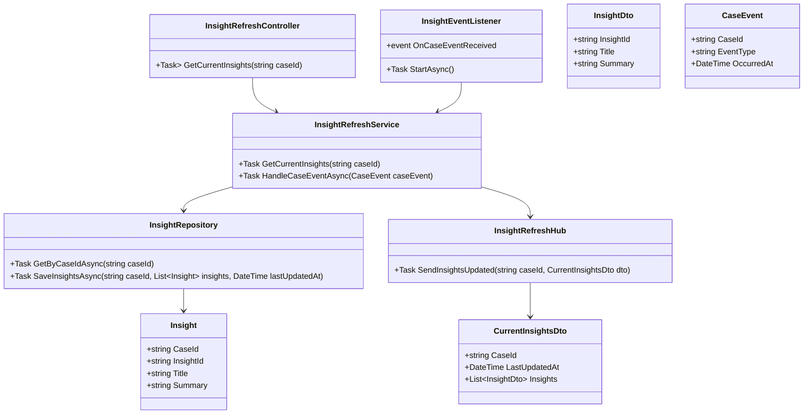
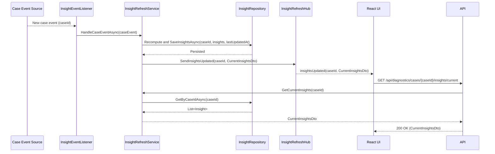
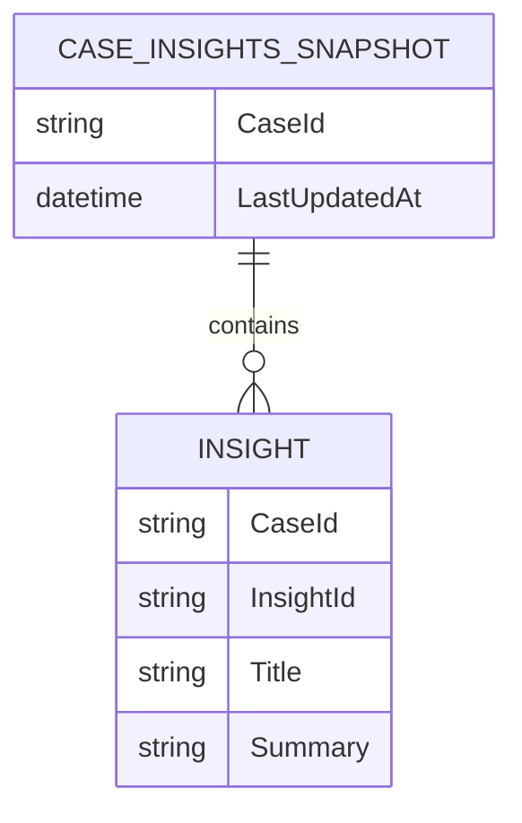

# Repository: APB_Demo
# Branch: APBTEST2610
# Folder: LLD

1. Objective
The objective is to ensure diagnostic insights refresh in real time for support agents viewing open member cases. The system must update AI-generated insights when new case data or events arrive and indicate the latest update time in the diagnostic panel. This keeps agents working with the most current information.

2. Backend C# API Details
2.1. API Model
2.1.1. Common Components/Services
- InsightRefreshService (application service): Coordinates real-time refresh of insights for a given case.
- InsightEventListener (infrastructure component): Listens to case data or event streams and triggers insight recomputation.
- InsightRefreshHub (SignalR hub): Pushes refreshed insights to connected clients for a case.
- InsightRepository (data access abstraction): Persists and retrieves AI-generated insights.

2.1.2. API Details
| Operation | REST Method | Type | URL | Request JSON | Response JSON |
| --- | --- | --- | --- | --- | --- |
| GetCurrentInsights | GET | New | /api/diagnostics/cases/{caseId}/insights/current | {} | {"caseId": "string", "lastUpdatedAt": "2024-01-01T00:00:00Z", "insights": [{"insightId": "string", "title": "string", "summary": "string"}]} |

2.1.3. Exceptions
- CaseNotFoundException: Thrown when the caseId is not recognized.

2.2. Functional Design
2.2.1. Class Diagram

2.2.2. UML Sequence Diagram

2.2.3. Components
| Component Name | Description | Existing/New |
| --- | --- | --- |
| InsightRefreshController | API controller for retrieving current insights. | New |
| InsightRefreshService | Service managing real-time refresh logic. | New |
| InsightEventListener | Background component listening to case events. | New |
| InsightRefreshHub | SignalR hub broadcasting updated insights. | New |
| InsightRepository | Repository for storing and retrieving insights. | New |
| Insight | Domain entity representing an AI diagnostic insight. | New |
| CurrentInsightsDto | DTO representing current insights and last updated time. | New |
| InsightDto | DTO for individual insight details. | New |
| CaseEvent | Domain model representing an incoming case event. | New |

2.3. Service Layer Business Logic
- Service architecture & dependency injection: InsightRefreshService is scoped for API usage and may also be used by singleton background services for event handling. InsightRepository and InsightRefreshHub are injected. InsightEventListener is registered as a hosted service.
- Workflow: When a new case event is received, InsightRefreshService recomputes or retrieves updated insights, persists them with a lastUpdatedAt timestamp, and pushes updates through InsightRefreshHub. The API endpoint GetCurrentInsights returns the latest snapshot for clients.
- Caching strategy: The latest insights per case are cached in memory by caseId to reduce database access when responding to GET requests; cache is updated whenever new insights are saved.
- Validation rules: Validates non-empty caseId and ensures that events contain a caseId.

Validation rules
| Field Name | Validation | Error Message | Class Used |
| --- | --- | --- | --- |
| caseId | Required, non-empty string | "CaseId is required." | InsightRefreshService |
| EventType | Required, non-empty string | "EventType is required." | InsightRefreshService |

2.4. Service Integrations
| System | Integrated For | Integration Type |
| --- | --- | --- |
| Case Event Stream | Receiving new case data or events. | Asynchronous messaging or event subscription |
| Internal AI Insights Engine | Recomputing insights when events arrive. | Synchronous call from InsightRefreshService to engine (abstracted in this story) |

3. Front End React Details
3.1. UI Component Architecture
- Component hierarchy and data flow: A React component named RealTimeInsightsPanel displays insights and listens for updates. It receives caseId as a prop from the diagnostic panel and subscribes to InsightRefreshHub via a SignalR client.
- State management: RealTimeInsightsPanel uses React hooks to maintain insights list, lastUpdatedAt, loading, and connection state. A custom hook useInsightUpdates may encapsulate SignalR subscription logic.
- Props interfaces: RealTimeInsightsPanelProps includes caseId: string.
- Routing: RealTimeInsightsPanel is used within the existing diagnostic panel route.

3.2. UI Specifications
- Wireframes/pages: The panel shows a header "AI Diagnostic Insights" with a small label "Updated at HH:MM" reflecting lastUpdatedAt. Below, a list of insights is displayed.
- Responsive breakpoints: The insights list is vertically scrollable and adapts to available panel width; the timestamp is right-aligned on larger screens and moves below the title on smaller screens.
- Form structures with validation: No forms are present; this is read-only.
- User interaction patterns: When new insights arrive via SignalR, the panel animates a brief highlight around updated items and updates the timestamp.

3.3. API Integration
- HTTP client configuration: On initial mount, RealTimeInsightsPanel calls GET /api/diagnostics/cases/{caseId}/insights/current using useApiClient.
- Call patterns and error handling: If initial load fails, an error message is shown with a retry option. Real-time updates via SignalR are handled separately; disconnects trigger automatic reconnection attempts and a banner indicating connection status.
- Loading states: Initial load shows a spinner; real-time updates show a subtle "Refreshing" indicator near the timestamp.
- Data transformation: Incoming DTOs are mapped directly to local state, with lastUpdatedAt formatted for display.

4. Database Details
4.1. ER Model

4.2. Database Validations
- CaseId is the primary key of CASE_INSIGHTS_SNAPSHOT.
- LastUpdatedAt is non-nullable.
- INSIGHT rows for a case have a foreign key to CASE_INSIGHTS_SNAPSHOT.CaseId.

5. Non-Functional Requirements
5.1. Performance
- Real-time refresh should propagate updates to connected clients within a few seconds of event arrival.
- The system should support multiple concurrent clients subscribed to different cases without noticeable degradation.

5.2. Security (Authentication & Authorization)
- SignalR connections and HTTP endpoints require authenticated users authorized to view the specific case.
- Case identifiers in messages are validated to prevent unauthorized cross-case access.

5.3. Logging (Application, Audit, Monitoring)
- Application logs capture key events such as event processing failures and hub broadcast errors.
- Monitoring includes metrics on connection counts, update latency, and error rates.

6. Dependencies
- ASP.NET Core Web API and SignalR for real-time communication.
- ORM (e.g., EF Core) for insight persistence.
- React with SignalR client library for real-time updates.

7. Assumptions
- An existing AI insights engine produces updated insights when case events occur.
- Case event source integration (e.g., message bus) is available and configured.
- Network conditions allow stable WebSocket or fallback transport for SignalR connections.
