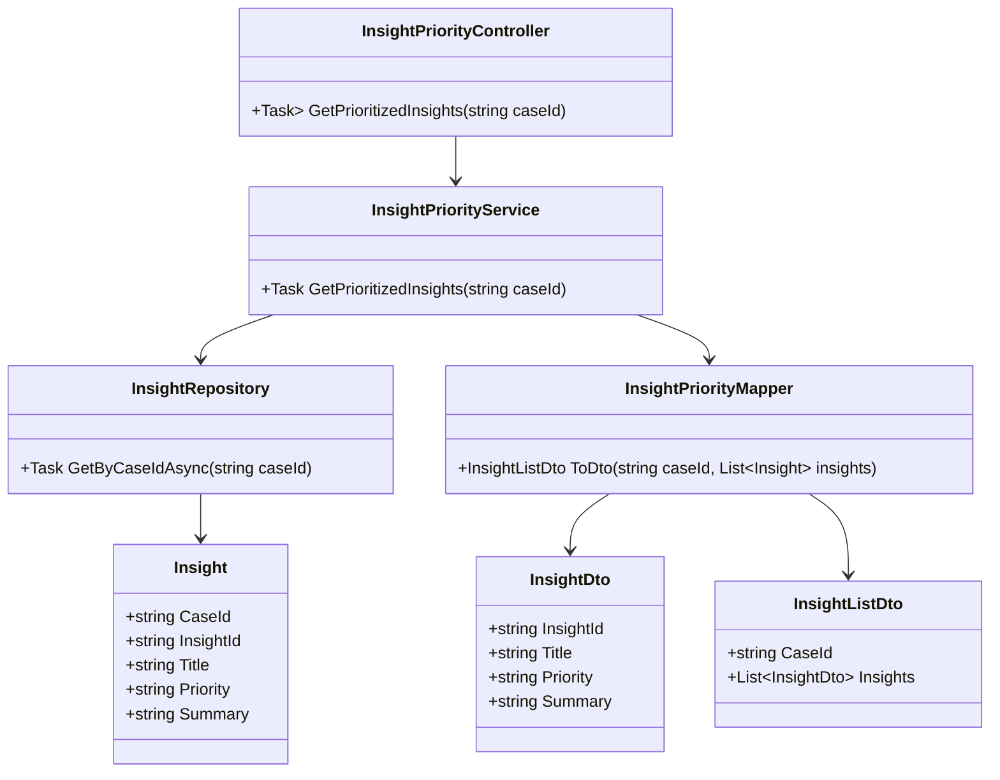
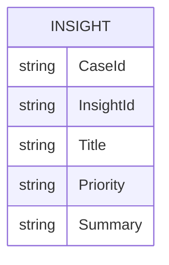

# Repository: APB_Demo
# Branch: APABTEST2610
# Folder: LLD

1. Objective
The objective is to highlight high-priority AI-generated insights within the diagnostic panel for support agents. The system must visually emphasize high-priority insights and ensure they appear at the top of the insight list. This allows agents to quickly focus on the most critical member issues.

2. Backend C# API Details
2.1. API Model
2.1.1. Common Components/Services
- InsightPriorityService (application service): Responsible for classifying and ordering insights based on priority.
- InsightRepository (data access abstraction): Retrieves AI-generated insights from the data store, including priority metadata.
- InsightPriorityMapper (mapping helper): Maps domain insights to DTOs with priority information.

2.1.2. API Details
| Operation | REST Method | Type | URL | Request JSON | Response JSON |
| --- | --- | --- | --- | --- | --- |
| GetPrioritizedInsights | GET | New | /api/diagnostics/cases/{caseId}/insights | {} | {"caseId": "string", "insights": [{"insightId": "string", "title": "string", "priority": "High", "summary": "string"}]} |

2.1.3. Exceptions
- CaseNotFoundException: Thrown when the specified caseId does not exist.

2.2. Functional Design
2.2.1. Class Diagram


2.2.2. UML Sequence Diagram
```mermaid
sequenceDiagram
    participant UI as React UI
    participant API as InsightPriorityController
    participant SVC as InsightPriorityService
    participant REP as InsightRepository
    participant MAP as InsightPriorityMapper

    UI->>API: GET /api/diagnostics/cases/{caseId}/insights
    API->>SVC: GetPrioritizedInsights(caseId)
    SVC->>REP: GetByCaseIdAsync(caseId)
    REP-->>SVC: List<Insight>
    SVC: Sort insights by priority (High first) and then by default order
    SVC->>MAP: ToDto(caseId, sortedInsights)
    MAP-->>SVC: InsightListDto
    SVC-->>API: InsightListDto
    API-->>UI: 200 OK (InsightListDto)
```

2.2.3. Components
| Component Name | Description | Existing/New |
| --- | --- | --- |
| InsightPriorityController | API controller for prioritized insight retrieval. | New |
| InsightPriorityService | Service layer for prioritizing and ordering insights. | New |
| InsightRepository | Repository for retrieving AI-generated insights. | New |
| Insight | Domain entity representing an AI diagnostic insight with priority. | New |
| InsightPriorityMapper | Mapper for converting domain insights to DTOs. | New |
| InsightListDto | Root DTO containing caseId and list of insights. | New |
| InsightDto | DTO representing a single prioritized insight. | New |

2.3. Service Layer Business Logic
- Service architecture & dependency injection: InsightPriorityService is scoped and injected into InsightPriorityController. InsightRepository and InsightPriorityMapper are injected into InsightPriorityService.
- Workflow: For a given caseId, the service retrieves insights, sorts them so that priority = "High" appear first and then by an optional secondary key (e.g., created time), and returns them via InsightListDto.
- Caching strategy: Optional short-lived cache per caseId may be applied to reduce repeated retrievals during the life of an open panel.
- Validation rules: Validates that caseId is provided and non-empty; ensures that each insight has a normalized priority value.

Validation rules
| Field Name | Validation | Error Message | Class Used |
| --- | --- | --- | --- |
| caseId | Required, non-empty string | "CaseId is required." | InsightPriorityService |
| priority | Must be one of ["High", "Medium", "Low"] | "Invalid priority value." | InsightPriorityService |

2.4. Service Integrations
| System | Integrated For | Integration Type |
| --- | --- | --- |
| Internal AI Insights Store | Retrieval of case-specific diagnostic insights with priority metadata. | Synchronous DB access via repository |

3. Front End React Details
3.1. UI Component Architecture
- Component hierarchy and data flow: A React component named InsightListPanel displays the list of insights for a case. It receives caseId as a prop, fetches prioritized insights from the API, and passes them to child components InsightListItem for rendering.
- State management: InsightListPanel uses React hooks to manage loading, error, and insight list state. High-priority insights are rendered first based on the sorted response.
- Props interfaces: InsightListPanelProps includes caseId: string. InsightListItemProps includes insightId, title, priority, and summary.
- Routing: InsightListPanel is embedded in the existing diagnostic panel route for viewing a member case.

3.2. UI Specifications
- Wireframes/pages: The list uses a vertical stacked layout with each insight rendered as a card. High-priority insights have a distinct visual treatment: a colored border, an icon, and a "High Priority" label.
- Responsive breakpoints: On narrow screens, each card uses full width; on wider screens, cards may be arranged in a single column with full width for readability.
- Form structures with validation: No forms are involved; the list is read-only.
- User interaction patterns: Clicking an insight card triggers selection to view details (handled by other stories); high-priority cards remain visually distinct even when selected.

3.3. API Integration
- HTTP client configuration: InsightListPanel uses useApiClient to send GET requests to /api/diagnostics/cases/{caseId}/insights.
- Call patterns and error handling: On error, the component displays a message "Unable to load insights" and offers a retry action.
- Loading states: A loading spinner or skeleton placeholders are shown while insights are being fetched.
- Data transformation: The component maps the priority field to CSS classes (e.g., high-priority class) and ensures high-priority items are shown at the top as received from the API.

4. Database Details
4.1. ER Model


4.2. Database Validations
- Priority is constrained to allowed values (High, Medium, Low) via a check constraint or lookup table.
- CaseId and InsightId combination is unique.

5. Non-Functional Requirements
5.1. Performance
- Retrieval and prioritization of insights should respond within 300 ms under normal load.

5.2. Security (Authentication & Authorization)
- Only authenticated and authorized support agents can retrieve case insights.

5.3. Logging (Application, Audit, Monitoring)
- Application logs include failures to retrieve or sort insights, including caseId and correlation identifiers.

6. Dependencies
- ASP.NET Core Web API and DI container.
- ORM (e.g., EF Core) for InsightRepository.
- React and styling libraries for UI (e.g., CSS modules or styled-components).

7. Assumptions
- Priority classification is provided by upstream AI processes and stored alongside insights.
- Only three priority levels (High, Medium, Low) are initially supported.
- Existing diagnostic panel already supports rendering a list of insights into which InsightListPanel is integrated.
