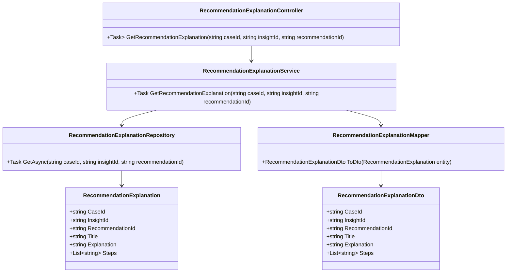
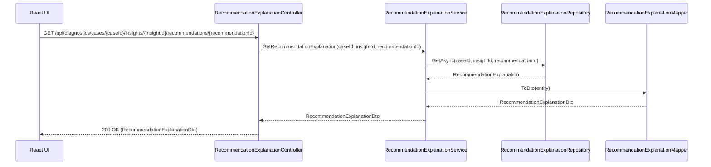
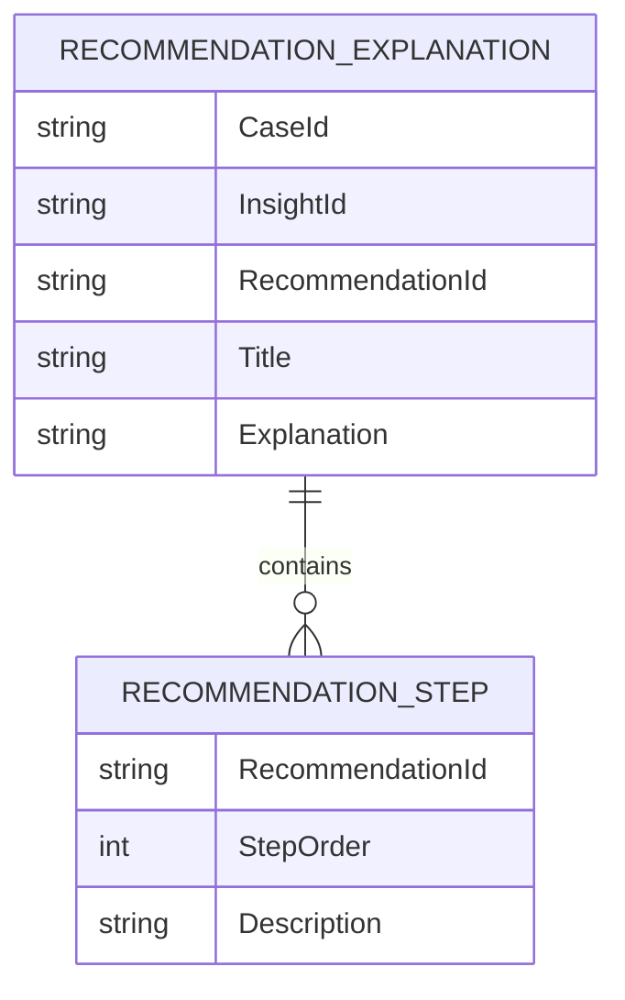

# Repository: APB_Demo
# Branch: APBTEST2610
# Folder: LLD

1. Objective
The objective is to present AI remediation recommendations with clear, plain-language explanations for support agents. The system should attach explanations describing why a recommendation is suggested and how it addresses the member issue. This enables agents to confidently understand and follow AI guidance.

2. Backend C# API Details
2.1. API Model
2.1.1. Common Components/Services
- RecommendationExplanationService (application service): Provides retrieval of AI recommendation details including explanation text for a specific insight.
- RecommendationExplanationRepository (data access abstraction): Retrieves recommendation explanation entities from the data store.
- RecommendationExplanationMapper (mapping helper): Maps domain entities to DTOs for API responses.

2.1.2. API Details
| Operation | REST Method | Type | URL | Request JSON | Response JSON |
| --- | --- | --- | --- | --- | --- |
| GetRecommendationExplanation | GET | New | /api/diagnostics/cases/{caseId}/insights/{insightId}/recommendations/{recommendationId} | {} | {"caseId": "string", "insightId": "string", "recommendationId": "string", "title": "string", "steps": ["string"], "explanation": "string"} |

2.1.3. Exceptions
- CaseNotFoundException: Thrown when the specified caseId does not exist.
- InsightNotFoundException: Thrown when the specified insightId does not belong to the case.
- RecommendationNotFoundException: Thrown when the recommendationId cannot be found for the given insight.

2.2. Functional Design
2.2.1. Class Diagram

2.2.2. UML Sequence Diagram

2.2.3. Components
| Component Name | Description | Existing/New |
| --- | --- | --- |
| RecommendationExplanationController | API controller to expose recommendation explanation retrieval. | New |
| RecommendationExplanationService | Service to orchestrate explanation retrieval. | New |
| RecommendationExplanationRepository | Repository to fetch recommendation explanation data. | New |
| RecommendationExplanation | Domain entity for AI recommendation explanation. | New |
| RecommendationExplanationMapper | Mapper to convert entity to DTO. | New |
| RecommendationExplanationDto | DTO returned to clients with plain-language explanation details. | New |

2.3. Service Layer Business Logic
- Service architecture & dependency injection: RecommendationExplanationService is registered as scoped and injected into RecommendationExplanationController. RecommendationExplanationRepository and RecommendationExplanationMapper are injected into RecommendationExplanationService.
- Workflow: The service validates identifiers, fetches the RecommendationExplanation entity from the repository, maps it to RecommendationExplanationDto, and returns it. If not found, it throws RecommendationNotFoundException.
- Caching strategy: Frequently requested recommendations may be cached in memory for a short duration using in-memory caching at the service layer to reduce repeated data store calls.
- Validation rules: Validates non-empty caseId, insightId, and recommendationId.

Validation rules
| Field Name | Validation | Error Message | Class Used |
| --- | --- | --- | --- |
| caseId | Required, non-empty string | "CaseId is required." | RecommendationExplanationService |
| insightId | Required, non-empty string | "InsightId is required." | RecommendationExplanationService |
| recommendationId | Required, non-empty string | "RecommendationId is required." | RecommendationExplanationService |

2.4. Service Integrations
| System | Integrated For | Integration Type |
| --- | --- | --- |
| Internal Recommendations Data Store | Fetching AI recommendation details and explanations. | Synchronous DB access via repository |

3. Front End React Details
3.1. UI Component Architecture
- Component hierarchy and data flow: A React component named RecommendationDetailsPanel is responsible for displaying AI recommendations and their explanations. It receives caseId, insightId, and recommendationId as props and fetches explanation data on demand when expanded.
- State management: RecommendationDetailsPanel uses React hooks for internal state, storing explanation data, loading status, and error status.
- Props interfaces: RecommendationDetailsPanelProps includes caseId: string, insightId: string, recommendationId: string, and optionally onExpanded callback.
- Routing: The component is used within an existing case diagnostics route; no new routing entries are added.

3.2. UI Specifications
- Wireframes/pages: Each AI recommendation item in the panel includes a summary row (title and brief description) with an expand/collapse control. Upon expansion, the panel shows explanation text "Why this is suggested" and "How this helps" sections, plus any step list.
- Responsive breakpoints: On narrow viewports, explanation text spans full width under the recommendation header; on wide viewports, explanation and steps are arranged in a two-column layout.
- Form structures with validation: No forms are required; this is a read-only display component.
- User interaction patterns: When the user clicks to expand a recommendation, a loading indicator appears while data is fetched. On success, the explanation is shown; on failure, an inline error banner indicates the explanation could not be loaded.

3.3. API Integration
- HTTP client configuration: RecommendationDetailsPanel uses a shared HTTP client hook useApiClient to issue GET requests with authentication headers.
- Call patterns and error handling: The component calls GET /api/diagnostics/cases/{caseId}/insights/{insightId}/recommendations/{recommendationId}. Network or server errors are handled by displaying a generic message like "Unable to load explanation".
- Loading states: The component tracks isLoadingExplanation to disable repeated fetches and to show a spinner next to the recommendation title.
- Data transformation: The raw DTO is mapped directly into display fields; multi-line explanation text may be split into paragraphs for rendering.

4. Database Details
4.1. ER Model

4.2. Database Validations
- RecommendationId is the primary key for RECOMMENDATION_EXPLANATION.
- Title and Explanation are non-nullable.
- In RECOMMENDATION_STEP, StepOrder is non-nullable and enforces sequence ordering per recommendation.

5. Non-Functional Requirements
5.1. Performance
- Explanation retrieval should generally respond within 200 ms under normal load.
- Responses may be cached at the application layer to reduce latency.

5.2. Security (Authentication & Authorization)
- Only authenticated support agents or equivalent roles may access recommendation explanations.
- No member-identifiable data is returned in explanations beyond case and insight identifiers.

5.3. Logging (Application, Audit, Monitoring)
- Application logs record failures to retrieve explanations, including correlation identifiers.
- Non-sensitive events are used for monitoring latency and error rates.

6. Dependencies
- ASP.NET Core Web API and DI container for controller and service wiring.
- ORM (e.g., EF Core) for RecommendationExplanationRepository.
- Shared React HTTP client utilities (useApiClient).

7. Assumptions
- Explanations are pre-generated and stored by upstream AI processes, not generated on demand in this story.
- Recommendation steps referenced here are aligned with those from the remediation guidance feature.
- The existing diagnostic panel already displays a list of recommendations into which RecommendationDetailsPanel will integrate.
