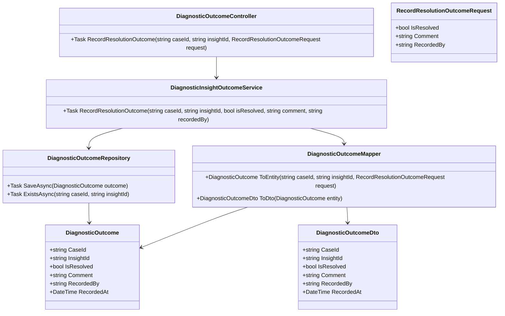
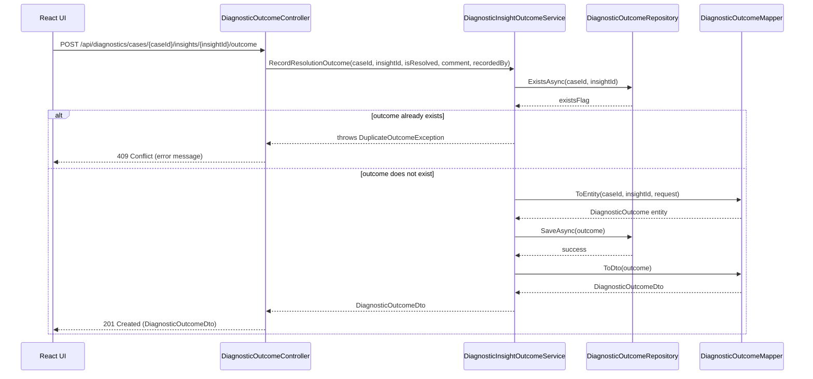
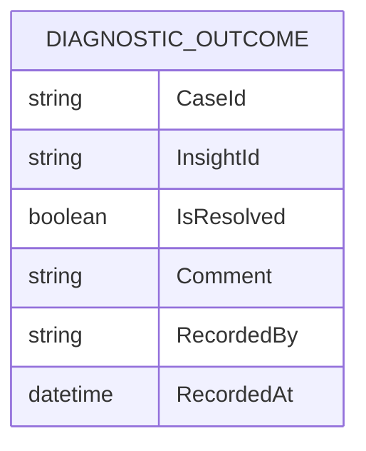

# Repository: APB_Demo
# Branch: APBTEST2610
# Folder: LLD

1. Objective
The objective is to enable support agents to capture resolution outcome feedback for AI-guided remediation steps in member issue diagnostics. The system must persist whether the AI-recommended steps resolved the issue and surface a confirmation to the agent. This feedback will later be used to improve AI diagnostic quality.

2. Backend C# API Details
2.1. API Model
2.1.1. Common Components/Services
- DiagnosticInsightOutcomeService (application service): Handles recording of resolution outcome feedback for a specific member case and associated AI insight or remediation recommendation.
- DiagnosticOutcomeRepository (data access abstraction): Persists and retrieves DiagnosticOutcome entities to and from the database.
- DiagnosticOutcomeMapper (mapping helper): Maps between API DTOs and domain entities.

2.1.2. API Details
| Operation | REST Method | Type | URL | Request JSON | Response JSON |
| --- | --- | --- | --- | --- | --- |
| RecordResolutionOutcome | POST | New | /api/diagnostics/cases/{caseId}/insights/{insightId}/outcome | {"isResolved": true, "comment": "string", "recordedBy": "string"} | {"caseId": "string", "insightId": "string", "isResolved": true, "comment": "string", "recordedBy": "string", "recordedAt": "2024-01-01T00:00:00Z"} |

2.1.3. Exceptions
- CaseNotFoundException: Thrown when the provided caseId does not exist.
- InsightNotFoundException: Thrown when the provided insightId does not exist for the given case.
- DuplicateOutcomeException: Thrown when an outcome has already been recorded for the given case and insight and duplicate submissions are not allowed.
- ValidationException: Thrown when required fields are missing or invalid.

2.2. Functional Design
2.2.1. Class Diagram

2.2.2. UML Sequence Diagram

2.2.3. Components
| Component Name | Description | Existing/New |
| --- | --- | --- |
| DiagnosticOutcomeController | API controller to handle resolution outcome requests. | New |
| DiagnosticInsightOutcomeService | Application service encapsulating business logic for recording outcomes. | New |
| DiagnosticOutcomeRepository | Repository for persisting DiagnosticOutcome entities. | New |
| DiagnosticOutcome | Domain entity representing resolution outcome feedback. | New |
| DiagnosticOutcomeMapper | Mapper between request/response DTOs and domain entities. | New |
| RecordResolutionOutcomeRequest | API request DTO for recording outcome. | New |
| DiagnosticOutcomeDto | API response DTO for recorded outcome. | New |

2.3. Service Layer Business Logic
- Service architecture & dependency injection: DiagnosticInsightOutcomeService is registered as a scoped service and injected into DiagnosticOutcomeController via constructor injection. DiagnosticOutcomeRepository is registered as a scoped repository and injected into DiagnosticInsightOutcomeService. DiagnosticOutcomeMapper is registered as a singleton or scoped dependency.
- Workflow: When RecordResolutionOutcome is called, the service validates input, checks for existing outcomes for the case and insight, constructs a DiagnosticOutcome entity with current timestamp, persists it via DiagnosticOutcomeRepository, and returns a DiagnosticOutcomeDto to the controller.
- Caching strategy: No caching is applied to write operations. Reads of outcomes (if added later) may rely on default database behavior without explicit caching.
- Validation rules: The service validates that caseId and insightId are non-empty, isResolved is provided, and recordedBy is present.

Validation rules
| Field Name | Validation | Error Message | Class Used |
| --- | --- | --- | --- |
| caseId | Required, non-empty string | "CaseId is required." | DiagnosticInsightOutcomeService |
| insightId | Required, non-empty string | "InsightId is required." | DiagnosticInsightOutcomeService |
| isResolved | Required boolean | "Resolution outcome is required." | DiagnosticInsightOutcomeService |
| recordedBy | Required, non-empty string | "RecordedBy is required." | DiagnosticInsightOutcomeService |
| comment | Optional, max 500 characters | "Comment must not exceed 500 characters." | DiagnosticInsightOutcomeService |

2.4. Service Integrations
| System | Integrated For | Integration Type |
| --- | --- | --- |
| Internal Diagnostics Data Store | Persisting resolution outcome feedback for AI-guided remediation steps. | Synchronous DB access via repository |

3. Front End React Details
3.1. UI Component Architecture
- Component hierarchy and data flow: A React component named ResolutionOutcomePanel is embedded within the existing diagnostic panel view for a member case. ResolutionOutcomePanel receives caseId and insightId as props from its parent (e.g., DiagnosticPanelView) and manages local state for isResolved, comment, loading, success, and error states.
- State management: ResolutionOutcomePanel uses React hooks (useState and useEffect) for local state management. There is no global store dependency assumed for this story.
- Props interfaces: ResolutionOutcomePanelProps includes caseId: string, insightId: string, and an optional onOutcomeRecorded callback.
- Routing: ResolutionOutcomePanel is rendered within an existing route for the diagnostic panel, so no new route is added.

3.2. UI Specifications
- Wireframes/pages: Within the diagnostic panel, a section labeled "Resolution Outcome" contains two radio buttons or a toggle for "Resolved" and "Not Resolved", an optional multiline comment box, and a "Save" button.
- Responsive breakpoints: The panel layout is responsive using flexbox; form elements stack vertically on small screens and align horizontally on larger screens.
- Form structures with validation: On submit, the component validates that one of the outcome options is selected; comment length is limited to 500 characters client-side.
- User interaction patterns: When the agent clicks "Save", the form is disabled and a loading indicator is shown; on success, a confirmation message "Outcome saved" is displayed. On error, an inline error message is shown without navigating away.

3.3. API Integration
- HTTP client configuration: A shared HTTP client hook useApiClient (assumed existing) is used to make POST requests with JSON and include authentication headers.
- Call patterns and error handling: ResolutionOutcomePanel calls POST /api/diagnostics/cases/{caseId}/insights/{insightId}/outcome with the form data; errors (4xx/5xx) are caught and translated into user-friendly messages.
- Loading states: A local isSaving state is used to disable inputs and display a spinner or "Saving..." label.
- Data transformation: The component maps local form state (e.g., radio selection) into the isResolved boolean, and passes recordedBy from the authenticated user context.

4. Database Details
4.1. ER Model

4.2. Database Validations
- CaseId and InsightId form a composite key to ensure uniqueness per outcome record.
- IsResolved is non-nullable.
- RecordedBy is non-nullable with a maximum length consistent with user identifier constraints.
- Comment has a maximum length of 500 characters.

5. Non-Functional Requirements
5.1. Performance
- The outcome recording operation should complete within 300 ms under normal load assuming low write volume.
- The endpoint must handle up to modest concurrent usage typical of support agents without special tuning.

5.2. Security (Authentication & Authorization)
- The endpoint requires authenticated users; authorization is limited to users with a support-agent role or equivalent.
- Input is validated and parameterized to avoid injection vulnerabilities.

5.3. Logging (Application, Audit, Monitoring)
- Application logs record success and failure of outcome submissions at info and warning/error levels respectively.
- Audit logs record caseId, insightId, recordedBy, and timestamp for each outcome submission without storing sensitive member data in plain text.
- Monitoring metrics include count of outcome submissions and failure rates.

6. Dependencies
- ASP.NET Core Web API for controller and DI infrastructure.
- Entity Framework Core or equivalent ORM for DiagnosticOutcomeRepository implementation.
- Shared HTTP client utilities on the React side (useApiClient).

7. Assumptions
- Each caseId and insightId pair can only have one outcome record; subsequent attempts are treated as duplicates.
- An existing authentication mechanism provides the recordedBy identifier to the frontend and backend.
- The internal diagnostics data store already exists and adding the DIAGNOSTIC_OUTCOME table does not require separate stories.
