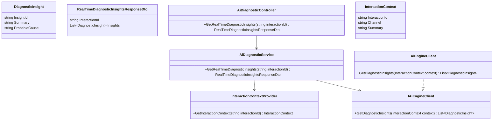
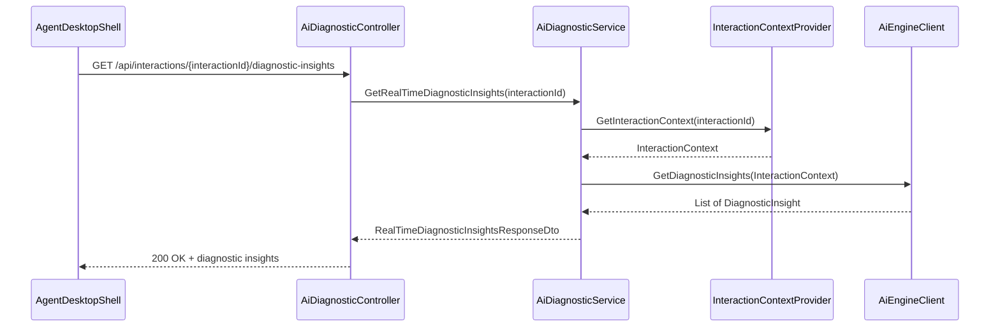
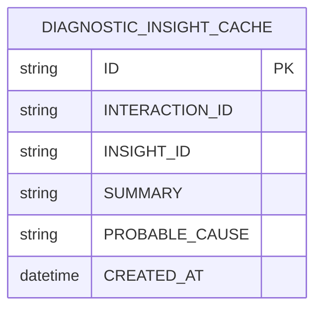

# Repository: APB_Demo
# Branch: APBMRN34044
# Folder: LLD

1. Objective
The objective is to provide real-time AI-generated diagnostic insights within the contact center agent desktop. The system must present summarized insights and probable issue causes based on the current interaction context. This capability is intended to reduce handling time and improve agent understanding of member issues.

2. Backend C# API Details

2.1. API Model

2.1.1. Common Components/Services
- AiDiagnosticService: Core service orchestrating AI processing of interaction context to produce diagnostic insights.
- InteractionContextProvider: Service retrieving non-sensitive interaction details used as input to the AI engine.
- AiEngineClient: Client abstraction for calling the AI diagnostic engine.

2.1.2. API Details
| Operation | REST Method | Type | URL | Request JSON | Response JSON |
|----------|-------------|------|-----|--------------|---------------|
| GetRealTimeDiagnosticInsights | GET | Query | /api/interactions/{interactionId}/diagnostic-insights | N/A | { "interactionId": "string", "insights": [ { "insightId": "string", "summary": "string", "probableCause": "string" } ] } |

2.1.3. Exceptions
- InteractionContextUnavailableException: Thrown when interaction context cannot be retrieved or is incomplete.
- AiDiagnosticEngineException: Thrown when AI engine fails to process the interaction.

2.2. Functional Design

2.2.1. Class Diagram

2.2.2. UML Sequence Diagram

2.2.3. Components
| Component Name | Description | Existing/New |
|-------------------------|-------------|------------|
| AiDiagnosticController | API controller exposing real-time diagnostic insights. | New |
| AiDiagnosticService | Service orchestrating interaction context retrieval and AI calls. | New |
| InteractionContextProvider | Service resolving interaction details. | New |
| AiEngineClient | Client integrating with AI diagnostic engine. | New |
| DiagnosticInsight | Model representing a diagnostic insight. | New |
| RealTimeDiagnosticInsightsResponseDto | DTO representing diagnostic insights response. | New |

2.3. Service Layer Business Logic
- Service Architecture & Dependency Injection: AiDiagnosticController uses AiDiagnosticService via constructor injection. AiDiagnosticService depends on InteractionContextProvider and IAiEngineClient registered via DI. AiEngineClient implements IAiEngineClient.
- Workflow: AiDiagnosticService retrieves InteractionContext using InteractionContextProvider, invokes IAiEngineClient.GetDiagnosticInsights, and maps the results into RealTimeDiagnosticInsightsResponseDto.
- Caching Strategy: Short-lived caching (e.g., 10-20 seconds) may be used for diagnostic insights per interactionId to avoid repeated calls, while keeping information near real-time.
- Validation Rules: Validate interactionId and ensure InteractionContext contains required fields before calling AI engine.

Validation rules
| Field Name | Validation | Error Message | Class Used |
|------------|-----------|---------------|------------|
| InteractionId | Required, non-empty string | "InteractionId is required." | AiDiagnosticService |
| InteractionContext | Must contain minimal fields such as channel and summary | "Interaction context is incomplete for diagnostics." | InteractionContextProvider |

2.4. Service Integrations
| System | Integrated For | Integration Type |
|--------|----------------|-----------------|
| Interaction Management System | Retrieve interaction context for diagnostic processing | Internal service call |
| AI Diagnostic Engine | Generate diagnostic insights and probable causes | REST or gRPC client |

3. Front End React Details

3.1. UI Component Architecture
- Component Hierarchy: AgentDesktopShell -> AiDiagnosticPanel -> DiagnosticInsightsList -> DiagnosticInsightItem.
- Data Flow: AgentDesktopShell passes interactionId to AiDiagnosticPanel. AiDiagnosticPanel fetches diagnostic insights and maintains them in local state. DiagnosticInsightsList receives insights via props and renders DiagnosticInsightItem components.
- State Management: AiDiagnosticPanel uses React hooks for insights, loading, and error states.
- Props Interfaces:
  - AiDiagnosticPanelProps: { interactionId: string }.
  - DiagnosticInsightsListProps: { insights: DiagnosticInsight[] }.
  - DiagnosticInsightItemProps: { insight: DiagnosticInsight }.
- Routing: AiDiagnosticPanel is rendered within the existing interaction view route on the agent desktop.

3.2. UI Specifications
- Wireframes/Pages: The diagnostic panel displays a list of summarized insights with probable causes. Each item shows a concise summary and an expandable area for additional detail.
- Responsive Breakpoints: On desktop, panel is a side column. On smaller screens, panel is collapsible and may appear at the bottom of the interaction view.
- Form Structures with Validation: No forms; read-only display. Frontend checks if insights list is empty and shows a "No diagnostic insights available" message.
- User Interaction Patterns: Agents can expand an insight to see more details and may refresh the panel manually to request updated insights.

3.3. API Integration
- HTTP Client Configuration: Shared HTTP client wrapper (e.g., axios instance) with base /api URL and agent authentication.
- Call Patterns and Error Handling: AiDiagnosticPanel calls GET /api/interactions/{interactionId}/diagnostic-insights on mount and when interactionId changes. On error, show a non-blocking error notification and allow manual retry.
- Loading States: Display a spinner or skeleton list while insights are being fetched.
- Data Transformation: Map JSON response to DiagnosticInsight interface with InsightId, Summary, and ProbableCause fields.

4. Database Details

4.1. ER Model

4.2. Database Validations
- INTERACTION_ID and INSIGHT_ID are non-null and indexed.
- SUMMARY has a maximum length constraint to prevent excessively long messages.

5. Non-Functional Requirements

5.1. Performance
- Real-time diagnostic insights retrieval should complete within 500 ms server-side in typical scenarios.
- Caching is used to reduce latency while maintaining freshness.

5.2. Security (Authentication & Authorization)
- Only authenticated agents can access diagnostic insights for interactions they are authorized to view.
- No sensitive credentials are exposed in diagnostic insights.

5.3. Logging (Application, Audit, Monitoring)
- Application logs capture diagnostic insight requests and AI engine responses.
- Monitoring metrics include AI engine latency, error rates, and cache hit ratios.

6. Dependencies
- ASP.NET Core Web API framework.
- React for agent desktop UI.
- AI diagnostic engine integration client.

7. Assumptions
- Interaction context necessary for diagnostics is available via existing APIs.
- AI engine can process context in near real-time to generate insights.
- Persistent storage of insights is not required beyond optional caching.
