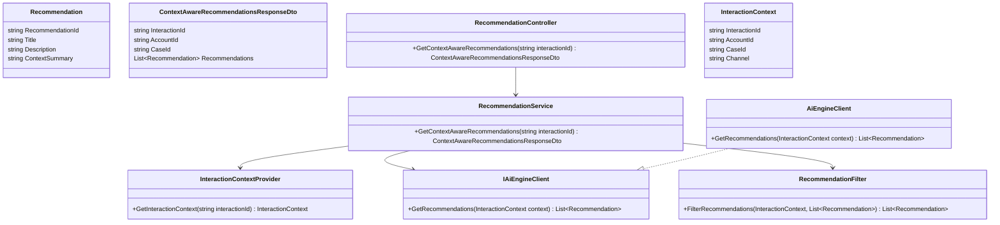
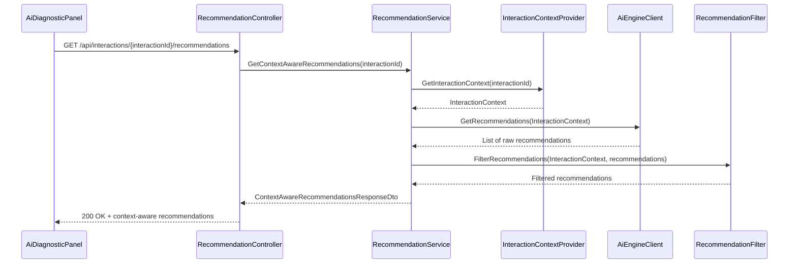
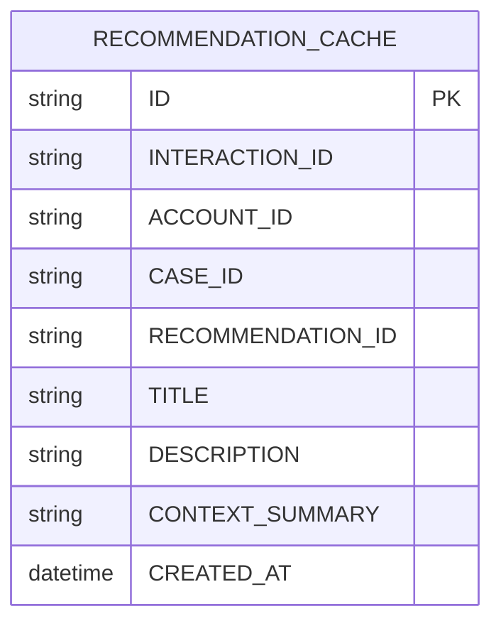

# Repository: APB_Demo
# Branch: APBMRN34044
# Folder: LLD

1. Objective
The objective is to deliver context-aware AI recommendations tailored to the member's current interaction. Recommendations must reference current account and case context. Unrelated actions must be excluded from the recommendation set.

2. Backend C# API Details

2.1. API Model

2.1.1. Common Components/Services
- RecommendationService: Generates AI recommendations based on interaction, account, and case context.
- InteractionContextProvider: Supplies non-sensitive interaction details including accountId and caseId where available.
- RecommendationFilter: Filters out actions that do not align with current context.

2.1.2. API Details
| Operation | REST Method | Type | URL | Request JSON | Response JSON |
|----------|-------------|------|-----|--------------|---------------|
| GetContextAwareRecommendations | GET | Query | /api/interactions/{interactionId}/recommendations | N/A | { "interactionId": "string", "accountId": "string", "caseId": "string", "recommendations": [ { "recommendationId": "string", "title": "string", "description": "string", "contextSummary": "string" } ] } |

2.1.3. Exceptions
- InteractionContextUnavailableException: Thrown when current interaction context cannot be resolved.
- RecommendationGenerationException: Thrown when AI engine fails to generate recommendations.

2.2. Functional Design

2.2.1. Class Diagram

2.2.2. UML Sequence Diagram

2.2.3. Components
| Component Name | Description | Existing/New |
|---------------------------|-------------|------------|
| RecommendationController | API controller providing context-aware recommendations. | New |
| RecommendationService | Service orchestrating context retrieval, AI calls, and filtering. | New |
| InteractionContextProvider | Service providing interaction, account, and case context. | New |
| RecommendationFilter | Component filtering out recommendations not relevant to current context. | New |
| AiEngineClient | Client integrating with AI engine recommendation APIs. | New |
| Recommendation | Model representing a single recommendation. | New |
| ContextAwareRecommendationsResponseDto | DTO representing response for context-aware recommendations. | New |

2.3. Service Layer Business Logic
- Service Architecture & Dependency Injection: RecommendationController uses RecommendationService through constructor injection. RecommendationService depends on InteractionContextProvider, IAiEngineClient, and RecommendationFilter via DI.
- Workflow: RecommendationService obtains InteractionContext from InteractionContextProvider, calls IAiEngineClient to get recommendations, applies RecommendationFilter using context rules, and returns the filtered set.
- Caching Strategy: Optional caching of InteractionContext for the duration of the interaction session and short-lived caching of recommendations per interactionId to minimize AI calls.
- Validation Rules: Validate interactionId and ensure accountId and caseId, if present, are consistent with the interaction.

Validation rules
| Field Name | Validation | Error Message | Class Used |
|------------|-----------|---------------|------------|
| InteractionId | Required, non-empty string | "InteractionId is required." | RecommendationService |
| AccountId | If present, must be associated with the interaction | "AccountId is not associated with the interaction." | InteractionContextProvider |
| CaseId | If present, must be associated with the interaction | "CaseId is not associated with the interaction." | InteractionContextProvider |

2.4. Service Integrations
| System | Integrated For | Integration Type |
|--------|----------------|-----------------|
| Interaction Management System | Retrieve interaction, account, and case context | Internal service call |
| AI Engine | Generate recommendation candidates based on context | REST or gRPC client |

3. Front End React Details

3.1. UI Component Architecture
- Component Hierarchy: AgentDesktopShell -> AiDiagnosticPanel -> RecommendationsList -> RecommendationItem.
- Data Flow: AiDiagnosticPanel requests context-aware recommendations from the backend and stores them in component state. RecommendationsList receives the list as props and renders RecommendationItem elements.
- State Management: AiDiagnosticPanel maintains recommendations state, including loading and error indicators. Interaction context (interactionId, accountId, caseId) is provided via React Context or props.
- Props Interfaces:
  - AiDiagnosticPanelProps: { interactionId: string; accountId?: string; caseId?: string }.
  - RecommendationsListProps: { recommendations: Recommendation[] }.
  - RecommendationItemProps: { recommendation: Recommendation }.
- Routing: Uses existing route for interaction; recommendations list is part of AI diagnostic panel with no new routes.

3.2. UI Specifications
- Wireframes/Pages: Recommendations list displays title, description, and contextSummary (e.g., referencing account or case details) to show why the recommendation is relevant.
- Responsive Breakpoints: On desktop, recommendations appear in a vertical list. On smaller displays, list may be collapsible or paginated.
- Form Structures with Validation: No new forms; data is read-only. Client-side validation ensures recommendations missing contextSummary are visually flagged as "Limited context".
- User Interaction Patterns: Agents can expand a recommendation to view more details and see which context elements it references.

3.3. API Integration
- HTTP Client Configuration: Shared HTTP client wrapper configured with base /api and authentication headers.
- Call Patterns and Error Handling: AiDiagnosticPanel performs GET /api/interactions/{interactionId}/recommendations when interaction context becomes available or changes. Errors display a message that recommendations are temporarily unavailable.
- Loading States: Loading spinner or skeleton cards are shown until recommendations are loaded.
- Data Transformation: Backend DTO is mapped into Recommendation interface with RecommendationId, Title, Description, and ContextSummary.

4. Database Details

4.1. ER Model

4.2. Database Validations
- INTERACTION_ID is non-null and indexed for fast lookup.
- RECOMMENDATION_ID is unique per interaction within cache.

5. Non-Functional Requirements

5.1. Performance
- Context resolution and recommendation retrieval should complete within 400 ms server-side under typical load.

5.2. Security (Authentication & Authorization)
- Only authorized agents can request recommendations for interactions they are permitted to view.
- No credentials are exposed via recommendation content.

5.3. Logging (Application, Audit, Monitoring)
- Application logs include context retrieval and recommendation generation events.
- Monitoring includes counts of recommendations served, filter rates, and AI engine call latency.

6. Dependencies
- ASP.NET Core Web API framework.
- React for UI components.
- AI engine client for recommendations.

7. Assumptions
- Interaction management system exposes APIs to retrieve account and case context for a given interactionId.
- AI engine supports context-based recommendation generation.
- Recommendations do not need to be permanently stored; optional caching is sufficient.
