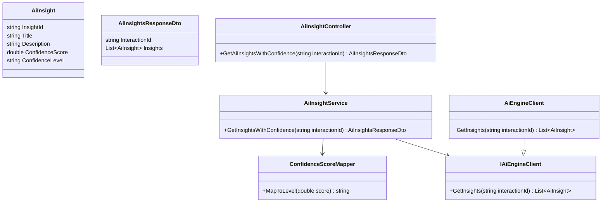
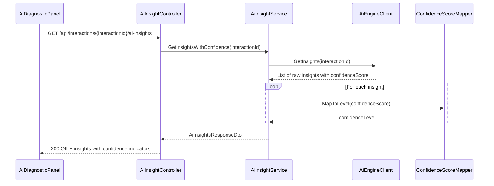
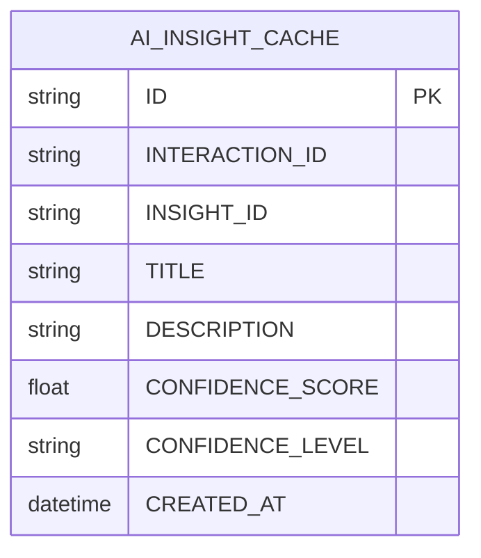

# Repository: APB_Demo
# Branch: APBMRN34044
# Folder: LLD

1. Objective
The objective is to add confidence indicators to AI-generated insights presented to contact center agents. The system must ensure each insight includes a non-sensitive confidence score or level. These indicators help agents judge how much to rely on each recommendation.

2. Backend C# API Details

2.1. API Model

2.1.1. Common Components/Services
- AiInsightService: Provides AI insights enriched with confidence scores.
- ConfidenceScoreMapper: Maps raw AI confidence values to user-friendly confidence levels.

2.1.2. API Details
| Operation | REST Method | Type | URL | Request JSON | Response JSON |
|----------|-------------|------|-----|--------------|---------------|
| GetAiInsightsWithConfidence | GET | Query | /api/interactions/{interactionId}/ai-insights | N/A | { "interactionId": "string", "insights": [ { "insightId": "string", "title": "string", "description": "string", "confidenceScore": 0.85, "confidenceLevel": "High" } ] } |

2.1.3. Exceptions
- AiInsightsUnavailableException: Thrown when AI engine fails to produce insights.
- ConfidenceScoreMappingException: Thrown when raw confidence values cannot be mapped to defined levels.

2.2. Functional Design

2.2.1. Class Diagram

2.2.2. UML Sequence Diagram

2.2.3. Components
| Component Name | Description | Existing/New |
|--------------------------|-------------|------------|
| AiInsightController | API controller exposing insights with confidence indicators. | New |
| AiInsightService | Service retrieving AI insights and applying confidence mapping. | New |
| AiEngineClient | Client encapsulating calls to the AI engine. | New |
| ConfidenceScoreMapper | Utility for mapping numeric confidence scores to textual levels. | New |
| AiInsight | Domain model representing a single AI insight with confidence metadata. | New |
| AiInsightsResponseDto | DTO representing insights for a given interaction. | New |

2.3. Service Layer Business Logic
- Service Architecture & Dependency Injection: AiInsightController depends on AiInsightService via constructor injection. AiInsightService depends on IAiEngineClient and ConfidenceScoreMapper via constructor injection. Implementations are registered in DI container with appropriate lifetimes.
- Workflow: AiInsightService calls IAiEngineClient.GetInsights to retrieve raw insights including numeric confidence. For each insight, ConfidenceScoreMapper.MapToLevel is applied to set ConfidenceLevel. The service returns AiInsightsResponseDto to the controller.
- Caching Strategy: Optionally cache insights per interactionId for a short duration (e.g., 30 seconds) to avoid repeated AI engine calls during an active interaction.
- Validation Rules: Ensure interactionId is valid and confidenceScore is within expected range (0.0 to 1.0).

Validation rules
| Field Name | Validation | Error Message | Class Used |
|------------|-----------|---------------|------------|
| InteractionId | Required, non-empty string | "InteractionId is required." | AiInsightService |
| ConfidenceScore | Must be between 0.0 and 1.0 | "ConfidenceScore must be between 0.0 and 1.0." | AiInsightService |

2.4. Service Integrations
| System | Integrated For | Integration Type |
|--------|----------------|-----------------|
| AI Engine | Retrieve raw insights with confidence scores | REST or gRPC client |

3. Front End React Details

3.1. UI Component Architecture
- Component Hierarchy: AgentDesktopShell -> AiDiagnosticPanel -> AiInsightsList -> AiInsightItem.
- Data Flow: AiDiagnosticPanel fetches insights for the current interaction and passes them to AiInsightsList, which renders AiInsightItem for each insight. AiInsightItem displays the confidenceScore and confidenceLevel visually.
- State Management: AiDiagnosticPanel manages insights state with hooks, including loading and error flags.
- Props Interfaces:
  - AiDiagnosticPanelProps: { interactionId: string }.
  - AiInsightsListProps: { insights: AiInsight[] }.
  - AiInsightItemProps: { insight: AiInsight }.
- Routing: Existing interaction route is reused; AiDiagnosticPanel is embedded within that view.

3.2. UI Specifications
- Wireframes/Pages: The insights list displays each insight with title, description, and a confidence badge (e.g., High, Medium, Low) plus numeric score if appropriate.
- Responsive Breakpoints: On desktop, insights are in a vertical list with badges. On smaller screens, confidence indicators may be simplified to colored dots and labels.
- Form Structures with Validation: No forms; read-only display. Client-side validation ensures insights without confidenceScore are either hidden or marked as "Confidence unavailable".
- User Interaction Patterns: Hover tooltips provide explanations of what confidence levels mean.

3.3. API Integration
- HTTP Client Configuration: Shared HTTP client wrapper with base URL /api and existing authentication headers.
- Call Patterns and Error Handling: AiDiagnosticPanel issues GET /api/interactions/{interactionId}/ai-insights on mount and when interactionId changes. Errors show a non-blocking notification and hide the insights list.
- Loading States: A loading spinner or skeleton is shown while insights are being fetched.
- Data Transformation: Raw JSON is mapped to AiInsight interface with confidenceScore and confidenceLevel fields.

4. Database Details

4.1. ER Model

4.2. Database Validations
- CONFIDENCE_SCORE must be between 0.0 and 1.0.
- INTERACTION_ID and INSIGHT_ID are non-null and can be indexed to speed lookup.

5. Non-Functional Requirements

5.1. Performance
- Response time for insights retrieval should be under 300 ms server-side when AI engine responds promptly.
- Optional caching reduces repeated calls for the same interaction.

5.2. Security (Authentication & Authorization)
- Endpoint is accessible only to authenticated agents.
- Insights do not include credentials or sensitive personal identifiers beyond what is already present in interaction context.

5.3. Logging (Application, Audit, Monitoring)
- Application logs record calls to AI engine and mapping operations.
- Monitoring tracks AI engine latency and any mapping errors for confidence levels.

6. Dependencies
- ASP.NET Core Web API framework.
- React for UI components.
- AI engine client library or HTTP integration.

7. Assumptions
- AI engine already provides numeric confidence scores per insight.
- InteractionId is available in the agent desktop when requesting insights.
- No persistence of insights is required beyond optional caching.
