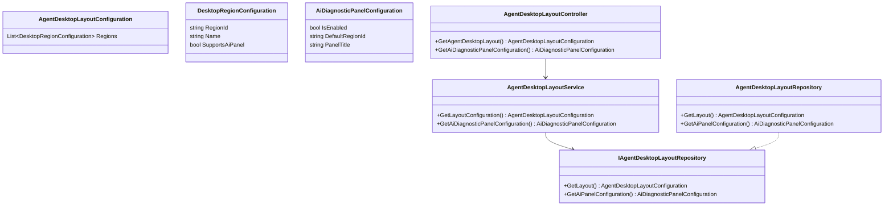
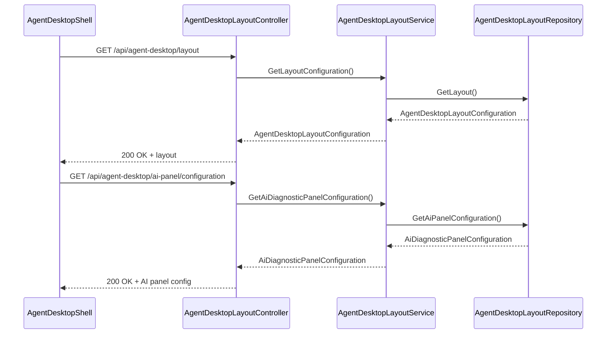
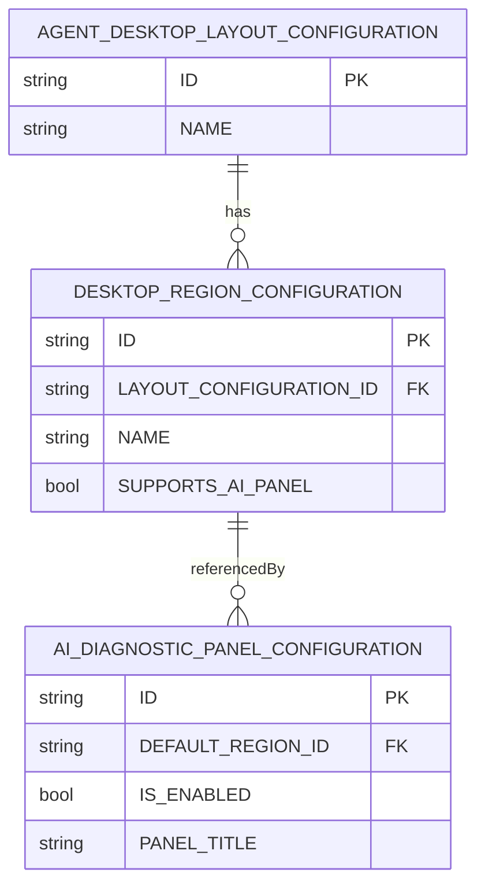

# Repository: APB_Demo
# Branch: APBMRN34044
# Folder: LLD

1. Objective
The objective is to integrate an AI diagnostic panel into the existing contact center agent desktop without disrupting the agent's workflow. The AI diagnostic panel must appear within the current desktop layout when available. The panel must not require application switching or cause the agent to lose their place in the current interaction.

2. Backend C# API Details

2.1. API Model

2.1.1. Common Components/Services
- AgentDesktopLayoutService: Provides configuration for where and how AI panels should be rendered in the agent desktop.
- InteractionContextProvider: Supplies non-sensitive identifiers for the current interaction and agent session.

2.1.2. API Details
| Operation | REST Method | Type | URL | Request JSON | Response JSON |
|----------|-------------|------|-----|--------------|---------------|
| GetAgentDesktopLayout | GET | Query | /api/agent-desktop/layout | N/A | { "regions": [ { "regionId": "string", "name": "string", "supportsAiPanel": true } ] } |
| GetAiDiagnosticPanelConfiguration | GET | Query | /api/agent-desktop/ai-panel/configuration | N/A | { "isEnabled": true, "defaultRegionId": "string", "panelTitle": "string" } |

2.1.3. Exceptions
- AgentDesktopConfigurationNotFoundException: Thrown when layout configuration cannot be retrieved.
- AiPanelConfigurationDisabledException: Thrown when the AI diagnostic panel is globally disabled.

2.2. Functional Design

2.2.1. Class Diagram

2.2.2. UML Sequence Diagram

2.2.3. Components
| Component Name | Description | Existing/New |
|-------------------------------|-------------|------------|
| AgentDesktopLayoutController | API controller exposing agent desktop layout and AI panel configuration. | New |
| AgentDesktopLayoutService | Service for retrieving layout and panel configuration. | New |
| AgentDesktopLayoutRepository | Repository for layout and AI panel configuration from configuration store. | New |
| AgentDesktopLayoutConfiguration | Model representing agent desktop regions. | New |
| DesktopRegionConfiguration | Model representing a single desktop region. | New |
| AiDiagnosticPanelConfiguration | Model representing AI panel configuration for the desktop. | New |

2.3. Service Layer Business Logic
- Service Architecture & Dependency Injection: AgentDesktopLayoutController depends on AgentDesktopLayoutService via constructor injection. AgentDesktopLayoutService depends on IAgentDesktopLayoutRepository via constructor injection. All services and repositories are registered via DI with scoped or singleton lifetime as appropriate.
- Workflow: When the front-end requests layout configuration, AgentDesktopLayoutService retrieves data from AgentDesktopLayoutRepository and returns it to the controller. When AI panel configuration is requested, the service returns configuration, including whether the panel is enabled and the designated region.
- Caching Strategy: Layout and AI panel configuration are relatively static. Use in-memory caching with a configurable refresh interval (e.g., 10 minutes) to avoid frequent configuration store reads.
- Validation Rules: Ensure configuration exists and is internally consistent (e.g., DefaultRegionId references a valid region that supports AI panel).

Validation rules
| Field Name | Validation | Error Message | Class Used |
|------------|-----------|---------------|------------|
| Regions | At least one region must exist | "No desktop regions configured." | AgentDesktopLayoutService |
| DefaultRegionId | Must correspond to a region where SupportsAiPanel is true | "DefaultRegionId must reference a region that supports AI panel." | AgentDesktopLayoutService |

2.4. Service Integrations
| System | Integrated For | Integration Type |
|--------|----------------|-----------------|
| Configuration Store | Retrieve desktop layout and AI panel configuration | Internal configuration access |

3. Front End React Details

3.1. UI Component Architecture
- Component Hierarchy: AgentDesktopShell -> InteractionWorkspace -> AiDiagnosticPanelContainer -> AiDiagnosticPanel.
- Data Flow: AgentDesktopShell fetches layout and AI panel configuration from the backend and passes region placement information to InteractionWorkspace. AiDiagnosticPanelContainer decides whether to render AiDiagnosticPanel in the configured region based on AiDiagnosticPanelConfiguration.
- State Management: AgentDesktopShell maintains layoutConfig and aiPanelConfig in local state or a global store (e.g., React Context). InteractionWorkspace reads these values to position the panel.
- Props Interfaces:
  - AgentDesktopShellProps: { initialInteractionId?: string }.
  - InteractionWorkspaceProps: { layoutConfig: AgentDesktopLayoutConfiguration; aiPanelConfig: AiDiagnosticPanelConfiguration }.
  - AiDiagnosticPanelContainerProps: { regionId: string; aiPanelConfig: AiDiagnosticPanelConfiguration }.
- Routing: Existing route for interaction view is reused; AiDiagnosticPanel is conditionally rendered within this route without adding new routes.

3.2. UI Specifications
- Wireframes/Pages: The AI diagnostic panel appears as a contextual column or docked pane inside the existing interaction view. It should be aligned to a configured region (e.g., right sidebar) without covering or replacing core interaction content.
- Responsive Breakpoints: On desktop (>1024px), the panel is shown as a fixed side column. On tablet (768-1024px), the panel is collapsible. On mobile (<768px), the panel may appear as a slide-in overlay triggered by a button but still within the same route.
- Form Structures with Validation: No additional forms; configuration is consumed read-only. Client-side validation ensures that if the AI panel is enabled but no valid region is available, the panel is hidden and a non-blocking log or console message is recorded.
- User Interaction Patterns: Agents remain on the same page; no full-page reload occurs when panel becomes available. A subtle animation can be used to show the panel appearing without disrupting content.

3.3. API Integration
- HTTP Client Configuration: Use a shared HTTP client wrapper configured with base /api URL, using existing authentication headers.
- Call Patterns and Error Handling: AgentDesktopShell performs parallel GET calls to /api/agent-desktop/layout and /api/agent-desktop/ai-panel/configuration during initial load. Error handling logs issues and hides the AiDiagnosticPanel when configuration cannot be retrieved.
- Loading States: While configuration is loading, a placeholder skeleton where the AI panel would appear is shown. The main interaction content loads independently.
- Data Transformation: Responses are mapped directly to TypeScript interfaces AgentDesktopLayoutConfiguration and AiDiagnosticPanelConfiguration for use in components.

4. Database Details

4.1. ER Model

4.2. Database Validations
- Layout configuration must have at least one associated region.
- DefaultRegionId in AI_DIAGNOSTIC_PANEL_CONFIGURATION must reference an existing DESKTOP_REGION_CONFIGURATION with SUPPORTS_AI_PANEL = true.

5. Non-Functional Requirements

5.1. Performance
- Layout and configuration retrieval must complete within 150 ms server-side under normal load.
- Use caching to minimize database or configuration store round trips.

5.2. Security (Authentication & Authorization)
- Endpoints are accessible only to authenticated agent users.
- Configuration data does not contain sensitive member details.

5.3. Logging (Application, Audit, Monitoring)
- Application logs record configuration retrieval success and failure.
- Monitoring captures configuration retrieval latency and error rates.

6. Dependencies
- ASP.NET Core Web API for backend services.
- React for frontend integration into the agent desktop.
- Configuration storage (e.g., SQL or configuration service).

7. Assumptions
- The agent desktop is a React-based single-page application.
- AI diagnostic functionality already exists and only panel placement is in scope.
- Configuration for layout and AI panel is centrally managed and can be read via repository APIs.
