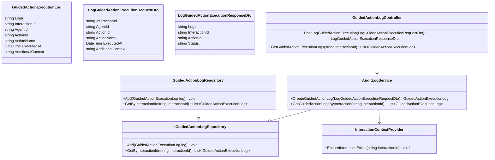
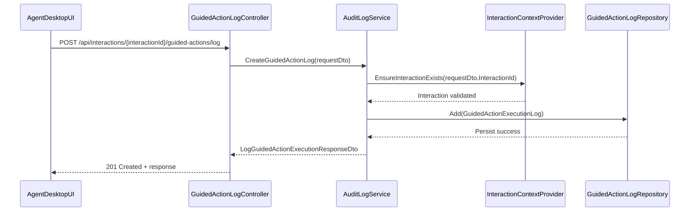
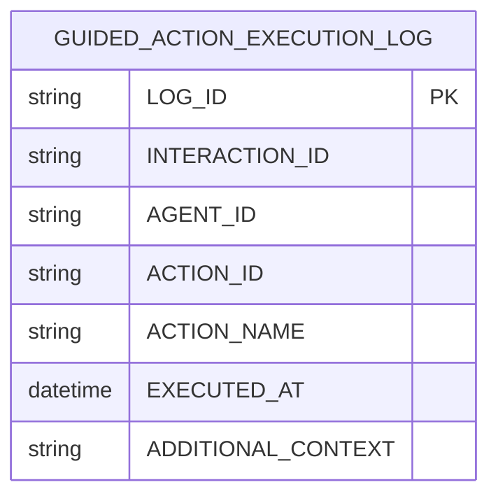

# Repository: APB_Demo
# Branch: APBMRN34044
# Folder: LLD

1. Objective
The objective is to implement a backend and frontend capability to log execution of AI-recommended remediation steps taken by a contact center agent. The system must record non-sensitive step execution logs associated with a specific interaction. These logs will enable downstream auditability and analytics without storing credentials or personal identifiers.

2. Backend C# API Details

2.1. API Model

2.1.1. Common Components/Services
- InteractionContextProvider: Provides non-sensitive interaction identifiers (e.g., InteractionId) and agent context for logging.
- AuditLogService: Encapsulates creation and persistence of GuidedActionExecutionLog records.
- DateTimeProvider: Abstraction over system clock for testability.

2.1.2. API Details
| Operation | REST Method | Type | URL | Request JSON | Response JSON |
|----------|-------------|------|-----|--------------|---------------|
| LogGuidedActionExecution | POST | Command | /api/interactions/{interactionId}/guided-actions/log | { "interactionId": "string", "agentId": "string", "actionId": "string", "actionName": "string", "executedAt": "string", "additionalContext": "string" } | { "logId": "string", "interactionId": "string", "actionId": "string", "status": "string" } |
| GetGuidedActionExecutionLogs | GET | Query | /api/interactions/{interactionId}/guided-actions/logs | N/A | [ { "logId": "string", "interactionId": "string", "agentId": "string", "actionId": "string", "actionName": "string", "executedAt": "string" } ] |

2.1.3. Exceptions
- GuidedActionLogValidationException: Thrown when required fields are missing or invalid.
- InteractionNotFoundException: Thrown when interactionId cannot be resolved to a known interaction context.
- GuidedActionLogPersistenceException: Thrown when the underlying data store fails to persist or read logs.

2.2. Functional Design

2.2.1. Class Diagram

2.2.2. UML Sequence Diagram

2.2.3. Components
| Component Name | Description | Existing/New |
|-----------------------------|-------------|------------|
| GuidedActionLogController | ASP.NET Core API controller exposing endpoints for logging and retrieving guided action executions. | New |
| AuditLogService | Domain service handling validation, interaction context checks, and mapping between DTOs and persistence model. | New |
| GuidedActionExecutionLog | Persistence/entity model representing a single guided action execution. | New |
| IGuidedActionLogRepository | Abstraction for data access to guided action logs. | New |
| GuidedActionLogRepository | Concrete repository implementation using the chosen data store (e.g., SQL). | New |
| InteractionContextProvider | Helper service to validate interaction existence using non-sensitive identifiers. | New |

2.3. Service Layer Business Logic
- Service Architecture & Dependency Injection: GuidedActionLogController depends on AuditLogService via constructor injection. AuditLogService depends on IGuidedActionLogRepository and InteractionContextProvider via constructor injection. All services are registered with scoped lifetime in the ASP.NET Core DI container.
- Workflow: When a log request is received, AuditLogService validates the request, verifies the interaction via InteractionContextProvider, constructs a GuidedActionExecutionLog entity, and calls IGuidedActionLogRepository.Add to persist the log. For retrieval, AuditLogService calls IGuidedActionLogRepository.GetByInteractionId and returns a collection to the controller.
- Caching Strategy: No caching is applied to log creation. Optional read caching can be introduced for GetGuidedActionExecutionLogs via in-memory cache keyed by interactionId with a short TTL (e.g., 5 minutes) to reduce read load.
- Validation Rules: Minimal validation on request fields, ensuring non-empty identifiers and correct date format while not including personal identifiers.

Validation rules
| Field Name | Validation | Error Message | Class Used |
|------------|-----------|---------------|------------|
| InteractionId | Required, non-empty string | "InteractionId is required." | AuditLogService |
| AgentId | Required, non-empty string | "AgentId is required." | AuditLogService |
| ActionId | Required, non-empty string | "ActionId is required." | AuditLogService |
| ActionName | Required, max length 256 | "ActionName is required and must be within 256 characters." | AuditLogService |
| ExecutedAt | Required, must be a valid DateTime in UTC | "ExecutedAt must be a valid UTC timestamp." | AuditLogService |

2.4. Service Integrations
| System | Integrated For | Integration Type |
|--------|----------------|-----------------|
| Interaction Management System | Interaction existence verification via InteractionContextProvider | Internal service call |

3. Front End React Details

3.1. UI Component Architecture
- Component Hierarchy: AgentDesktopShell -> AiDiagnosticPanel -> GuidedActionsList -> GuidedActionItem.
- Data Flow: AiDiagnosticPanel receives AI recommendations and passes each recommended step as props to GuidedActionsList. GuidedActionItem emits an onActionExecuted event when the agent marks a step as completed. AgentDesktopShell handles the event by invoking the LogGuidedActionExecution API.
- State Management: Local state within AiDiagnosticPanel for current recommendations and execution statuses; lightweight state (e.g., React Context) for the active interactionId and agentId.
- Props Interfaces:
  - AiDiagnosticPanelProps: { interactionId: string; agentId: string; insights: InsightDto[] }.
  - GuidedActionsListProps: { actions: GuidedActionDto[]; onActionExecuted: (action: GuidedActionDto) => void }.
  - GuidedActionItemProps: { action: GuidedActionDto; onExecute: (actionId: string) => void }.
- Routing: No new route required; AiDiagnosticPanel is rendered within the existing agent desktop route for interaction details.

3.2. UI Specifications
- Wireframes/Pages: Within the interaction details page, AiDiagnosticPanel appears as a side panel listing guided actions with a checkbox or button to mark an action as completed.
- Responsive Breakpoints: Panel collapses into a horizontal expandable section on narrow screens (<768px) and is shown as a right-side vertical panel on desktop.
- Form Structures with Validation: GuidedActionItem includes a simple confirmation action (e.g., button) with no additional form fields, so validation is limited to ensuring an interactionId and actionId are available before API calls.
- User Interaction Patterns: When an agent clicks "Mark as Completed" on a GuidedActionItem, the button shows a loading state, triggers the log API call, then displays a confirmation icon (e.g., checkmark) or error indicator.

3.3. API Integration
- HTTP Client Configuration: Use a shared HTTP client wrapper (e.g., fetch or axios instance) configured with base URL for /api and authenticated via existing session token.
- Call Patterns and Error Handling: GuidedActionItem or AgentDesktopShell calls POST /api/interactions/{interactionId}/guided-actions/log with relevant payload. On errors (4xx/5xx), display a non-blocking toast notification while allowing the agent to continue work.
- Loading States: Show inline spinner next to the action while the log request is pending. Disable the "Mark as Completed" button until the response is received or times out.
- Data Transformation: Map AI recommendation objects (InsightDto) to GuidedActionDto with actionId, actionName, and context details before sending to the backend.

4. Database Details

4.1. ER Model

4.2. Database Validations
- LOG_ID is unique and non-null.
- INTERACTION_ID, AGENT_ID, ACTION_ID, ACTION_NAME, EXECUTED_AT are non-null.
- ACTION_NAME length is constrained (e.g., nvarchar(256)).

5. Non-Functional Requirements

5.1. Performance
- Logging operations must complete within 200 ms server-side under normal load.
- System should support at least 100 log writes per second without degradation.

5.2. Security (Authentication & Authorization)
- Endpoints require authenticated agent context via existing security mechanisms.
- Authorization ensures agents can only log actions for interactions they are assigned to or allowed to access.
- No personal identifiers or credentials are stored in GuidedActionExecutionLog.

5.3. Logging (Application, Audit, Monitoring)
- Application logs include success/failure of guided action logging requests.
- Audit logs can be generated downstream using GuidedActionExecutionLog data.
- Monitoring metrics: number of logs per interaction, error rate per endpoint.

6. Dependencies
- ASP.NET Core Web API framework.
- ORM library such as Entity Framework Core for data access.
- React for frontend components.

7. Assumptions
- InteractionId and AgentId are non-sensitive identifiers and can be stored safely.
- Existing interaction management APIs are available to validate interaction existence.
- AI recommendations already provide a unique actionId and human-readable actionName.
