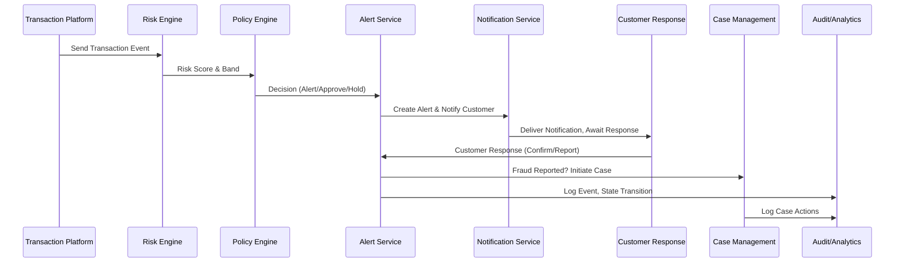

## Low-Level Design (LLD): Credit Card Fraud Alert System

### 1. Component Specifications

#### 1.1 Transaction Event Ingestion Service
- **Function:** Listens to transaction events from the card authorization platform.
- **Interface:** REST API endpoint (`/api/transaction/ingest`), accepts JSON payload with transaction details.
- **Validation:** Schema validation, input sanitization, format checks.
- **Security:** TLS 1.3, JWT authentication, rate limiting.
- **Logging:** All received events logged with correlation IDs.

#### 1.2 Fraud Risk Engine
- **Function:** Calculates risk score using ML models and rules.
- **Interface:** Internal API (`/api/risk/score`), receives normalized transaction data.
- **Algorithm:** Pluggable model versioning, configurable thresholds.
- **Output:** Risk score (0-100), risk band (Low/Medium/High), audit trail.
- **Security:** Model access controlled by RBAC.

#### 1.3 Policy/Decision Engine
- **Function:** Maps risk bands to actions (approve, alert, hold, decline).
- **Interface:** Internal API (`/api/policy/decide`), receives risk scoring output.
- **Logic:** Rules engine, tunable per business/compliance requirements.
- **Output:** Decision, action trigger, escalation flag.

#### 1.4 Alert Service
- **Function:** Creates alerts, manages alert state machine.
- **Interface:** REST API (`/api/alert/create`, `/api/alert/update`), WebSocket for real-time ops.
- **State Machine:** States: Created, Notified, Responded, Resolved, Expired.
- **Security:** Alert data encrypted at rest.

#### 1.5 Notification Service
- **Function:** Delivers alerts via Push, SMS, Email, In-App.
- **Interface:** REST API (`/api/notify/send`), integration with external providers.
- **Fallback:** Automatic fallback to alternate channels if delivery fails.
- **Logging:** Provider status, delivery timestamps, failure reasons.

#### 1.6 Customer Response Service
- **Function:** Handles customer responses to alerts.
- **Interface:** REST API (`/api/response/submit`), authentication with ID provider.
- **Workflow:** Confirms or reports fraud, triggers case management.
- **Security:** ABAC enforced, customer authentication required.

#### 1.7 Protection/Case Management
- **Function:** Manages card blocks, replacements, disputes.
- **Interface:** REST API (`/api/case/create`, `/api/case/update`), integration with core banking.
- **Workflow:** Initiated on fraud confirmation, tracks status and actions.

#### 1.8 Analytics & Audit Logging Service
- **Function:** Captures lifecycle events, metrics, and audit logs.
- **Interface:** REST API (`/api/audit/log`), exportable reports.
- **Security:** Immutable storage, access restricted to ops/compliance roles.

#### 1.9 Preferences & Profile Service
- **Function:** Manages user notification preferences, contact channels.
- **Interface:** REST API (`/api/profile/preferences`), integration with authentication provider.
- **Security:** Consent management, overrides for security policy.

#### 1.10 Integration with Authentication/Identity Provider
- **Function:** Enforces authentication for customer actions and analyst access.
- **Interface:** OAuth2, SAML, OpenID Connect.
- **Security:** RBAC for analysts, ABAC for customers.

### 2. Data Flows

#### Sequence Diagram: Transaction to Alert



#### Data Flow: Notification Fallback
1. Alert generated by Alert Service.
2. Notification Service attempts Push notification.
3. If Push fails, fallback to SMS, then Email, then In-App.
4. Each attempt is logged with provider status and timestamps.

#### Data Flow: Customer Response
1. Customer receives notification.
2. Customer authenticates via ID provider.
3. Customer submits response (Confirm/Report).
4. Response Service updates alert state, triggers case management if fraud.
5. All actions logged for compliance.

### 3. Implementation Details

#### Technology Stack
- **API Services:** Node.js (Express), Python (FastAPI), Java (Spring Boot)
- **Messaging:** Kafka, RabbitMQ for event-driven flows
- **Database:** PostgreSQL (core), Redis (cache), ElasticSearch (audit logs)
- **Notification Providers:** Twilio (SMS), Firebase (Push), SendGrid (Email)
- **Authentication:** Auth0, Azure AD, custom SAML integration
- **Infrastructure:** Docker, Kubernetes, Terraform
- **CI/CD:** GitHub Actions, Azure DevOps Pipelines

#### Security Features
- **Encryption:** AES-256 for DB, TLS 1.3 for APIs
- **Access Control:** RBAC/ABAC enforced at API gateway
- **Secrets Management:** HashiCorp Vault, Azure Key Vault
- **Audit Logging:** All state transitions, alerts, responses, and case actions
- **Rate Limiting:** Sensitive endpoints protected

#### Compliance
- **PCI DSS:** Masked card data, no PAN exposure
- **GDPR/CCPA:** Consent tracking, data minimization, erasure workflows
- **Auditability:** Exportable logs, immutable storage
- **Incident Response:** Security events trigger SOC alerts

#### Error Handling
- **Retries:** Exponential backoff for notification/case workflows
- **Fallbacks:** Alternate channels for notification failures
- **Circuit Breaker:** Integration failures handled gracefully
- **Idempotency:** Duplicate events filtered
- **Edge Cases:** Offline users, ambiguous merchants, unavailable providers

#### Monitoring & Operations
- **Metrics:** Prometheus, Grafana dashboards
- **Logging:** ELK stack, Splunk integration
- **Ops UI:** Analyst dashboard for alert/case investigation

### 4. API Contracts (Sample)

#### Transaction Ingestion
```yaml
POST /api/transaction/ingest
Request:
  transaction_id: string
  account_id: string
  card_id: string
  merchant: string
  amount: number
  currency: string
  timestamp: string
  channel: string
Response:
  status: string
  correlation_id: string
```

#### Risk Score
```yaml
POST /api/risk/score
Request:
  transaction_id: string
  account_id: string
  card_id: string
  merchant: string
  amount: number
  currency: string
  timestamp: string
  channel: string
Response:
  risk_score: number
  risk_band: string
  model_version: string
  decision: string
```

#### Alert Creation
```yaml
POST /api/alert/create
Request:
  transaction_id: string
  customer_id: string
  severity: string
  status: string
Response:
  alert_id: string
  created_at: string
```

#### Customer Response
```yaml
POST /api/response/submit
Request:
  alert_id: string
  customer_id: string
  response: string
  authenticated_at: string
Response:
  response_id: string
  timestamp: string
```

### 5. Data Model (ERD)
- See HLD for entity relationships.
- All FK/PK enforced, referential integrity.
- Audit logs reference transaction, alert, response, and case IDs.

### 6. Compliance & Security
- Data retention, consent, encryption, RBAC/ABAC, audit logging, rate limiting, incident response.
- All customer actions traceable from ingestion to outcome.

### 7. Deployment & CI/CD
- Docker images for each service
- Kubernetes manifests
- GitHub Actions for build/test/deploy
- Azure DevOps for pipeline orchestration

### 8. Monitoring & Alerting
- Prometheus metrics, Grafana dashboards
- ELK/Splunk for logs
- Ops UI for analyst workflows

### 9. Edge Case Handling
- Offline customers: Deferred notifications, retry logic
- Ambiguous merchants: Escalation workflow
- Provider outages: Circuit breaker, fallback channels

---

**End of LLD Document**
